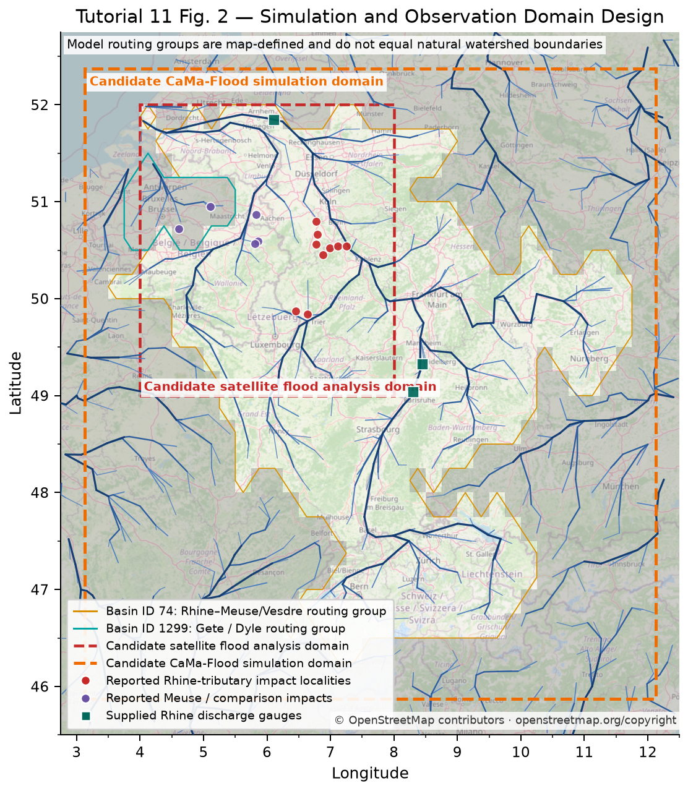

# Tutorial 11 — Step 2: Spatial Domain and Observation Design

**Status:** Provisional spatial design for the July 2021 Western European flood evaluation. This L1 planning task did not configure or run CaMa-Flood and did not acquire new observations.

## Purpose and evidence

Step 2 uses the event background, supplied impact-location table, supplied discharge inventory, existing GFM processing, and the CaMa-Flood v5 glb_15min map to compare model routing groups with reported impacts and candidate observation areas.

Figure 1 in [the Step 1 event overview](01_flood_event_overview.md) records the reported impact localities from `01_impact_locations.csv`. Figure 2 below carries those same points into the domain review, where they are considered alongside the mapped routing groups, gauges and candidate extents. Both figures reuse the shared River Map p01-f06 f06b/f06a renderers with Tutorial-local settings. They are planning aids, not hydrologic validation. Impact markers are approximate locality coordinates, not observed flood boundaries. Gauge coordinates are copied from `stations_data/allstations.csv`; their datum and exact station-location convention are not declared.

## Figure 2 — Simulation and Observation Domain Design

Regenerate Figure 2 from the repository root with
`bash tutorial/tutorial11-event_evaluation/f02-analysis_domain.sh`
after installing the Visualization dependencies. Figure 1 is generated by
`bash tutorial/tutorial11-event_evaluation/f01-reported_flood_impacts.sh`.

The map is the primary Step 2 spatial review. It shows OSM, the broad `glb_15min` river network, the map-defined Basin ID 74 and 1299 groups, reported impact localities, supplied Rhine gauges, and two distinct candidate rectangles. The orange dashed box is the **Candidate CaMa-Flood simulation domain**; the red dashed box is the **Candidate satellite flood analysis domain**. The map viewport extends beyond both boxes so their geographic context is visible. The gray mask is outside Basin ID 74 and is not a dry-area classification.

### Map-based Basin ID identification

The IDs were rechecked from the current `map/glb_15min/COG/` rasters rather than carried forward as natural watershed labels. The COGs use EPSG:4326, a 0.25° grid and 1440 × 720 cells. Reported Step 1 impact localities and supplied gauges were assigned to their containing raster cells; `basin` and `uparea` were inspected there, and `nextxy` destinations were followed to check mapped downstream routing. All sampled Ahr, Erft/Swist, Kyll/Prüm, Vesdre/Meuse localities and Lobith/Speyer/Maxau map to ID 74; Halen and Wavre map to ID 1299. Their sampled downstream links remain within those IDs along the inspected paths. Town coordinates are approximate and the 0.25° grid is coarse: this is a routing-group association check, not a precise channel/station match or a delineation of natural divides.

The basin raster contains 391 cells for ID 74 and 19 cells for ID 1299. Their cell-centre envelopes are approximately 3.625–11.625°E, 46.375–51.875°N (ID 74) and 3.875–5.375°E, 50.625–51.375°N (ID 1299). ID 74 is a Rhine–Meuse/Vesdre model routing group, not a pure natural Rhine watershed. ID 1299 contains the model cells associated with the Gete/Halen and Dyle/Wavre locations. Basin labels alone therefore do not establish that either ID is identical to a natural catchment.

## Candidate simulation domain and rationale

The figure shows **3.125–12.125°E, 45.875–52.375°N** as a candidate outer model window. It encloses the inspected ID 74 and ID 1299 cell-centre envelopes, reported impact localities and supplied gauges, with approximately two 0.25° grid intervals of margin around the mapped group extents. This is a full-routing-group planning window for the current comparison scope, not an attempt to minimize computation. The larger Rhine upstream domain is appropriate when needed to represent the target river's upstream contributing area; satellite analysis can be smaller. The regional run's interpretation of boundary coordinates and its active-cell mask still need confirmation before configuration.

This rectangle is not a final simulation domain or a basin mask. The candidate was drawn around the map-defined groups implicated by the current impact/gauge set, not inferred from damage points alone. If the objective is Rhine-only, ID 74 cannot define that natural watershed by itself. Before a run, inspect appropriate native/high-resolution basin and network connectivity, establish whether ID 1299 is included or treated separately for the evaluation question, and confirm the complete upstream contributing area, downstream outlet, forcing coverage, model dimensions and boundary treatment. A rectangle that contains the required groups can also contain adjacent routing groups.

**Candidate only:** the map supports carrying this full-group rectangle forward for review. The decision sequence remains candidate bounds → visual review against the routed map and event evidence → human decision → final documented domain. Do not describe it as a finalized Rhine-only simulation area. The scientific scope (Rhine-only versus the combined ID 74 group, and whether ID 1299 is part of the evaluation) remains unresolved.

## Candidate satellite analysis area and local AOIs

The red rectangle in Figure 2 is the **candidate satellite flood analysis domain**, using the existing processed GFM target-grid bounds of 4–8°E and 49–52°N as a starting extent for review. Reusing those bounds does not make this candidate a scientifically selected or fully observed domain. For the 15 July 2021 S1A morning pass, validation metadata report usable support in **7,258,263 of 17,280,000 target cells (42.0038%)**; support is spatially patchy. Missing, excluded or invalid cells must not be interpreted as dry.

The GFM target grid and smaller candidate AOIs answer different questions. An earlier 1-arcmin GFM sample in the background inventory reports 44.045% support; that percentage describes a different grid product and is not interchangeable with the 3-arcsec validation result below:

| Candidate observation AOI (W/S/E/N) | Target rivers and localities | Use and limitation |
| --- | --- | --- |
| **Ahr–Erft–Swist and nearby Kyll/Prüm**, 6.0 / 49.4 / 7.8 / 51.1 | Ahr, Erft/Swist, Kyll and Prüm; reported localities from Schuld/Altenahr through Bad Neuenahr/Sinzig, Euskirchen/Blessem and Kordel/Prümzurlay | Prioritize destructive tributary reaches. The box is an inventory/search area, not a mapped flood perimeter or proof of usable GFM support. |
| **Meuse–Vesdre–Gete–Dyle comparison**, 4.2 / 49.5 / 6.3 / 51.4 | Vesdre/Verviers/Pepinster, Meuse/Valkenburg, Gete/Halen and Dyle/Wavre | Keep these separate from Rhine tributaries. The box overlaps the western part of the first AOI and includes separate river systems. |

These smaller AOIs fit within the candidate 4–8°E, 49–52°N analysis rectangle. They are literature-informed search/comparison areas, not observed flood perimeters, and neither proves that a suitable satellite acquisition exists over each locality. The current GFM pass is one acquisition product for 15 July, not a complete event record or event-peak map. Before selecting a final observation extent, inspect each scene footprint, acquisition time, valid-support mask, exclusion/quality layers and event timing. If coverage is sparse, consider separate targeted AOIs or passes rather than treating the full rectangular target as observed.

## Existing gauges and additional observation priorities

The supplied files contain three Rhine main-stem stations: Lobith (ID 153; 6.10833°E, 51.84444°N), Speyer (ID 63; 8.44876°E, 49.32379°N), and Maxau (ID 28; 8.30561°E, 49.03896°N). All three are shown in Figure 2. The supplied series are described as six-hour mean discharge with end-of-interval labels, but units, source time zone and coordinate datum remain undocumented. They do not directly measure Ahr or Erft discharge.

For the next observation inventory, search for event hydrographs, stage records and high-water marks at:

- **Ahr:** Altenahr–Sinzig reaches, to constrain the rapid tributary response and downstream propagation.
- **Erft/Swist:** Euskirchen–Blessem/Erftstadt reaches, to constrain impacts outside the Ahr system.
- **Vesdre:** Verviers–Pepinster reaches, as a distinct Meuse-system comparison.

These are reach-level search priorities, not verified gauge sites. Station names, coordinates, record availability, time conventions and access rights have not been established. No new observation data were obtained in this task. The supplied Rhine gauges remain useful for main-stem wave context, subject to their metadata limitations.

## Decision trace and Step 3 handover

Figure 1's report-based impact inventory is the input to Figure 2's spatial review. Figure 2 exposes broad basin/network context, the sampled routing groups, impacts, gauges and candidate boxes together. It supports a review, not an automatic selection. Human review must decide the hydrologic target and whether ID 1299 belongs in the simulation/evaluation scope; only then should candidate bounds be confirmed as final. The satellite box is intentionally distinct from the simulation box and is based on the already processed target-grid extent, with its patchy valid support explicitly noted.

Before fixing the model or satellite domains:

1. Confirm the hydrologic target against the native/high-resolution basin and routed network; determine the relation of model ID 74 to natural Rhine and Meuse/Vesdre divides.
2. Decide whether ID 1299 is included, excluded by a supported mask, or analyzed as a separate group.
3. Confirm the model grid-cell boundary convention, complete upstream/downstream extent, active cells, forcing support and boundary conditions for the candidate rectangle.
4. Inventory event-period gauge/stage/high-water data in the Ahr, Erft/Swist and Vesdre reaches; verify station coordinates and temporal metadata before mapping or comparing.
5. For GFM and other satellite products, search acquisition-level footprints and usable-pixel masks for the candidate AOIs. Treat the current 15 July target extent and 42.0038% valid support as evidence for that processed product only.
6. Once the event period and observation support are resolved, choose separate simulation and observation domains and document their final coordinate convention.

The existing detailed [event background](01_flood_event_overview.md), [discharge inventory](observation_data_inventory.md), [GFM inventory](gfm_data_inventory.md), and [GFM workflow](gfm_3sec_workflow.md) remain the evidence sources. The reusable stages are in [00_event_evaluation_process.md](00_event_evaluation_process.md). The prior plan and setup report remain unchanged as development history under development_log/.

### Machine-readable handoff to Step 3

The shared [`metadata/02_domain_selection.json`](metadata/02_domain_selection.json)
records the event context, candidate event-analysis window, satellite search
period and bbox, candidate simulation bbox, and the undecided simulation
period. Step 3a reads the satellite dates and bbox from this file; the search
values are not repeated in its shell settings. The current 14–16 July search
centers the catalogue survey on the 15 July disaster date; the earlier
13–20 July scan is retained in development history. The 4–8°E, 49–52°N bbox
remains a candidate analysis domain based on the previously processed target
grid. Neither is a confirmed event-observation interval or valid-pixel
boundary. The simulation period is still undecided and must not be inferred
from the search dates. See the
[Step 3a satellite data survey](03_satellite_data_survey.md) for the
observed STAC passes, footprint maps and remaining selection decisions.
