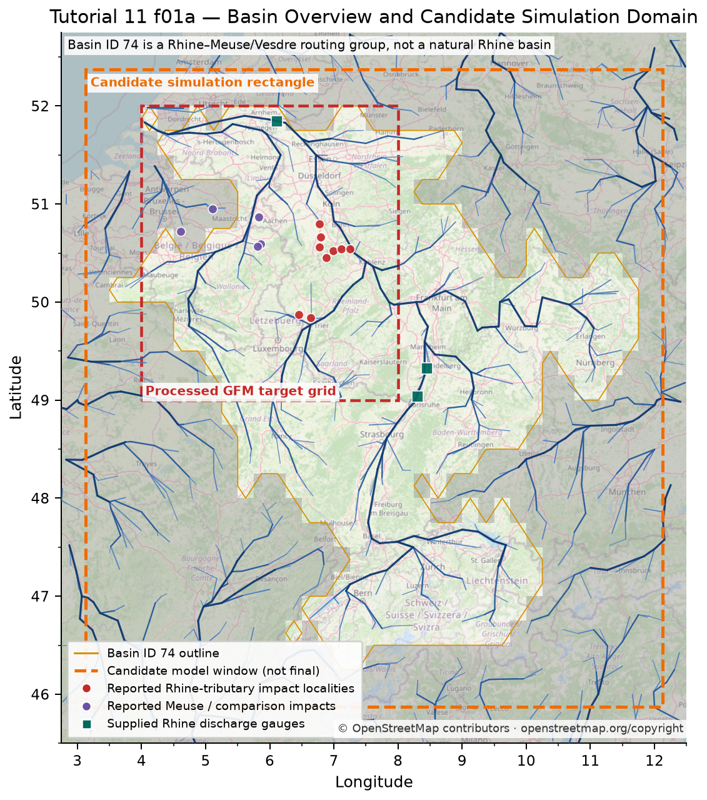
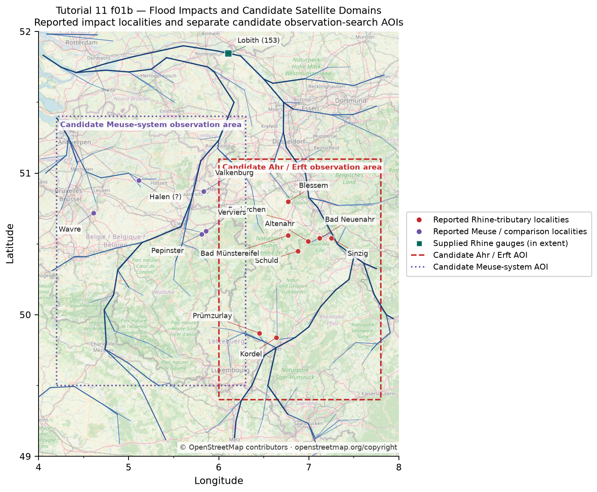

# Tutorial 11 — Step 2: Spatial Domain and Observation Design

**Status:** Provisional spatial design for the July 2021 Western European flood evaluation. This L1 planning task did not configure or run CaMa-Flood and did not acquire new observations.

## Purpose and evidence

Step 2 uses the event background, supplied impact-location table, supplied discharge inventory, existing GFM processing, and the CaMa-Flood v5 glb_15min map to compare model routing groups with reported impacts and candidate observation areas.

The maps were generated as Tutorial Figure f01a/f01b with the shared River Map p01-f06 f06a/f06b renderers using Tutorial-local settings and point data. They are planning aids, not hydrologic validation. The existing f06b_plot.csv town markers are approximate locality coordinates, not observed flood boundaries. The three supplied gauge coordinates are copied from stations_data/allstations.csv; their coordinate datum and exact station-location convention are not declared.

## Figure f01a — Basin overview and candidate simulation domain

The map shows OSM, the glb_15min river network, Basin ID 74, the candidate simulation rectangle, reported impact localities, the processed GFM target-grid extent, and the three supplied Rhine gauges. The gray mask distinguishes cells outside Basin 74; the orange dashed rectangle is a computational-window candidate. The red outline is the 4–8°E, 49–52°N processed GFM target grid.

Read the Basin ID as a model routing classification, not a natural watershed boundary. At 0.25° resolution, the inspected basin raster contains 391 cells with ID 74 and 19 with ID 1299. ID 74 groups Rhine and Meuse/Vesdre routing; it is not a pure Rhine catchment. ID 1299 includes cells around the Gete/Halen and Dyle/Wavre area. The Basin 74 cell-centre envelope is approximately 3.625–11.625°E and 46.375–51.875°N. These facts do not establish natural catchment divides or whether the two groups should be simulated together.

## Simulation-domain recommendation

Retain **3.125–12.125°E, 45.875–52.375°N** as the provisional outer model window. Relative to the Basin 74 outer cell centres, it provides two 0.25° grid intervals on each side and includes the reported impact localities and neighboring ID 1299 cells. params.txt confirms the global 0.25° grid and lonlat.nc confirms that the listed values coincide with cell centres. The regional run's interpretation of boundary coordinates and its active-cell mask still need confirmation before configuration.

This rectangle is not a final simulation domain or a basin mask. If the objective is Rhine-only, ID 74 cannot define that natural watershed by itself. Before a run, inspect the selected native/high-resolution basin and network connectivity, establish whether ID 1299 is included or treated separately, and confirm the complete upstream boundary, downstream outlet, forcing coverage, model dimensions and boundary treatment. A rectangle that contains the target cells can also contain adjacent routing groups.

**Provisional recommendation:** use the rectangle only as an outer planning extent for a model-routing-group experiment. Do not describe it as a finalized Rhine-only simulation area. The scientific scope (Rhine-only versus the combined ID 74 group, and the treatment of ID 1299) remains unresolved.

## Figure f01b — Flood impacts and candidate satellite acquisition domains

The local map shows the CaMa-Flood river network, reported locality markers, two candidate satellite-observation/search AOI outlines, OSM and the supplied gauge that falls inside the displayed extent (Lobith). The map extent is the **processed GFM target grid**, 4–8°E and 49–52°N. It is not a claim that every cell was observed. For the 15 July 2021 S1A morning pass, the validation metadata report usable support in **7,258,263 of 17,280,000 target cells (42.0038%)**; support is spatially patchy. Missing, excluded or invalid cells must not be interpreted as dry.

The GFM target grid and candidate AOIs answer different questions. An earlier 1-arcmin GFM sample in the background inventory reports 44.045% support; that percentage describes a different grid product and is not interchangeable with the 3-arcsec validation result below:

| Candidate observation AOI (W/S/E/N) | Target rivers and localities | Use and limitation |
| --- | --- | --- |
| **Ahr–Erft–Swist and nearby Kyll/Prüm**, 6.0 / 49.4 / 7.8 / 51.1 | Ahr, Erft/Swist, Kyll and Prüm; reported localities from Schuld/Altenahr through Bad Neuenahr/Sinzig, Euskirchen/Blessem and Kordel/Prümzurlay | Prioritize destructive tributary reaches. The box is an inventory/search area, not a mapped flood perimeter or proof of usable GFM support. |
| **Meuse–Vesdre–Gete–Dyle comparison**, 4.2 / 49.5 / 6.3 / 51.4 | Vesdre/Verviers/Pepinster, Meuse/Valkenburg, Gete/Halen and Dyle/Wavre | Keep these separate from Rhine tributaries. The box overlaps the western part of the first AOI and includes separate river systems. |

These AOIs fit within the already processed GFM target grid, but neither proves that a suitable satellite acquisition exists over each locality. The current GFM pass is one acquisition product for 15 July, not a complete event record or event-peak map. Before selecting a final observation extent, inspect each scene footprint, acquisition time, valid-support mask, exclusion/quality layers and event timing. If coverage is sparse, prefer multiple targeted AOIs or passes over treating the full rectangular target as observed.

## Existing gauges and additional observation priorities

The supplied files contain three Rhine main-stem stations: Lobith (ID 153; 6.10833°E, 51.84444°N), Speyer (ID 63; 8.44876°E, 49.32379°N), and Maxau (ID 28; 8.30561°E, 49.03896°N). All three are plotted in Figure f01a; only Lobith is inside the Figure f01b extent. The supplied series are described as six-hour mean discharge with end-of-interval labels, but units, source time zone and coordinate datum remain undocumented. They do not directly measure Ahr or Erft discharge.

For the next observation inventory, search for event hydrographs, stage records and high-water marks at:

- **Ahr:** Altenahr–Sinzig reaches, to constrain the rapid tributary response and downstream propagation.
- **Erft/Swist:** Euskirchen–Blessem/Erftstadt reaches, to constrain impacts outside the Ahr system.
- **Vesdre:** Verviers–Pepinster reaches, as a distinct Meuse-system comparison.

These are reach-level search priorities, not verified gauge sites. Station names, coordinates, record availability, time conventions and access rights have not been established. No new observation data were obtained in this task. The supplied Rhine gauges remain useful for main-stem wave context, subject to their metadata limitations.

## Step 3 handover and open questions

Before fixing the model or satellite domains:

1. Confirm the hydrologic target against the native/high-resolution basin and routed network; determine the relation of model ID 74 to natural Rhine and Meuse/Vesdre divides.
2. Decide whether ID 1299 is included, excluded by a supported mask, or analyzed as a separate group.
3. Confirm the model grid-cell boundary convention, complete upstream/downstream extent, active cells, forcing support and boundary conditions for the candidate rectangle.
4. Inventory event-period gauge/stage/high-water data in the Ahr, Erft/Swist and Vesdre reaches; verify station coordinates and temporal metadata before mapping or comparing.
5. For GFM and other satellite products, search acquisition-level footprints and usable-pixel masks for the candidate AOIs. Treat the current 15 July target extent and 42.0038% valid support as evidence for that processed product only.
6. Once the event period and observation support are resolved, choose separate simulation and observation domains and document their final coordinate convention.

The existing detailed [event background](01_flood_event_overview.md), [discharge inventory](observation_data_inventory.md), [GFM inventory](gfm_data_inventory.md), and [GFM workflow](gfm_3sec_workflow.md) remain the evidence sources. The reusable stages are in [event_evaluation_process.md](event_evaluation_process.md). The prior plan and setup report remain unchanged as development history under development_log/.
