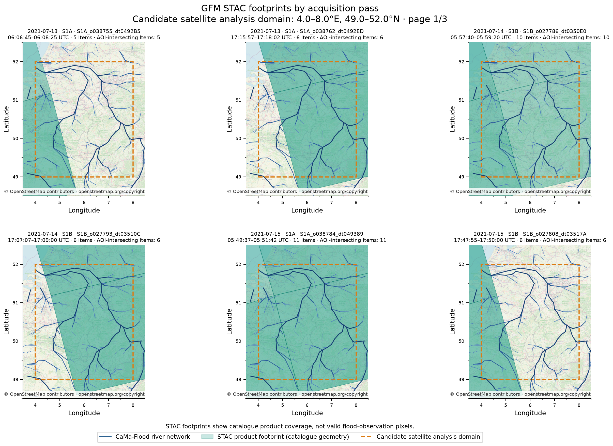
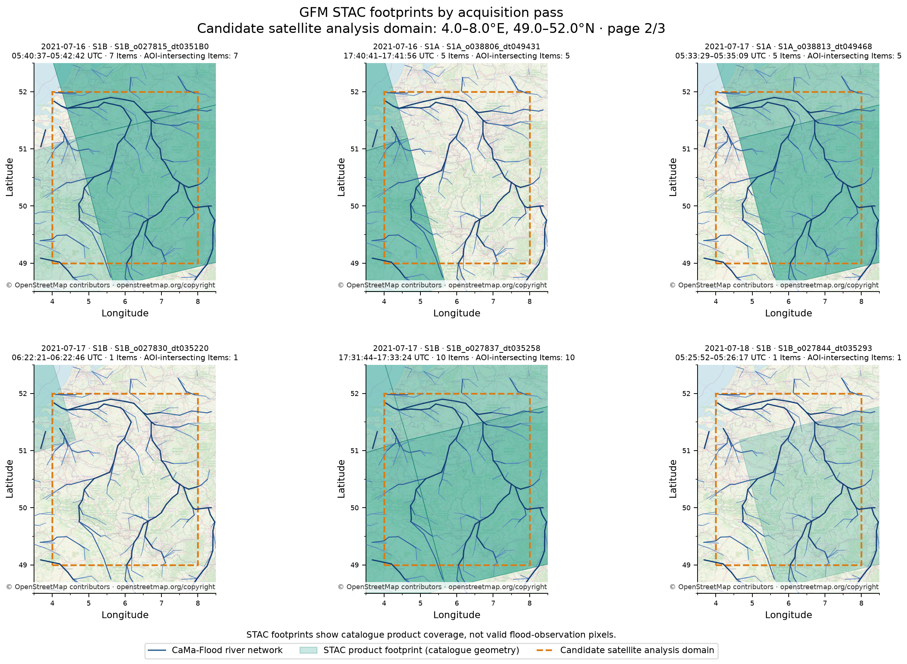
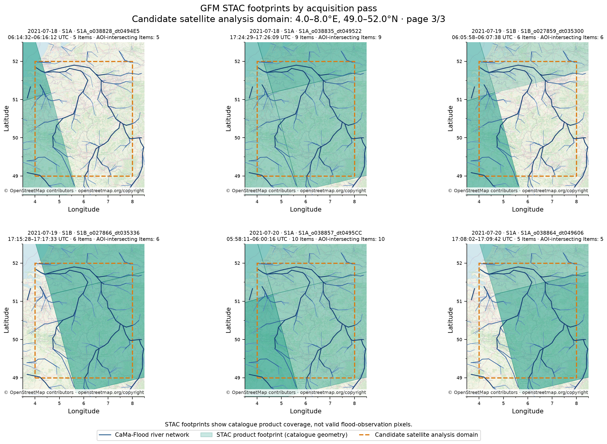

# Tutorial 11 — Step 3a: Satellite Observation Availability Survey

**Status:** Catalogue availability survey completed for candidate review. No GFM
COG assets were downloaded and no pass is approved yet for observation use.

## Purpose and configuration handoff

Step 3a searches acquisition metadata, groups STAC Items by their verified
Sentinel-1 source identity, maps each pass footprint, and compares candidate
coverage before any image download. It follows the time and spatial handoff in
[`metadata/domain_selection.json`](metadata/domain_selection.json), which is
the shared configuration for Step 2 and this survey.

The current settings are:

| Setting | Value | Status / meaning |
| --- | --- | --- |
| Event context | 2021-07-13–2021-07-15 | Documented core rainfall period; not a complete event or model period |
| Event analysis window | 2021-07-10–2021-07-25 | Candidate context window, not an approved simulation period |
| Satellite catalogue search | 2021-07-13–2021-07-20, inclusive | Candidate search period |
| Simulation period | Undecided | Must be selected after hydrologic scope, forcing and initialization are reviewed |
| Simulation domain | 3.125–12.125°E, 45.875–52.375°N | Candidate rectangle from Step 2; full watershed and boundaries still need confirmation |
| Satellite analysis domain | 4–8°E, 49–52°N | Candidate bounds based on the existing GFM target-grid extent, not a validated coverage boundary |

The map viewport is expanded by 0.5° around the candidate satellite domain so
the orange AOI frame is visible inside the map. This display margin does not
change the catalogue query bbox or analysis extent.

## Search method and Atlantis status

The tracked command is
[`s03a-satellite_availability_survey.sh`](s03a-satellite_availability_survey.sh).
It reads period and bbox values from the Step 2 JSON and calls the existing
[`s01-download_gfm.py`](scripts/s01-download_gfm.py) once per date with
`--catalogue-only`. Each day has a distinct output directory under
`Atlantis/catalogue/YYYY-MM-DD/metadata/` and a separate runner/log directory
under `Atlantis/runs/YYYY-MM-DD/`; the Tutorial-local `Atlantis/` directory is
ignored and is intended for catalogue caches, logs and any future data
products. No satellite assets are requested by the catalogue-only mode.

For this run, the expected local Atlantis links were unavailable:
`~/work/Atlantis/source` points to the missing `old/source`, and
`~/work/Atlantis/pixi/bin/pixi` points to the missing `old/pixi/bin/pixi`.
The environment was not repaired or reinstalled. To finish the survey without
acquiring images, the July 15 cache already present in the prior Atlantis data
directory was reused, and the remaining dates were queried read-only from the
EODC GFM STAC API. The returned STAC FeatureCollections and per-date request
records are retained locally under the ignored Tutorial `Atlantis/` directory.
The results were grouped with the same `gfm_common.parse_source` source-name
contract used by the existing workflow. When the Atlantis environment is
available again, run the tracked shell command to recreate the catalogue-only
cache through `s01`.

STAC Items are grouped by Sentinel-1 platform, absolute orbit and datatake
(for example, `S1A_o038784_dt049389`). Multiple tile Items from one acquisition
remain one pass. The pass time range is taken from the verified Sentinel-1
source identifiers, not inferred by clustering timestamps. The inventory
records relative orbit and direction when available from the existing
Atlantis/Copernicus OData metadata; those fields are not present in the GFM
STAC Items for the other passes.

## Results and footprint figures

The 8 daily catalogue responses contain **114 STAC Items grouped into 18
acquisition passes**. Daily counts are:

| UTC date | STAC Items | Distinct passes |
| --- | ---: | ---: |
| 2021-07-13 | 11 | 2 |
| 2021-07-14 | 16 | 2 |
| 2021-07-15 | 17 | 2 |
| 2021-07-16 | 12 | 2 |
| 2021-07-17 | 16 | 3 |
| 2021-07-18 | 15 | 3 |
| 2021-07-19 | 12 | 2 |
| 2021-07-20 | 15 | 2 |

All 18 pass IDs, source time ranges, Item counts, AOI-intersecting Item counts,
and the Item IDs are recorded in
[`metadata/satellite_pass_inventory.csv`](metadata/satellite_pass_inventory.csv).
The two 15 July orbit enrichments are recorded in
[`metadata/satellite_orbit_metadata.csv`](metadata/satellite_orbit_metadata.csv).

Each panel is one acquisition pass. All panels use the same expanded geographic
extent, map scale, OSM background and `glb_15min` CaMa-Flood river vectors. The
orange dashed rectangle is the same candidate 4–8°E, 49–52°N satellite analysis
domain in every panel. Teal translucent polygons are the actual STAC `geometry`
for each Item in that pass; adjacent Item polygons are drawn individually, not
expanded into a convex hull. The pages are split chronologically because there
are 18 passes:







The maps compare catalogue product footprints with the candidate AOI. A STAC
footprint describes the catalogue item's spatial coverage; it is **not** the
distribution of valid flood-observation pixels. It does not establish usable
flood classifications, quality, exclusion status, or coverage of a particular
river reach. The catalogue search was itself spatially filtered by the same
candidate bbox, so the recorded AOI-intersection counts confirm returned
geometry intersection rather than rank the passes by valid observation area.

## Candidate comparison for researcher review

The catalogue returns two acquisitions per day on 13, 14, 15, 16, 19 and 20
July, and three on 17 and 18 July. The panels show meaningful footprint-shape
and tile-coverage differences inside the same AOI, while the individual STAC
Items are mostly 20 m Equi7 tile products. No pass can be selected solely from
the queried footprint.

For a first image-download review, the 15 July morning
`S1A_o038784_dt049389` (11 Items; relative orbit 37, descending) is the most
directly linked to the existing native GFM sample already processed for this
Tutorial. The 15 July evening `S1B_o027808_dt03517A` (6 Items; relative orbit
132, ascending) offers a same-day, different-orbit acquisition for comparison.
These are practical candidates, not a scientific ranking or approval. The
other 13–20 July passes could help describe temporal evolution; prioritize
them only after comparing event-response timing, valid-pixel masks, data-layer
availability, licensing and the intended evaluation question. A footprint
intersection does not mean that all items in the pass are useful over the
reported impact localities.

## Reproduce and hand over to Step 3b

With the existing Atlantis Python environment active, from the repository root
run:

```bash
bash tutorial/tutorial11-event_evaluation/s03a-satellite_availability_survey.sh
```

The wrapper issues one catalogue-only request per date, creates date-separated
local catalogue outputs and logs in the ignored Tutorial `Atlantis/` folder,
then writes the tracked pass inventory and three footprint pages. The
visualization reuses `visualization/river_map/script/f06_common.py`; it does
not alter the Gallery or Catalog. OSM tiles are fetched/cached by that shared
renderer and attributed on every panel.

Before Step 3b downloads anything, the researcher should review candidate
passes against the reported flood localities, acquisition time, all four
required GFM layers, valid/exclusion masks, data-use terms and the event
hydrographs. Decide whether the existing 15 July S1A pass is sufficient for a
first processing example and whether the same-day S1B or selected earlier/later
passes add useful spatial or temporal coverage. Then record selected pass IDs
and the selection rationale before requesting COG assets. No satellite image
download, flood-map computation or model comparison was performed in Step 3a.
