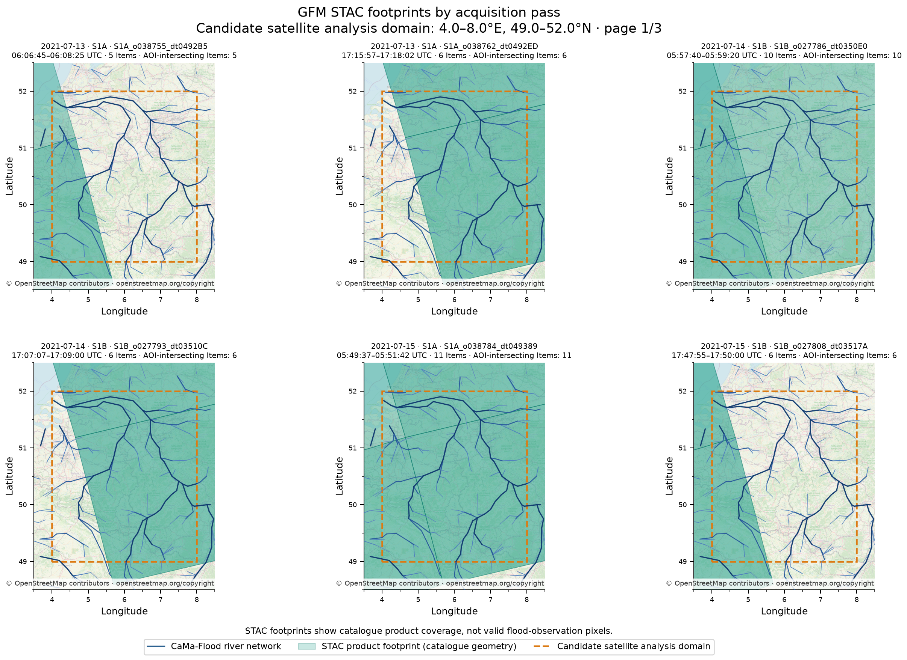

# Tutorial 11 — Step 3a: Satellite Data Survey

**Status:** Catalogue availability survey completed. No GFM COG assets were
downloaded during the survey. The existing first-processing candidate is
recorded as proposed; no pass is scientifically approved for event evaluation.

## Purpose and configuration handoff

For future events, use the reusable [p03a satellite availability Agent Workflow](p03a-satellite_availability.md). This Rhine 2021 survey is a worked sample and is not rerun by that Prompt.

Step 3a searches acquisition metadata, groups STAC Items by their verified
Sentinel-1 source identity, maps each pass footprint, and compares candidate
coverage before any image download. It follows the time and spatial handoff in
[`metadata/02_domain_selection.json`](metadata/02_domain_selection.json), which is
the shared configuration for Step 2 and this survey.

The current settings are:

| Setting | Value | Status / meaning |
| --- | --- | --- |
| Event context | 2021-07-13–2021-07-15 | Documented core rainfall period; not a complete event or model period |
| Event analysis window | 2021-07-10–2021-07-25 | Candidate context window, not an approved simulation period |
| Satellite catalogue search | 2021-07-14–2021-07-16, inclusive | Focused candidate search around 15 July, the central disaster date for this survey |
| Simulation period | Undecided | Must be selected after hydrologic scope, forcing and initialization are reviewed |
| Simulation domain | 3.125–12.125°E, 45.875–52.375°N | Candidate rectangle from Step 2; full watershed and boundaries still need confirmation |
| Satellite analysis domain | 4–8°E, 49–52°N | Candidate bounds based on the existing GFM target-grid extent, not a validated coverage boundary |

The map viewport is expanded by 0.5° around the candidate satellite domain so
the orange AOI frame is visible inside the map. This display margin does not
change the catalogue query bbox or analysis extent.

## Search method and Atlantis status

Run `s03a-satellite_availability.sh` to read dates and bbox from the Step 2
JSON, then call the existing [`s01-download_gfm.py`](script/s01-download_gfm.py)
once per date with `--catalogue-only`. It caches STAC Items and Copernicus orbit
metadata under `Atlantis/catalogue/YYYY-MM-DD/` and logs under
`Atlantis/runs/YYYY-MM-DD/`; no satellite COG assets are requested. The helper
then writes the Git-tracked pass inventory, orbit table and source acquisition
footprints. `f03a-satellite_footprints.sh` renders the figure from those local
catalogues and tracked metadata only; it does not search or download. The
Tutorial-local `Atlantis/` directory is ignored and holds acquisition caches,
logs and data.

For this run, the expected local Atlantis links were unavailable:
`~/work/Atlantis/source` points to the missing `old/source`, and
`~/work/Atlantis/pixi/bin/pixi` points to the missing `old/pixi/bin/pixi`.
The environment was not repaired or reinstalled. To finish the survey without
acquiring images, the July 15 cache already present in the prior Atlantis data
directory was reused, and the remaining dates were queried read-only from the
EODC GFM STAC API. The returned STAC FeatureCollections and per-date request
records are retained locally under the ignored Tutorial `Atlantis/` directory.
The results were grouped with the same `gfm_common.parse_source` source-name
contract used by the existing workflow. When the Atlantis environment is
available again, run the tracked shell command to recreate the catalogue-only
cache through `s01`.

STAC Items are grouped by Sentinel-1 platform, absolute orbit and datatake
(for example, `S1A_o038784_dt049389`). Multiple tile Items from one acquisition
remain one pass. The pass time range is taken from the verified Sentinel-1
source identifiers, not inferred by clustering timestamps. The inventory
records relative orbit and direction when available from the existing
Atlantis/Copernicus OData metadata; those fields are not present in the GFM
STAC Items for the other passes.

## Results and footprint figures

The focused 3-day catalogue responses contain **45 STAC Items grouped into 6
acquisition passes and 27 unique source product slices**. The earlier 13–20
July scan is retained in development history, but is outside the current review
scope. Daily counts are:

| UTC date | STAC Items | Distinct passes |
| --- | ---: | ---: |
| 2021-07-14 | 16 | 2 |
| 2021-07-15 | 17 | 2 |
| 2021-07-16 | 12 | 2 |

The 6 in-scope pass IDs, source time ranges, STAC Item counts, unique Sentinel-1
source product counts, Equi7 tile counts, AOI intersections and source IDs are
recorded in [`metadata/03a_satellite_pass_inventory.csv`](metadata/03a_satellite_pass_inventory.csv).
Relative orbit and ascending/descending direction for the same six passes are in
[`metadata/03a_satellite_orbit_metadata.csv`](metadata/03a_satellite_orbit_metadata.csv).
The 27 source product geometries for this focused window are retained separately in
[`metadata/03a_sentinel1_acquisition_footprints.geojson`](metadata/03a_sentinel1_acquisition_footprints.geojson).

### Geometry investigation: GFM tile coverage versus Sentinel-1 acquisition

The first version of the comparison map drew each GFM STAC Item's `geometry`.
That geometry describes the GFM Item's spatial coverage on its `Equi7Tile`, not
the original Sentinel-1 acquisition swath. The Items also carry `proj:geometry`,
`proj:bbox`, `proj:shape` and `proj:transform` describing the projected Equi7
tile grid; for example, each 20 m tile is 15,000 × 15,000 pixels (300 km per
side). The WGS84 STAC `geometry` is the geographic outline used to locate that
tile. Geometry coordinates are GeoJSON longitude, latitude; they are not a
valid-pixel mask or the area actually classified as flood.

Each GFM Item links to a source Sentinel-1 product with `rel=derived_from`.
The linked EODC Sentinel-1 STAC Item URL was not available for the checked
product, so source metadata were queried from the public
[Copernicus Data Space OData Products catalogue](https://catalogue.dataspace.copernicus.eu/odata/v1/Products).
Its `GeoFootprint` and `ContentDate`, plus `orbitDirection` and
`relativeOrbitNumber` product attributes, identify the source GRD product's
acquisition geometry and orbit. The compact geometries used here are stored
with the source product IDs, acquisition times and provenance in the GeoJSON
above. Only catalogue metadata were requested; no Sentinel-1 image or GFM COG
was downloaded. The original GRD SAFE record was preferred when the catalogue
also exposed a COG copy of the same source product. Across 72 matched SAFE/COG
records, their GeoFootprint vertices agreed within 5×10⁻¹³ degrees; the SAFE
record was retained once per source product to avoid duplicate slice geometry.

For `S1B_o027786_dt0350E0` on 2021-07-14, the 10 GFM STAC Items resolve to 4
unique source product IDs (four consecutive 25-second source slices) and 4
Equi7 tile IDs. The tile geometry has only 4 unique shapes: the same tile outline
is repeated across different source timestamps. Thus 10 Items are not 10
independent observations; they are tile products from one acquisition pass.
Repeated translucent plotting of those Item polygons caused darker overlap
areas that could be mistaken for repeated observations or stronger coverage.
Three of the four source product footprints intersect the candidate bbox; this
is a geometric footprint check, not a pixel-validity assessment. The updated
map draws the source product footprints as one compound filled shape per pass,
with one teal color and fixed opacity. Overlapping slices are painted once, and
no convex hull or interpolated coverage is introduced.

The 15 July pair demonstrates why the geometry distinction matters. The S1A
morning descending pass has 11 STAC Items and 3 of 5 source product footprints
intersect the candidate 4–8°E, 49–52°N bbox. The S1B evening ascending pass has
6 STAC Items (2 tile IDs), but **none of its 5 source product footprints
intersect that bbox**; its actual source footprint lies farther west. The GFM
tile bounds overlap the bbox even though the source scenes do not. The S1B pass
is therefore not a same-AOI observation comparator under the current candidate
bounds. It could be reconsidered only if the observation domain is deliberately
expanded west to address a separate locality, not from the Item geometry alone.

Each panel is one acquisition pass. All panels use the same expanded geographic
extent, map scale, OSM background and `glb_15min` CaMa-Flood river vectors. The
orange dashed rectangle is the same candidate 4–8°E, 49–52°N satellite analysis
domain in every panel. Teal is now the Copernicus source GRD `GeoFootprint`,
not the STAC Item tile geometry. Every title distinguishes STAC Item count,
source product count and tile count and labels the verified orbit direction.
All six passes fit on one page, ordered chronologically:



The maps compare source acquisition footprints with the candidate AOI. A
Copernicus product `GeoFootprint` is the catalogued source-product coverage; it
is **not** the distribution of valid GFM flood-observation pixels. It does not
establish usable flood classifications, quality, exclusion status, or coverage
of a particular river reach. The inventory retains the STAC Item/AOI and
source-product/AOI intersections separately; the search was spatially filtered
by the same candidate bbox, so those counts are not a ranking of valid observed
flood area.

## Candidate comparison for researcher review

The selected window returns two passes on each of 14, 15 and 16 July. Within a pass, multiple source GRD slices may
partly overlap along track, and each slice may be represented by several GFM
Equi7 tile Items. These levels are separately counted in the inventory; their
overlap does not mean independent overpasses or stronger observed flooding. No
pass can be selected solely from product geometry.

For an initial processing example, the 15 July morning
`S1A_o038784_dt049389` (11 Items; relative orbit 37, descending) is the most
directly linked to the existing native GFM sample already processed for this
Tutorial. It is recorded as the initial `proposed` pass in
[`metadata/03a_selected_passes.json`](metadata/03a_selected_passes.json), not as
a scientific ranking or approved event dataset. The 15 July evening
`S1B_o027808_dt03517A` (6 Items, 5 source products, relative orbit 132,
ascending) does **not** cover the current candidate bbox: zero source product
GeoFootprints intersect it, despite all 6 GFM tile Items intersecting. Do not
treat it as a same-AOI comparison unless the observation domain is intentionally
expanded west for a stated evaluation purpose. The 14 and 16 July passes provide
before/after context around the central 15 July date. Their relative priority
remains open pending review of coverage, event-response timing, valid-pixel
masks, data-layer availability, licensing and the evaluation question. An
acquisition-footprint intersection does not mean the GFM pixels are valid or
useful over reported impact localities.

## Reproduce and hand over to Step 3b

With the existing Atlantis Python environment active, from the repository root
run:

```bash
bash tutorial/tutorial11-event_evaluation/s03a-satellite_availability.sh
bash tutorial/tutorial11-event_evaluation/f03a-satellite_footprints.sh
bash tutorial/tutorial11-event_evaluation/s03b-download_gfm.sh
```

`s03a` acquires STAC and orbit/source-footprint metadata only. `f03a` regenerates
the one-page footprint comparison from local catalogues and metadata without
network search. `s03b` reads the selected pass and analysis bounds from the
Step 3a/2 JSON, then downloads or reuses native 20 m COGs. The downloader uses
the four layers needed by the classification workflow:
`ensemble_flood_extent`, `ensemble_water_extent`, `reference_water_mask`, and
`exclusion_mask`. After a successful acquisition, it writes a per-pass
`download_manifest_<pass-id>.csv` and `download_summary_<pass-id>.json` under
`Atlantis/catalogue/<date>/metadata/`. CSV paths are relative to the Tutorial's
`Atlantis/` root. The summary reports `ready_for_p03c` after matching selected
STAC Items/layers and checking file size, checksum and GeoTIFF readability.
This status is independent of Human review; missing or unreadable files leave
the pass unready. p03c uses this Manifest to find its inputs and does not need
to repeat STAC search or download. The downloader does not convert, reproject,
or classify data.
The visualization reuses
`visualization/river_map/script/f06_common.py`; it does not alter the Gallery
or Catalog. OSM tiles are fetched/cached by that shared renderer and attributed
on every panel.

The fixed `metadata/03a_selected_passes.json` is the Step 3b selection
interface. It currently records the 15 July S1A pass as `proposed`; status is
descriptive and does not block a Step 3b run. Human review of the candidate
against reported localities, acquisition time, required layers,
valid/exclusion masks, data-use terms and event hydrographs remains the
recommended research process. Rebuild the handover from existing files without
repeating acquisition with:

```bash
python3 -B tutorial/tutorial11-event_evaluation/script/s03b-build_download_manifest.py \
  --selection-json tutorial/tutorial11-event_evaluation/metadata/03a_selected_passes.json \
  --catalogue-root tutorial/tutorial11-event_evaluation/Atlantis/catalogue \
  --atlantis-root tutorial/tutorial11-event_evaluation/Atlantis
```

No satellite image download, flood-map computation or model comparison was
performed as part of the Step 3a survey.
