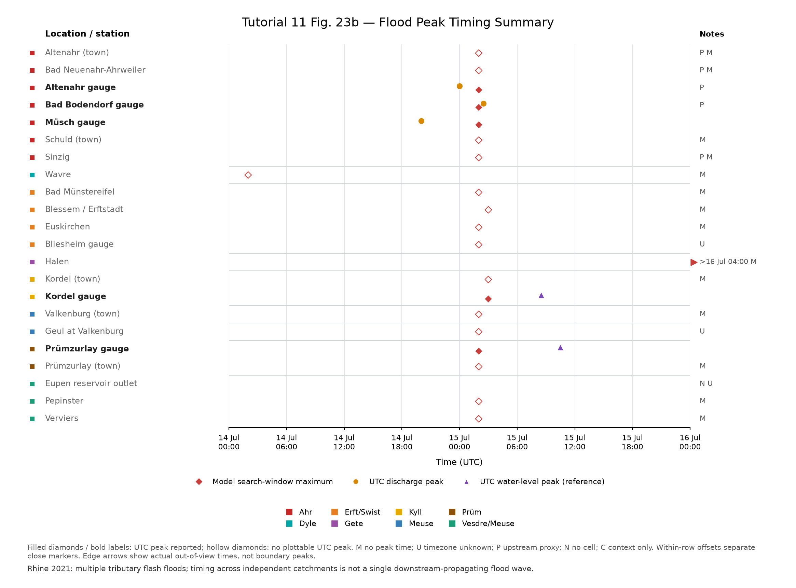

# Scientific Results — Rhine 2021 Preliminary Event Study

## Scope and evidence

This synthesis joins the retained Tutorial11 Step01–24 results as of
2026-11-24. It is a retrospective scientific assessment, not a new simulation,
source-data analysis, literature review or validation exercise. Quantities below
come from the linked Step reports, CSVs and execution metadata. No new input-data verification was performed.
Local availability limits are in the [preparation record](../AI_work_report/00_synthesis_preparation.md).

The central finding is that the example connects event research, observations,
a regional CaMa-Flood run and exploratory comparisons, while exposing important
limits in temporal interpretation and local tributary representation. It does
**not** establish quantitative inundation-reproduction skill.

## Event and observation support

The July 2021 event involved rapid flooding on tributaries including Ahr, Erft,
Kyll and Prüm, alongside Rhine main-stem and neighboring Meuse-system responses.
These are different spatial and hydrologic targets. The [Step01 report](01_flood_event_overview.md)
retains 14 impact localities and a separate 22-record timing ledger. Approximate
town coordinates do not define observed inundation boundaries; gauge peaks are
not automatically town-impact times.

The supplied annual discharge series are **Lobith (153), Speyer (63), Maxau
(28)**, with 1,460 six-hour labels per station. Bonn/6, named in the initial
correspondence, is absent. The [Step04 inspection](04_discharge_observations.md)
records CSV/NetCDF agreement and no missing samples. Provider correspondence
identifies six-hour means labelled at interval end; the files themselves do not
establish the discharge unit, timezone or interval bounds. These observations
provide main-stem context rather than direct Ahr/Erft discharge measurements.

The [satellite survey](03a_satellite_availability.md) records 45 GFM Items in
six passes over July14–16. Item count, acquisition footprint and valid-pixel
support are distinct. One S1A descending pass on July15 was selected for the
worked example, not as a proven event-peak observation. The [classification](03c_gfm_classification.md)
uses Code1/(Codes0–4) as valid-support Flood Fraction; exclusion, ambiguity and
NoData are outside that denominator. Fifteen [native 20m crops](03d_focus_area_extraction.md)
are inspection/storage subsets, not a complete flood inventory. Their selection
retains 87.48% of the recorded reconstructed one-minute Flood-pixel population;
that statistic is not model accuracy, event coverage or an area-weighted score.

## Simulation and spatial correspondence

The [Step14 record](14_simulation_setup.md) describes a 40×32, 15arcmin Rhine
map, hourly ERA5-Land forcing and the regional `ERA5land_Rhine2021Jul` Input
Matrix. The cold-start simulation spans July1–August1 exclusive, **744 hours**,
with no spin-up. Completion and readable outputs demonstrate an operational
workflow; they do not establish hydrologic accuracy. ERA5-Land accumulation
attribution/period-boundary treatment remains unresolved as KG-0019.

[Step21](21_gauge_allocation.md) distinguishes geographic containment, direct
one-minute `catmxy` assignment and the final river-evaluation candidate. Of the
22 impact/timing reports, final allocation uses 16 direct assignments, five
reviewed one-step upstream Ahr proxies and one unassigned record. The proxy
choice is supported by a named anchor and actual `nextxy` connectivity; it is
not an exact lower-Ahr reach delineation. Missing downstream contributing area
and coarse channel aggregation remain limitations (KG-0039).

## Exploratory discharge and timing findings

Figure22 overlays hourly model outflow and supplied six-hour values at the
three allocated main-stem gauges. [Step22](22_hydrograph_comparison.md) reports
model maxima of 8,490.1, 6,465.5 and 6,473.4m³/s at Lobith, Speyer and Maxau;
observation maxima are 6,684.7, 3,957.5 and 4,214.6 in an undeclared unit.
These retained values describe the plotted series. Unknown observation units,
clock basis and different averaging supports preclude an amplitude-bias or
formal timing-accuracy conclusion. No implicit unit conversion or clock shift
is warranted.

Figure23b relates model maxima to source-supported timing records. Filled and
hollow diamonds encode observation availability, not agreement. [Step23](23_impact_timing_comparison.md)
retains 22 reports sharing ten model cells. Only three comparisons yield
provisional discharge-peak offsets: Müsch **+6h**, Altenahr **+2h**, Bad
Bodendorf **−0.5h**, all from the same model hydrograph. They are not three
independent validations; the last value does not demonstrate half-hour model
accuracy. Water-level peaks, unknown timezones and unavailable timings remain
reference/context rather than discharge-lag scores. The row sequence across
independent tributaries is not evidence of one propagating downstream wave.

## Inundation downscaling and interpretation

Figure24 is simulated depth, not a satellite classification or agreement map.
[Step24](24_inundation_downscaling.md) matches the selected S1A acquisition's
05:50:39.8965UTC envelope midpoint to the nearest saved 06:00UTC model output
on July15 (+560.1035s), then uses maintained tributary-aware downscaling from
15arcmin to 1arcmin. The retained record gives a 180×240 field: 42,960 valid,
240 unmapped, 37,429 dry and 5,531 positive cells, with depths up to 10.874m.
These are inherited execution statistics; the derived NetCDF is not currently
available locally and was not regenerated for this synthesis.

Depth follows the river network with limited visible lateral spread. That
appearance alone cannot establish underestimation: positive depth includes the
existing 0.1m permanent-water minimum, terrain downscaling adds spatial detail
without new hydrodynamics, and GFM Flood Fraction has a different denominator
and water definition. Model resolution, forcing, initial/boundary conditions,
terrain/channel representation and SAR observability may all matter; their
relative effects have not been isolated. No pixelwise GFM comparison or skill
metric was computed.

## Scientific conclusion and limits of inference

The supported scientific contribution is a worked example of how event evidence,
observation support and model representation constrain flood-event evaluation.
It identifies where comparisons are feasible and where a seemingly precise
plot would overstate knowledge. The results support exploratory pattern/timing
inspection, not a validated reconstruction of local tributary or overbank
flooding. Refining forcing, hydrodynamics or terrain addresses different
uncertainties; none is demonstrated here to resolve the event discrepancies.

Formal performance work would require defensible observation units/time support,
reach correspondence, forcing/initial/boundary sensitivity, common spatial masks
and permanent-water treatment. These are future scientific choices, not work
performed for this report. **Step24 is the final Step; Step25 is canceled.**
