# Human–AI Collaborative Flood Event Evaluation

## A Case Study of the July 2021 Rhine Basin Flood

### Overview

The July 2021 western European floods provide a demanding test of how a continental river model can be connected to evidence from rapidly responding tributaries, main-stem gauges and intermittent satellite observations. This case study documents the scientific results obtained through a Human–AI collaborative Flood Event Evaluation Tutorial built on CaMa-Flood v5. It brings together event research, observation preparation, a regional experiment and exploratory comparisons in a single research sequence.

Sixteen completed component Steps established the evidence: a review of 14 reported impact localities; a satellite catalogue survey identifying six acquisition passes during 14–16 July; preparation of one Sentinel-1A pass and three year-long discharge series; a 31-day, 15 arcmin simulation with 744 hourly steps; and analyses of river allocation, hydrographs, flood timing and time-selected inundation. The strongest combined finding is that evaluation must distinguish the Rhine main-stem response from destructive tributary floods and must match the spatial and temporal support of each observation to the model. The work also demonstrates a practical link from satellite acquisition time to terrain-based inundation mapping. These results establish an evidence-rich prototype for event evaluation, while identifying the specific matching and definition questions that precede formal performance scoring.

## 1 Introduction and research objectives

Event-based evaluation asks whether a model represents the location, timing and magnitude of a particular flood, rather than only its long-term statistical behavior. The July 2021 event exposes several difficulties at once. Intense rainfall affected multiple river systems; the most destructive flooding occurred in tributary valleys; river gauges and satellites observe different quantities at different intervals; and a coarse river network may combine an affected tributary with a much larger receiving river. A useful evaluation therefore begins with the event and its observations, then determines what the model can meaningfully be compared with.

The objective is to assess CaMa-Flood flood behavior using available discharge and satellite evidence, with explicit treatment of river identity, observation support and time conventions. The case study contributes to an Event-based Benchmark prototype developed using CaMa-Flood v5. Researchers set the objectives and reviewed scientific choices, while AI agents supported investigation, processing, experiment construction, visualization and reporting. The scientific account below follows the resulting evidence rather than attributing individual findings to an assumed division of labor.

The research proceeds from event context and spatial design to observations, model preparation and simulation, then to discharge, timing and inundation comparisons. The evaluation has reached exploratory scientific interpretation. A formal score requires additional correspondence checks, especially for observation units and time support and for the definition of satellite-observed versus model-simulated floodwater. The [research objectives and workflow](../README.md) and linked individual reports provide detailed evidence for each part of this account.

## 2 Flood event and study region

### 2.1 A regional rainfall event with distinct river responses

Intense rainfall over the Eifel and Ardennes during 13–15 July 2021 caused severe flooding in western Germany and neighboring countries. The Ahr and Erft experienced particularly destructive tributary floods. Kyll and Prüm belong to the Moselle system, while the Meuse and its tributaries form a separate basin. The Rhine main stem also rose, but its response integrates runoff over a much larger region. These distinctions organize the evaluation: a main-stem discharge series cannot stand in for a local Ahr flood, and a row of peaks from different tributaries cannot automatically be interpreted as one propagating wave. The event review draws on [Mohr et al. (2023)](https://nhess.copernicus.org/articles/23/525/2023/), the [LfU flood report](https://lfu.rlp.de/fileadmin/lfu/Service/Publikationen/Bestellkatalog/Hochwasser_im_Juli2021_barrierefrei.pdf) and other sources retained in the [Step01 Survey Report](01_flood_event_overview.md).

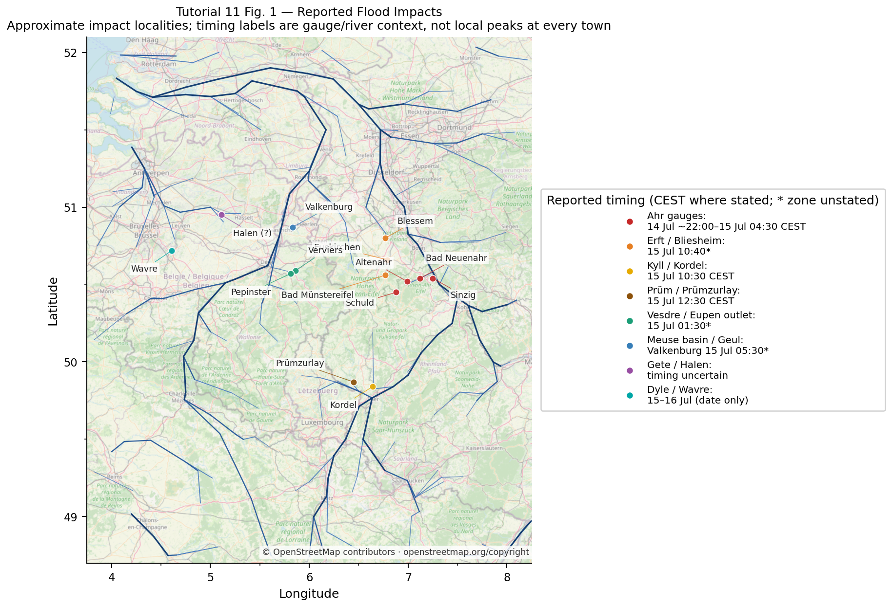

**Figure 1. Reported flood-impact localities and their river-system context.** The 14 markers identify approximate named places, with source-based gauge and timing context in the legend. They are useful anchors for selecting relevant rivers and observation searches; they do not delineate surveyed flood boundaries. The geographical spread motivates a regional model domain and separate treatment of Rhine, Moselle and neighboring Meuse responses.

The event inventory subsequently expanded to 22 report-linked records, retaining locality reports separately from gauge timing records. Source-supported Ahr discharge peaks fall during the night of 14–15 July, whereas the three supplied Rhine main-stem series have July maxima on 17–18 July. This establishes a useful event-scale contrast between rapid tributary flooding and the later main-stem response. Detailed lag interpretation still requires the time and reach matching described in Section 6.

### 2.2 Separate domains for routing and satellite assessment

The regional experiment covers 3–13°E and 45–53°N, using outer grid-cell edges. This window contains a 40 × 32 grid at 0.25° (15 arcmin). Auxiliary terrain and assignment data cover the same region at 1 arcmin, with 600 × 480 cells. The satellite-analysis domain is smaller: 4–8°E and 49–52°N, or 240 × 180 cells at 1 arcmin. The larger model domain provides routing context; the smaller observation domain targets the affected region and available satellite evidence.

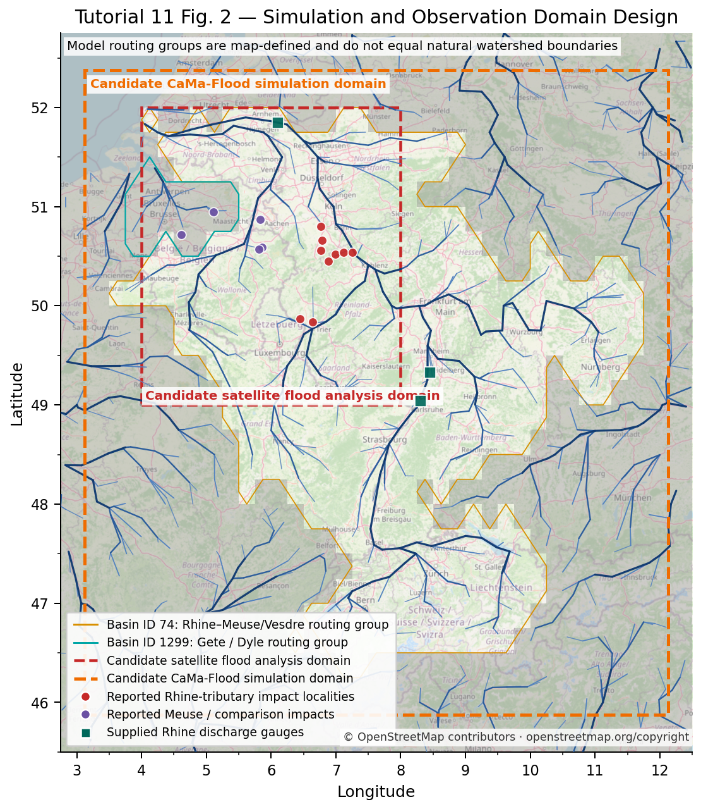

**Figure 2. Spatial design linking reported impacts, gauges and the CaMa-Flood network.** The figure preserves the domain-design stage's candidate terminology; the 3–13°E, 45–53°N window was subsequently used for the regional experiment. The satellite box is an analysis region rather than a measured acquisition footprint. Keeping these roles distinct prevents a rectangular study domain from being mistaken for either a natural watershed or an observed flood extent.

The inspected global map assigns sampled Rhine and some neighboring Meuse/Vesdre locations to routing group 74, containing 391 cells; Halen and Wavre associate with group 1299, containing 19 cells. These identifiers describe the particular model map. Natural river-system names remain the appropriate scientific frame for interpreting the flood. Domain and map evidence are documented in [Step02](02_analysis_domain_design.md), [Step11](11_regional_map_preparation.md) and the [domain metadata](../metadata/02_domain_selection.json).

## 3 Observational datasets

### 3.1 Satellite opportunity depends on acquisitions and valid pixels

The focused search for 14–16 July returned 45 GFM STAC Items, grouped into six Sentinel-1 acquisition passes and 27 source product slices. These are three different counts: catalogue Items can share assets or tiles, multiple slices can belong to one pass, and none alone measures the number of independent observations of a particular river.

**Table 1. Sentinel-1 passes identified around the event and intersection of source-product footprints with the satellite-analysis domain.** Times are UTC and rounded to seconds. The intersection count concerns source footprints, not valid classified flood pixels.

| Date and approximate interval | Platform and direction | STAC Items | Source products | Footprints intersecting domain |
| --- | --- | ---: | ---: | ---: |
| 14 July 05:57–05:59 | S1B descending | 10 | 4 | 3 |
| 14 July 17:07–17:09 | S1B ascending | 6 | 5 | 1 |
| 15 July 05:49–05:52 | S1A descending | 11 | 5 | 3 |
| 15 July 17:48–17:50 | S1B ascending | 6 | 5 | 0 |
| 16 July 05:41–05:43 | S1B descending | 7 | 5 | 3 |
| 16 July 17:41–17:42 | S1A ascending | 5 | 3 | 2 |

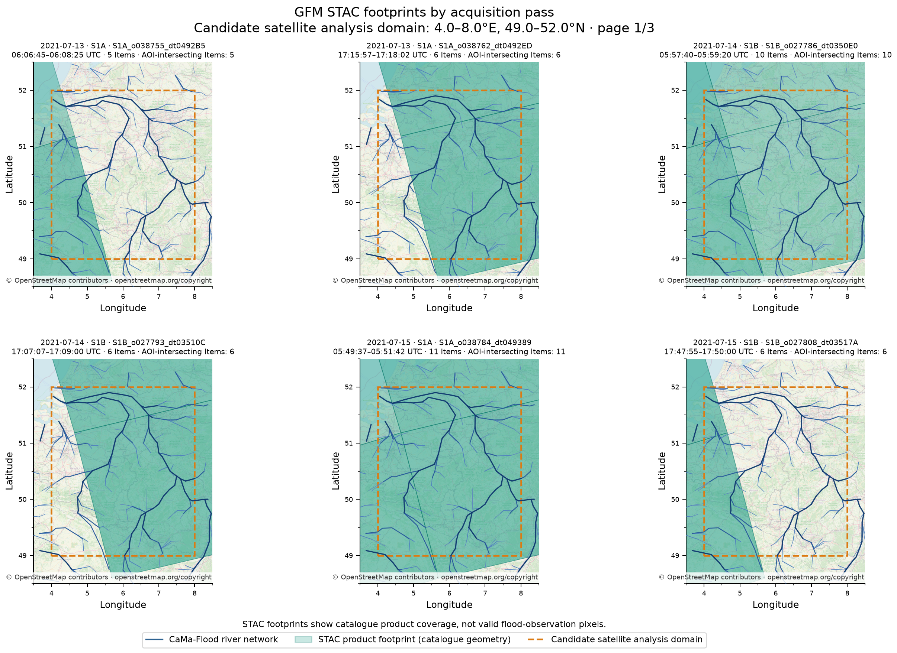

**Figure 3a. Source-product acquisition footprints for six passes on 14–16 July.** The dashed domain box provides a common reference. The 15 July evening pass is particularly instructive: catalogue tile intersections suggested availability, but none of its five source-product footprints intersected the analysis domain. A valid-observation mask is still required even where a source footprint overlaps. Thus acquisition geometry is an intermediate filter between catalogue discovery and scientific usability.

The selected processing example is the 15 July morning descending Sentinel-1A pass, orbit 038784. Five source scenes belong to this one acquisition. Four GFM layers were retained: ensemble flood extent, ensemble water extent, reference water mask and exclusion mask. The acquisition record contains 37 unique COG assets, allowing flood detections to be interpreted alongside reference water and unusable support. Selection of this pass provided a feasible initial example; it does not rank it as the best possible observation of every affected river. Evidence is in [Step03a](03a_satellite_availability.md), [Step03b](03b_gfm_download.md) and the [pass inventory](../metadata/03a_satellite_pass_inventory.csv).

### 3.2 Flood classification and the meaning of flood fraction

The processed classification distinguishes observed land, flood, permanent water, seasonal water, other water, exclusion, inconsistency and NoData. This is scientifically important: excluded or unobserved terrain is not evidence of dry conditions, and existing river water is not equivalent to event flooding. The retained full-source record contains 182,974 Flood-class pixels at 20 m, together with extensive excluded and missing areas.

The 1 arcmin product uses the following definition: Flood Fraction (%) equals 100 times the number of Flood pixels (Code 1) divided by the number of pixels in valid classes 0–4. Codes 5, 6 and 255 are excluded. A target cell without valid support is NoData. Consequently, the fraction describes flooding conditional on usable classification within the cell; it is not necessarily the flooded percentage of the whole geographical cell. There are 35,225 cells with some valid support, and the maximum recorded fraction is 75.9%.

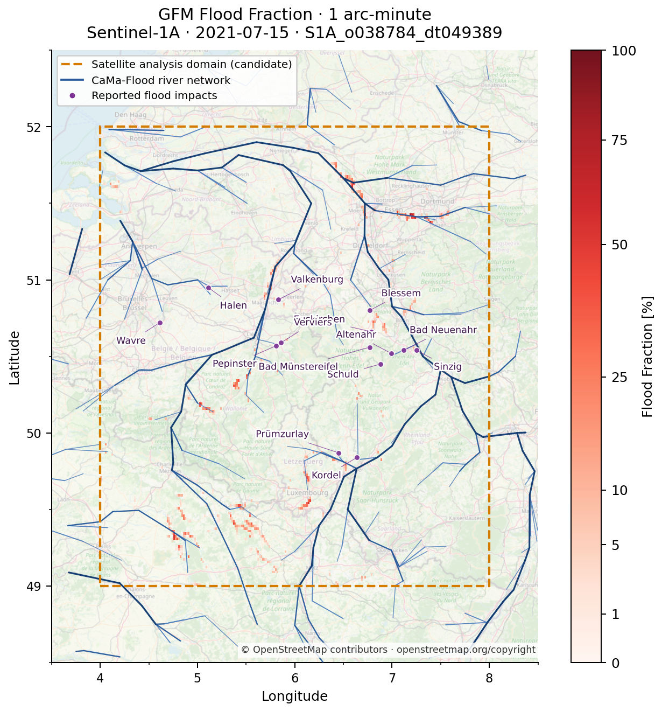

**Figure 3c. One-arcminute GFM Flood Fraction, reported impact localities and selected focus areas.** Red shading represents the conditional fraction, green outlines mark 15 inspection areas and purple markers locate reported impacts. The map connects satellite observations with the event context while exposing their different spatial support. High fractions require accompanying support information, especially where only a small part of a cell has valid classification.

Fifteen focus boxes were selected using flood-pixel counts and valid support rather than proximity to impact markers. They preserve 140,228 of 160,301 Flood pixels in the reconstructed one-minute selection population, or 87.5%, within approximately 9,200 km². The 160,301 selection count and 182,974 full-source count refer to different populations and should not be substituted for one another. The focus subset therefore provides targeted high-resolution evidence while retaining an explicit record of omitted flood detections.

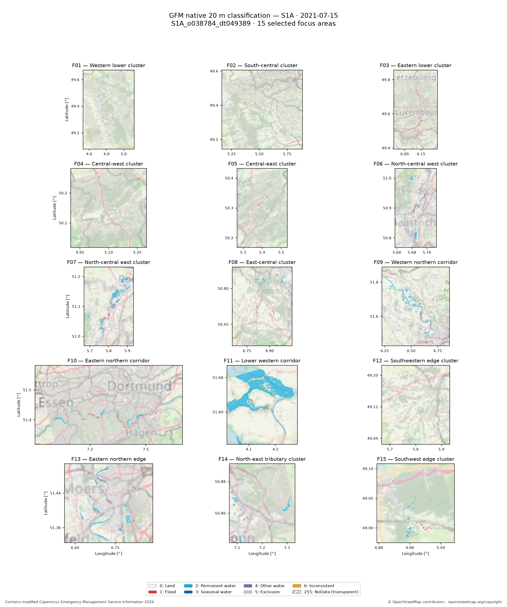

**Figure 3d. Fifteen extracted 20 m classification windows.** Original source-pixel alignment and class values were retained during extraction. The panels show local water patterns and unusable support in a geographical setting, providing detail that the aggregated fraction alone cannot convey. Because projected crop windows can overlap, summing their per-window class counts would not yield a unique flooded area. These are selected observations rather than a complete event-maximum map.

The combined satellite products provide two complementary views: a regional screening layer and native-resolution inspection of selected clusters. Their methodological definitions and selection tradeoffs are documented in [Step03c](03c_gfm_classification.md), [Step03d](03d_focus_area_extraction.md), [focus-selection metadata](../metadata/03c_focus_areas.json) and [extraction metadata](../metadata/03d_extracted_areas.json).

### 3.3 Main-stem discharge observations

Three supplied 2021 series cover Lobith, Speyer and Maxau. Each contains 1,460 regularly spaced six-hour records, from 1 January 2021 06:00 through 1 January 2022 00:00 as labelled. The records contain no missing values or duplicate timestamps, and CSV values match their NetCDF float32 representation. Provider correspondence describes six-hour means labelled at the end of the aggregation interval. The files themselves leave units and timezone unspecified and provide no explicit averaging bounds or quality flags.

**Table 2. Supplied Rhine stations and observed July maxima.** Coordinates are supplied station coordinates; maxima retain source units and timestamp labels. They are six-hour series maxima, not instantaneous discharge peaks.

| Station and ID | Country | Longitude, latitude | July maximum, source unit | Source timestamp |
| --- | --- | --- | ---: | --- |
| Maxau, 28 | Germany | 8.30561°E, 49.03896°N | 4,214.6 | 17 July 18:00 |
| Speyer, 63 | Germany | 8.44876°E, 49.32379°N | 3,957.5 | 18 July 06:00 |
| Lobith, 153 | Netherlands | 6.10833°E, 51.84444°N | 6,684.7 | 18 July 06:00 |

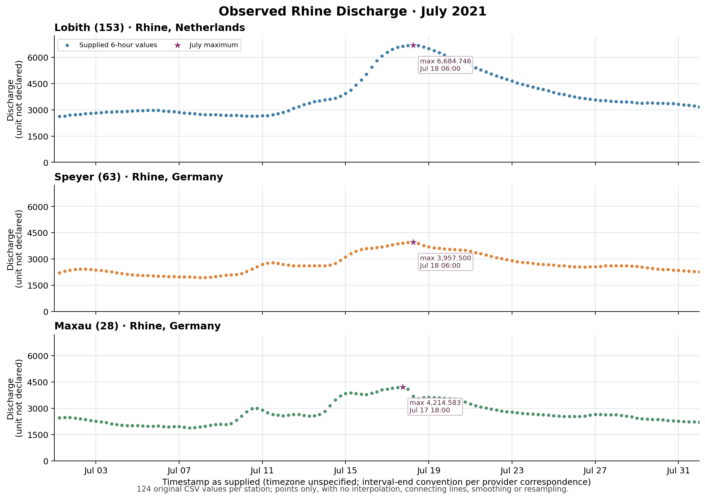

**Figure 4. Supplied July discharge records at the three Rhine gauges.** Points retain the original values and source times, without smoothing or interpolation. The main-stem response culminates on 17–18 July, providing later-stage event context than the rapid tributary peaks discussed below. The vertical quantity remains labelled with its unit unspecified; resolving that metadata is necessary before a quantitative discharge comparison.

These records support continuous event-context inspection but do not directly observe the Ahr or Erft. Their availability also illustrates a central distinction in evaluation: completeness of a time series does not by itself establish its physical comparability with a model variable. Details are in [Step04](04_discharge_observations.md) and the [discharge inventory](../metadata/04_discharge_inventory.csv).

## 4 Model setup and experimental design

### 4.1 Regional routing and runoff mapping

A regional CaMa-Flood v5 map was prepared from the global 15 arcmin network over the model domain. The map contains 1,245 river-network cells and 35 other cells, with 1 arcmin auxiliary terrain and catchment assignments. Standard `nextxy` connectivity and stored channel/overland bifurcation pathways provide the routing framework. The experiment uses an hourly ERA5-Land runoff subset at 0.1°, extending beyond the model window to provide mapping support at its edges.

Matching forcing resolution is insufficient to identify the correct runoff mapping. The regional ERA5-Land grid has 111 × 91 cells and a different origin from the global grid. A dedicated mapping linked its runoff cells to the regional unit catchments through area weights. All 1,245 river-network cells have contributions; the mapping contains 16,963 positive-area input/model pairs. This supplies a consistent spatial link between atmospheric runoff and river routing rather than a nearest-grid-center assignment. See [Step11](11_regional_map_preparation.md), [Step12](12_era5land_runoff_preparation.md), [Step13](13_runoff_input_matrix.md) and the [matrix metadata](../metadata/13_runoff_input_matrix.json).

### 4.2 The executed July experiment

**Table 3. Principal experiment settings and temporal support.** Grid dimensions and periods describe the executed experiment, not the earlier candidate acquisition or analysis windows.

| Component | Executed configuration |
| --- | --- |
| River model | CaMa-Flood v5; 15 arcmin regional map |
| Model domain | 3–13°E, 45–53°N; 40 × 32 cells |
| Auxiliary map | 1 arcmin; 600 × 480 cells |
| Runoff input | ERA5-Land, 0.1°; 111 × 91 cells; hourly |
| Runoff spatial support | Centers 2.5–13.5°E, 44.5–53.5°N; rows north to south |
| Simulation period | 1 July 2021 00:00 to 1 August 2021 00:00, end exclusive |
| Integration | 744 hourly steps; adaptive internal timestep |
| Initial condition | Standard model state, without restart or spin-up |
| Routing | Standard nextxy; bifurcation routing enabled; dam operation disabled |
| Output | Eight variables at hourly intervals; final restart |
| Output time meaning | Outflow: hourly mean; floodplain depth: point value at output time |

The simulation completed the full 31 days and produced hourly discharge, bifurcation flow, storage, water level, river and floodplain depth, flooded fraction and flooded area. Output labels run from 1 July 01:00 to 1 August 00:00. This provides a continuous regional experiment spanning both the rapid tributary event and the subsequent main-stem recession. The [Step14 report](14_simulation_setup.md) and [experiment metadata](../metadata/14_simulation_setup.json) describe the run.

Two experiment conditions matter throughout interpretation. First, a cold start leaves initial river storage and water levels unconstrained by a preceding spin-up. Second, ERA5-Land accumulated runoff requires careful temporal attribution: the 00 UTC source value represents the preceding 24-hour accumulation, and the conversion's first-record and period-boundary treatment remains unresolved. The available results support inspection of this experiment, while identifying initial-state and forcing-time sensitivity as priorities for a controlled follow-up.

## 5 Simulated flood dynamics

### 5.1 Spatial distribution of local discharge extremes

Hourly outflow was summarized by selecting, independently at each cell, the signed value at the largest absolute discharge. For a bifurcation, signed flows over active layers were summed before selecting the largest absolute value. This preserves modeled direction changes that a simple positive-maximum map would omit. Line width follows upstream area, while channel and overland bifurcation styles remain distinct.

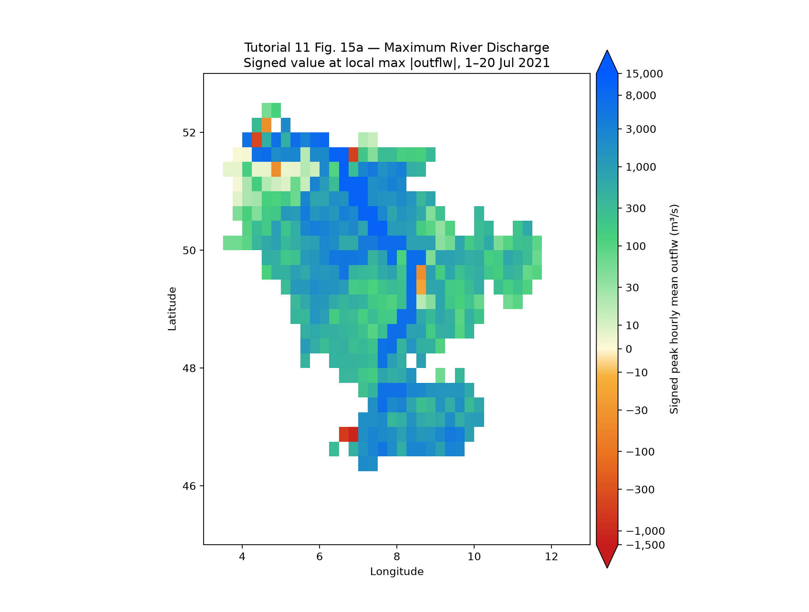

**Figure 15a. Signed local discharge extremes over the regional network during July.** Color encodes the signed discharge selected at each cell's own extreme hour; arrows identify flow direction, including negative values. The network provides a regional picture of discharge magnitude and routes connecting the study area to the Rhine system. It combines local extremes from different times, rather than showing one simultaneous flood state.

The 1,245 valid cell peaks range from approximately −1,095 to 11,593 m³/s, with 11 negative signed extremes. This is evidence that direction matters in reading the simulation. Negative values warrant examination in their local hydraulic and temporal context; the peak map alone does not attribute them to a particular mechanism.

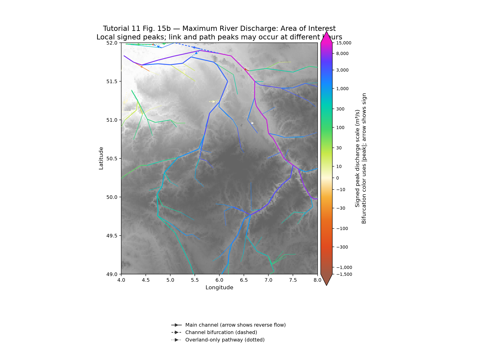

**Figure 15b. Local discharge extremes and bifurcation pathways in the satellite-analysis region.** The closer view exposes routing complexity over the auxiliary terrain background. Dashed channel bifurcations and dotted overland pathways distinguish additional connections from the primary network. Their extrema may occur at different hours from nearby main-channel extrema, so connected-looking colors should not be read as a simultaneous flow balance.

These maps establish where to examine the simulated event, but the hydrographs are needed to recover its temporal evolution. That distinction links the spatial visualization to the station and impact analyses in the next section. Definitions and recorded ranges are in [Step15](15_simulation_output_visualization.md) and its [summary metadata](../metadata/15_simulation_output_visualization.json).

## 6 Discharge and flood timing evaluation

### 6.1 River identity is part of the comparison

Station allocation used stored high-resolution `catmxy` assignments and routing evidence rather than geographic cell containment alone. Each high-resolution pixel identifies an assigned coarse river cell; that catchment can extend beyond the rectangle containing the station. Standard downstream connectivity then provides a separate check on network relationships. For the supplied gauges, the retained allocation follows the Maxau–Speyer–Lobith sequence and has map upstream areas of approximately 50,800, 52,100 and 159,300 km² respectively.

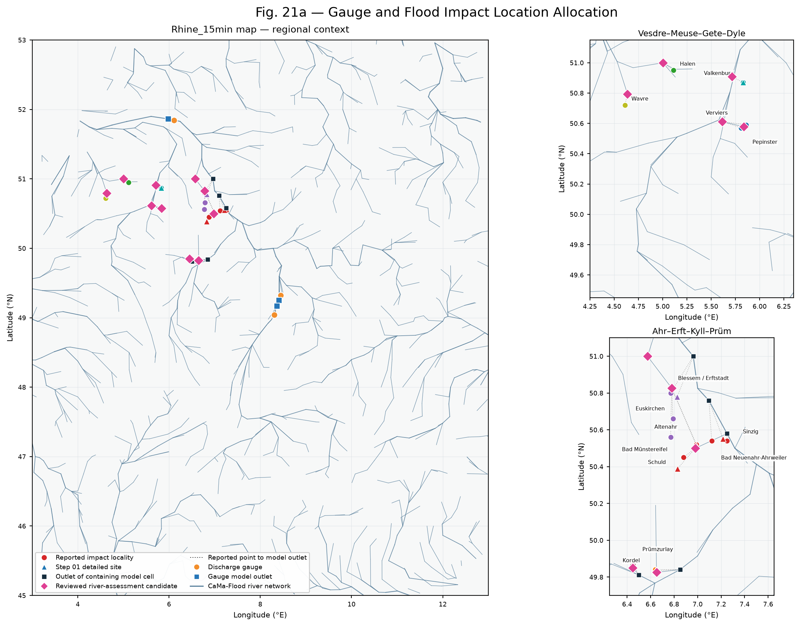

**Figure 21a. Final model outlets adopted for reported locations and gauges.** Connectors show the relationship between a reported point and its selected outlet. They are allocation guides rather than surveyed river courses. The map allows the observational geography to be compared with the actual routing representation used for subsequent extraction.

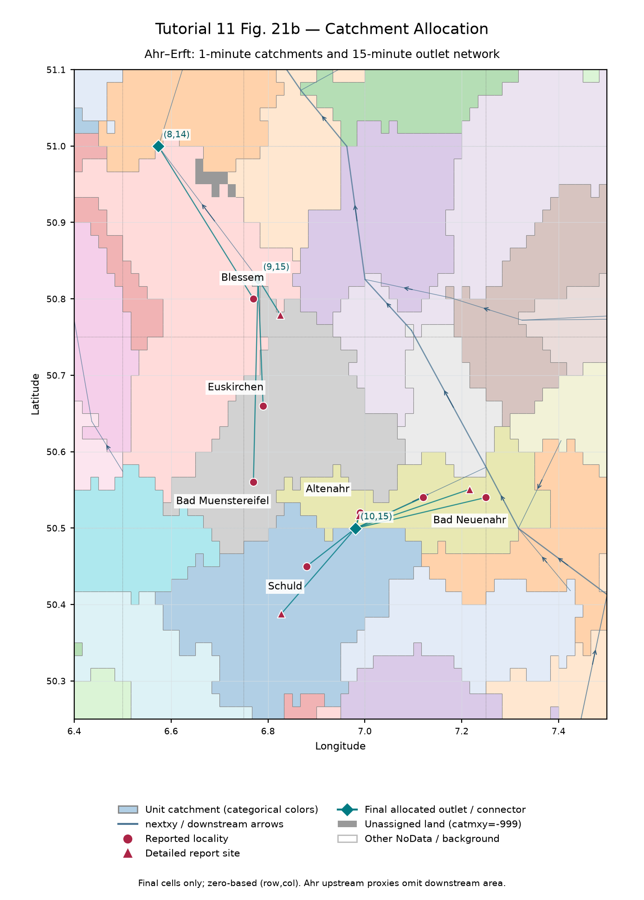

**Figure 21b. One-arcminute catchment assignments, downstream links and final evaluation outlets.** Irregular catchment geometry explains why a reported point can map to a cell whose computational rectangle lies elsewhere. Labels retain the source figure's zero-based row/column convention. The selected lower-Ahr outlets include reviewed upstream proxies, which preserve tributary context while leaving exact local reach support unresolved.

Of 22 report-linked records, 21 have direct assignments and 11 differ from their geographic containing cell. Final evaluation uses 16 direct assignments and five reviewed one-step upstream Ahr proxies; Eupen is unassigned. Several lower-Ahr points directly map to a receiving-channel cell with about 140,600 km² upstream area. The adopted upstream Ahr cell has approximately 680 km² and routes directly into that receiving cell. This is a consequential scale distinction: extracting the receiving river's hydrograph would answer a different hydrologic question.

The proxy represents an upstream tributary context, omits downstream contributing area and is not an exact allocation of every lower-Ahr reach. Repeated sites using it share one model hydrograph. The [Step21 report](21_gauge_allocation.md), [station allocations](../metadata/21_gauge_allocation.csv) and [impact allocations](../metadata/21_impact_location_allocation.csv) retain direct and adopted assignments separately.

### 6.2 Main-stem hydrographs

The comparison interval is 10 July to 1 August, end exclusive, containing 528 hourly model records and 88 six-hour observation labels per gauge. Hourly mean model outflow is shown with the original observations without resampling or shifting either series.

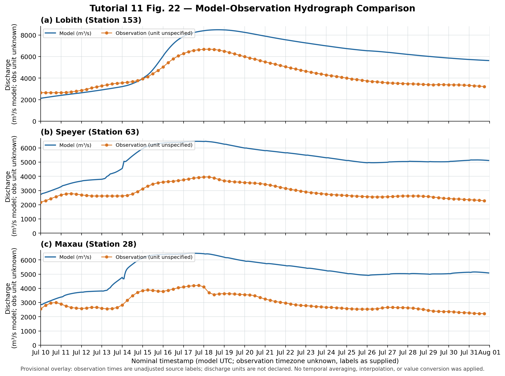

**Figure 22. Exploratory hydrograph overlays for Maxau, Speyer and Lobith.** Modeled flow is in m³/s and uses the model's UTC time convention. Observation values and clock labels remain as supplied. The series permit inspection of rise, crest and recession, but differences in numerical magnitude and plotted time cannot yet be assigned to model error because observation units and timezone are unresolved.

**Table 4. Main-stem maxima in the comparison interval.** Model and observation columns retain different units/time bases intentionally; these values are not paired error statistics.

| Station | Model maximum in m³/s | Model peak, UTC | Supplied maximum | Source peak label |
| --- | ---: | --- | ---: | --- |
| Maxau | 6,473.4 | 17 July 09:00 | 4,214.6 | 17 July 18:00 |
| Speyer | 6,465.5 | 18 July 02:00 | 3,957.5 | 18 July 06:00 |
| Lobith | 8,490.1 | 18 July 17:00 | 6,684.7 | 18 July 06:00 |

Both sets of records place the main response around 17–18 July, and the plotted model series show a longer recession. The modeled maxima progress from Maxau through Speyer to Lobith, consistent with their network order; a quantitative propagation or timing-error estimate would require harmonized temporal support and examination of the full waves. The numerically larger model maxima motivate a magnitude comparison after unit confirmation rather than establish a discharge bias now. See [Step22](22_hydrograph_comparison.md) and the [comparison summary](../metadata/22_hydrograph_comparison_summary.json).

### 6.3 Tributary peaks and reported flood timing

The impact analysis extracts 168 hourly records over 12–19 July, end exclusive, at ten unique model cells: 1,680 samples linked to the 22 report rows. The shared-cell organization is essential for interpreting apparent agreement across multiple locations.

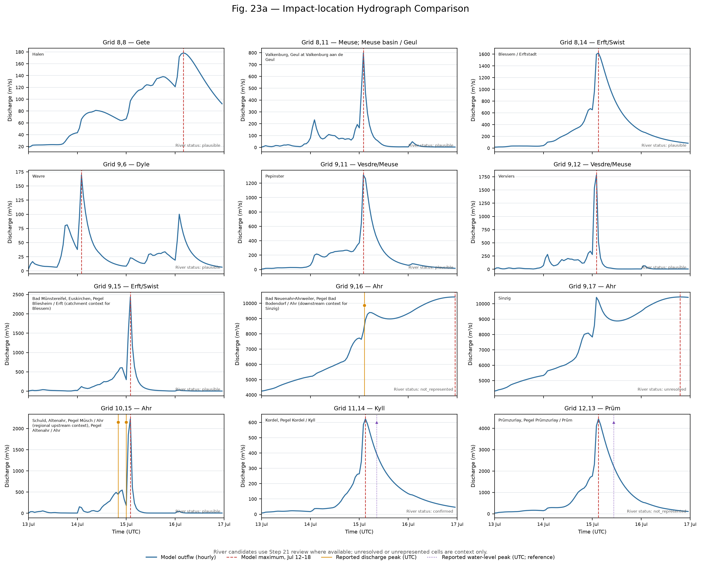

**Figure 23a. Hydrographs for final evaluation cells and available source peak times.** Red dashed lines identify model maxima, orange markers identify source discharge peaks and purple markers identify water-level peaks used only as context. The lower-Ahr panel identifies its shared upstream-proxy support. The figure shows sharp tributary responses near 15 July while retaining each comparison's river and observation basis.

The adopted Ahr cell peaks at approximately 2,227 m³/s on 15 July 02:00 UTC. Kordel/Kyll peaks at about 623 m³/s at 03:00, Prümzurlay at about 1,832 m³/s at 02:00 and Bliesheim/Erft at about 2,436 m³/s at 02:00. These are simulated local maxima within the search window. Together with the later main-stem maxima, they show that the experiment represents distinct temporal responses across the river system, rather than a single regional peak time.

**Figure 23b. Report-linked source and model timing evidence.** Filled model diamonds indicate that a plottable UTC source peak is available; they do not encode agreement. Hollow diamonds and compact codes retain unavailable timing, unknown timezone and proxy support. A rightward arrow preserves Halen's actual maximum at 16 July 04:00 UTC beyond the displayed axis. Differences across independent catchments should not be read as one downstream flood wave.

**Table 5. Provisional Ahr discharge-peak offsets using the same upstream model cell.** LfU's MESZ/CEST times are converted to UTC in the retained source ledger. Offsets are model minus source; spatial representativeness and reconstructed source peaks remain uncertain.

| Source gauge | Source peak, UTC | Model peak, UTC | Offset |
| --- | --- | --- | ---: |
| Müsch | 14 July 20:00 | 15 July 02:00 | +6 h |
| Altenahr | 15 July 00:00 | 15 July 02:00 | +2 h |
| Bad Bodendorf | 15 July 02:30 | 15 July 02:00 | −0.5 h |

The three offsets describe comparisons with one model series, not three independent validations. The −0.5 h offset also compares a source estimate with an hourly model sample and does not establish half-hour timing accuracy. Of the 22 records, three support provisional discharge-peak comparisons, two provide water-level references, two have unknown source timezones, 14 lack supported peak times and one lacks a model cell.

The [LfU report](https://lfu.rlp.de/fileadmin/lfu/Service/Publikationen/Bestellkatalog/Hochwasser_im_Juli2021_barrierefrei.pdf) provides explicit local-time labels for selected gauges. Other sources require caution: the Erftverband Bliesheim maximum lacks a confirmed timezone in the cited account, and Prümzurlay's water-level maximum differs between the retained LfU-derived ledger (10:30 UTC) and Mohr et al., Section 3.2.2 (05:30 UTC). That discrepancy remains unresolved; neither time is silently substituted. The Ahr gauges' event damage and reconstructed peaks further limit precision. Source identity, water-level versus discharge meaning and time convention therefore determine which timing comparisons are admissible. Details are in [Step23](23_impact_timing_comparison.md) and the [reported timing ledger](../metadata/01_reported_flood_timing.csv).

## 7 Inundation analysis

### 7.1 Linking the acquisition to a model state

The selected Sentinel-1A acquisition spans 15 July 05:49:37–05:51:42 UTC. Its envelope midpoint is approximately 05:50:40 UTC. The nearest existing model floodplain-depth output is 06:00 UTC, about 9 min 20 s later, selected without interpolation. This gives a close temporal correspondence for an instantaneous model depth field. The same selection would not automatically apply to hourly mean outflow or a multi-day satellite composite.

The 15 arcmin floodplain depth was downscaled to the 1 arcmin satellite-analysis grid using stored catchment assignments, terrain height differences and river connectivity, including tributary-aware behavior. This distributes an existing modeled state over finer terrain; it is distinct from running the hydrodynamic model at 1 arcmin. The [Step24 metadata](../metadata/24_downscaling_verification.json) retain acquisition and model times, method and output statistics.

### 7.2 Water-depth pattern and observation comparability

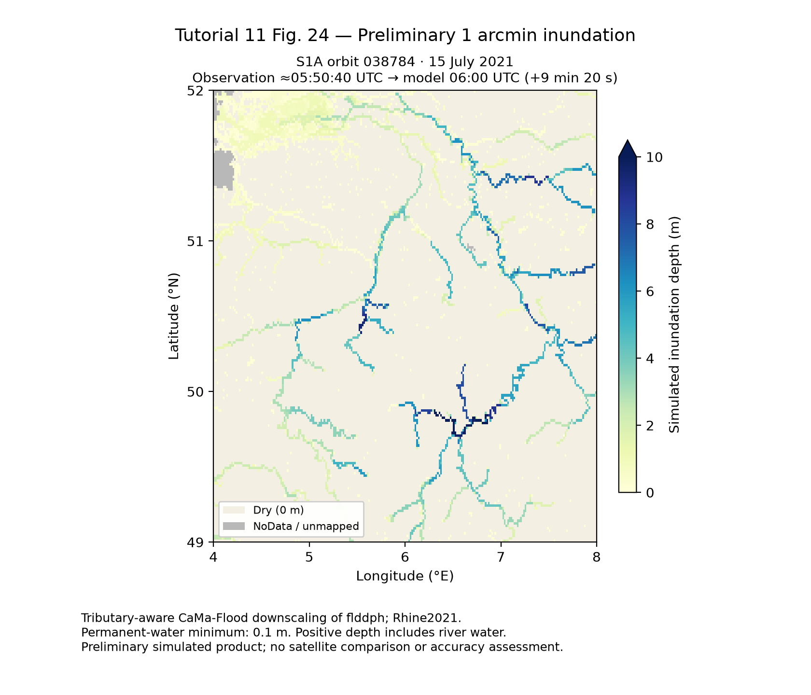

**Figure 24. One-arcminute simulated water depth at 06:00 UTC on 15 July.** Depth is concentrated along river networks, with limited visibly apparent lateral spreading at this resolution. Beige denotes dry cells and gray denotes unmapped cells; the color scale has an upper extension beyond 10 m. The image represents simulated depth at one time and should be interpreted alongside the GFM classification and its observation support, rather than as an agreement map.

The output has 42,960 valid cells and 240 unmapped cells. Of the valid cells, 37,429 are dry and 5,531 have positive depth; the maximum is approximately 10.9 m. Positive values include river water because a permanent-water option imposes a 0.1 m minimum at river-width pixels. Thus positive-depth counts cannot directly quantify event-specific overbank flooding.

**Table 6. Quantities that must be reconciled for satellite–model inundation evaluation.** A shared nominal grid or nearby timestamp does not remove these differences.

| Aspect | GFM product used here | Downscaled model field | Consequence for comparison |
| --- | --- | --- | --- |
| Physical quantity | Flood class and conditional Flood Fraction | Water depth in metres | Define a justified depth-to-event-flood criterion |
| Existing water | Permanent and seasonal classes separate from Flood | River water may have a 0.1 m floor | Separate river/reference water from event inundation |
| Valid support | Classes 0–4; exclusion/inconsistency/NoData omitted | Valid assigned cells, with separate unmapped mask | Compare on common observed and modeled support |
| Spatial detail | Native 20 m classes aggregated to 1 arcmin | Terrain distribution at 1 arcmin from 15 arcmin dynamics | Preserve area/support definitions within target cells |
| Time | One pass around 05:50 UTC | Point depth at 06:00 UTC | Assess a snapshot, not the maximum extent over the event |

The joint evidence supports three testable explanations for the limited visible lateral inundation: the experiment may produce insufficient floodplain water; 1 arcmin terrain may depict narrow flooded corridors poorly; or the apparent contrast may arise partly from the difference between water depth and observation-derived flood classes. Current evidence does not isolate these contributions. A useful diagnosis would examine depth, water level, storage and river-water masks together before attributing the pattern to a hydrodynamic error.

SAR detection also depends on land cover and radar conditions. Official [GFM recommendations](https://extwiki.eodc.eu/GFM/PUM/Recommendations) identify limitations in urban and densely vegetated areas and other low-sensitivity conditions. Those general mechanisms motivate mask-aware assessment; they do not identify a specific detection error in this case. The downscaling's five-coarse-cell internal buffer also extends beyond the regional map at the west and north edges, with an unquantified effect on boundary-adjacent behavior. [Step24](24_inundation_downscaling.md) integrates these scientific interpretation limits.

## 8 Integrated discussion

### 8.1 The event needs more than one evaluation target

The event review, observed hydrographs and simulated timing collectively distinguish rapid tributary flooding near 14–15 July from the Rhine main-stem crest on 17–18 July. This supports a layered event assessment: local tributary response, downstream main-stem evolution and spatial inundation at actual observation times. Success at one target would not establish success at the others. In particular, the three available discharge stations constrain main-stem behavior, while reported tributary peaks and satellite classifications provide different, less complete evidence near the damage locations.

The shared rainfall event can synchronize responses in separate tributaries without producing a single wave that travels through all plotted sites. This interpretation explains why chronological row order in a regional timing diagram is insufficient to diagnose propagation. Within connected reaches, routing topology and matching gauge definitions can support propagation analysis; across basins, a different question is being asked.

### 8.2 Representativeness is a scientific result of the workflow

The catchment-allocation analysis provides concrete evidence of a resolution constraint. Lower-Ahr localities can map to a receiving river of roughly 140,600 km² rather than the approximately 680 km² tributary proxy. This difference is much more consequential than a small marker displacement on a map. It changes the drainage system represented by the extracted series and therefore the scientific meaning of a model–observation comparison.

A higher-resolution routing experiment is a plausible way to distinguish tributaries and represent local floodplain geometry more explicitly. Its benefit remains a hypothesis to test with corresponding channel geometry, forcing mapping and initialization. Finer terrain-based downscaling addresses a separate issue: where water from a given model state is placed. It cannot supply missing flood volume or restore a tributary hydrograph that the underlying simulation did not resolve. Evaluating those two refinements separately would distinguish improvements in dynamics from improvements in spatial depiction.

### 8.3 Observation availability includes definitions and support

The satellite survey demonstrates that catalogue abundance is not equivalent to observation abundance. Six passes narrowed to one processed acquisition, and the footprint test rejected apparent coverage from one evening pass. Classification then introduced a further distinction between observed land and filtered or missing support. The conditional Flood Fraction is informative precisely because its denominator is explicit, but it must travel with support diagnostics if it is used for scoring.

Discharge observations present a complementary problem. The series are complete and consistently stored, yet their units, timezone and explicit aggregation bounds remain unconfirmed. These cases lead to the same methodological insight: data availability is established only when the quantity, location, time and valid support required by the intended comparison are specified. A common coordinate grid or visually aligned curves is an enabling step, not the end of that matching process.

### 8.4 What the current contrasts suggest and how to test them

The main-stem overlays show numerically higher modeled crests and a longer recession. Conditional on confirmed common units and averaging support, these patterns would motivate hypotheses involving runoff magnitude, storage and routing, or initial conditions. The present single cold-start experiment cannot attribute a discrepancy among those mechanisms. Confirmation of observation semantics and ERA5-Land accumulation treatment should precede controlled forcing, initialization or routing experiments.

For tributaries, the simulated peaks cluster around early 15 July, providing a physically relevant time window for examining the event. The Ahr offsets and Kyll/Prüm water-level references then identify where detailed timing review would be productive. Exact reach identity, reconstructed source peaks and the Prüm source discrepancy must be resolved at the level needed for that comparison. Introducing more decimal precision into the existing lags would not compensate for those uncertainties.

For inundation, the close acquisition/output timing removes one large potential mismatch, but leaves quantity and spatial support unresolved. An initial matched assessment should distinguish permanent river water from event flooding, retain excluded/unobserved areas, choose a depth criterion and evaluate sensitivity to that choice. Only then can an apparent shortfall in lateral spread be assigned a quantitative spatial meaning. Finer-terrain and finer-routing experiments could subsequently test the hypotheses identified above.

### 8.5 Achievements and remaining scientific decisions

**Table 7. Evidence established by the case study and the next scientific question it enables.** Proposed follow-up work is distinct from completed results.

| Theme | Established result | Next question |
| --- | --- | --- |
| Event context | Multiple tributary systems and later Rhine main-stem response identified | Which observations best constrain each river and flood phase? |
| Satellite observations | Six-pass inventory; one processed pass; explicit classes, support and focus areas | How much of each target reach was validly observed near its peak? |
| Discharge observations | Three complete six-hour 2021 series and consistent CSV/NetCDF values | What are the confirmed units, timezone and averaging intervals? |
| Regional experiment | 31-day, hourly, 15 arcmin run with regional runoff mapping | How sensitive are results to forcing attribution and initial state? |
| Spatial allocation | Direct assignments and five reviewed Ahr upstream proxies retained separately | Which tributary reaches need finer routing resolution? |
| Hydrographs and timing | Main-stem overlays and ten-cell tributary extraction completed | What timing/magnitude comparisons remain after support harmonization? |
| Inundation | Near-acquisition model state downscaled to 1 arcmin | How does event floodwater compare on common valid observation support? |

The evidence now forms a connected case study rather than isolated processing demonstrations. Event research determines the relevant rivers and times; availability analysis determines which observations can constrain them; model preparation creates a regional experiment; allocation determines what each extracted series represents; and the comparisons identify testable hydrological and observational questions. Formal quantitative evaluation remains the next scientific development, with clearer requirements because these connections have been made explicit.

## 9 Conclusions and future research

This case study establishes a regional flood-event evaluation prototype that connects literature-based event investigation, prepared discharge and satellite observations, a CaMa-Flood v5 experiment and exploratory comparison. The one-month simulation and retained observations enable inspection of both rapid tributary responses and the later Rhine main-stem crest, while the acquisition-time link supplies a concrete starting point for spatial inundation assessment.

Three conclusions emerge from the combined results. First, the July 2021 event requires river- and phase-specific evaluation: regional rainfall, destructive tributary flooding and main-stem discharge are related but distinct targets. Second, catchment assignment and river representation materially determine what a model series means, as shown by the lower-Ahr receiving-cell and upstream-proxy contrast. Third, observation support and variable definitions must remain part of the scientific result, from satellite exclusion masks to discharge interval semantics and the model's river-water depth floor.

The immediate research priorities are to confirm discharge units and time support, resolve forcing accumulation and period-boundary treatment, reconcile material source timing differences, and define satellite–model floodwater correspondence on common valid support. Subsequent sensitivity experiments can examine initialization, forcing, routing resolution and terrain detail separately. These steps would convert the existing exploratory comparisons into a defensible quantitative benchmark while retaining the broader workflow as a reference for other flood events.

## References and supporting evidence

The linked individual Survey Reports document the scientific results; metadata links identify quantitative source records. Individual technical Work Reports are available for [regional experiment execution](../AI_work_report/14_simulation_setup.md), [allocation](../AI_work_report/21_gauge_allocation.md), [timing extraction](../AI_work_report/23_impact_timing_comparison.md) and [downscaling](../AI_work_report/24_inundation_downscaling.md). The [Step31 Work Report](../AI_work_report/31_scientific_results_synthesis.md) records synthesis and document checks.

- Mohr, S., et al. (2023). A multi-disciplinary analysis of the exceptional flood event of July 2021 in central Europe – Part 1: Event description and analysis. Natural Hazards and Earth System Sciences, 23, 525–551. [Publisher and article](https://nhess.copernicus.org/articles/23/525/2023/), doi:10.5194/nhess-23-525-2023. Event context and an explicitly unresolved Prüm timing comparison.
- Landesamt für Umwelt Rheinland-Pfalz. Hochwasser im Juli 2021. [Official report](https://lfu.rlp.de/fileadmin/lfu/Service/Publikationen/Bestellkatalog/Hochwasser_im_Juli2021_barrierefrei.pdf). Gauge-level timing and explicit MESZ/CEST convention, including Table 5.
- Erftverband (2021). Hochwasser an der Erft und ihren Nebengewässern, 14. bis 16.07.2021: Erste Auswertung des Niederschlag-Abfluss-Geschehens. Revision 2, 20 August 2021. [Report](https://www.erftverband.de/wp-content/uploads/2021/08/20210820_ev_auswertung_hw_20210714.pdf). Erft event and Bliesheim timing context; source timezone remains unconfirmed.
- Copernicus Emergency Management Service. [Account of the July 2021 floods in Germany, the Netherlands, Belgium and Switzerland](https://mapping.emergency.copernicus.eu/news/the-copernicus-emergency-management-service-forecasts-notifies-and-monitors-devastating-floods-in-germany-netherlands-belgium-and-switzerland/). Regional event and observation-service context.
- EODC, Global Flood Monitoring Product User Manual. [Products](https://extwiki.eodc.eu/GFM/PUM/Products) and [Recommendations](https://extwiki.eodc.eu/GFM/PUM/Recommendations). Product interpretation and general SAR limitations; not a version-specific validation of the retained acquisition.
- CF Conventions, version 1.11. [Time-coordinate conventions](https://cfconventions.org/Data/cf-conventions/cf-conventions-1.11/cf-conventions.html). Model time interpretation, including the default timezone offset when omitted.

The supplied discharge series have researcher-confirmed permission for tutorial sharing, while a formal open-data licence identifier and original observing-agency attribution remain unspecified. Satellite and third-party geographical figures retain their source-specific attribution and use conditions. External distribution should retain those credits and confirm the applicable conditions for the materials being supplied.
