# Human–AI Collaborative Flood Event Evaluation: A Case Study of the July 2021 Rhine Basin Flood

### Executive Summary

This case study presents the research outputs achieved through collaboration between human researchers and AI agents in developing a flood event evaluation prototype based on CaMa-Flood v5. The July 2021 Rhine basin flood and flooding in neighbouring river systems provided the application case. **Sixteen workflow steps** connected event research, observation preparation, a regional model experiment, exploratory comparisons and scientific interpretation.

- **A defined evaluation context:** 14 reported impact localities and eight additional timing records were organised into a 22-record inventory. The analysis distinguished rapid tributary flooding in the Ahr, Erft and other systems from the Rhine main-stem response.
- **Prepared satellite observations:** 45 GFM STAC Items for 14–16 July were resolved into six acquisition passes and 27 original product slices. Four layers were acquired for one morning pass on 15 July, yielding 37 unique COGs, approximately 50 MiB in total. Native 20 m classification, 1 arcmin flood fractions and 15 detailed focus areas were prepared. The focus areas retained 87.5% of the Flood pixels in the population used for selection.
- **Prepared main-stem discharge records:** six-hourly series for Lobith, Speyer and Maxau contained 1,460 records per station. CSV and NetCDF values agreed for all 4,380 station–time pairs after conversion to float32. July hydrographs captured series maxima on 17–18 July.
- **A completed event experiment:** a 15 arcmin regional model with 40 columns × 32 rows was run for 31 days and 744 hourly steps using ERA5-Land runoff. A regional Input Matrix linked 1,245 river-network cells to 16,963 positive contributing-area pairs. Eight variables were saved at hourly intervals for subsequent analysis.
- **Discharge, timing and inundation comparisons:** main-stem hydrographs were overlaid at three stations. Tributary analysis organised 1,680 hourly samples from ten model cells alongside all 22 reports, including three provisional Ahr discharge-peak timing comparisons. A model output approximately 9 min 20 s after the midpoint of the selected satellite acquisition was used to produce a 1 arcmin inundation-depth map.

The study established concrete reasons to evaluate tributary floods and main-stem high flow separately, to distinguish satellite product tiles from actual observation footprints, and to consider the spatial aggregation of model channels when comparing individual locations. It also identified the definitions and valid-observation masks needed to compare satellite flood classes with modelled water depth. Section 6 synthesises these findings and develops explicit hypotheses concerning river response, resolution and inundation patterns, together with the additional analyses needed to test them. Formal quantitative performance assessment is a subsequent stage requiring consistent observation units, time conventions, river matching and spatial observation support.

### 1. Introduction

#### 1.1 Purpose and scope of the case study

The **Flood Event Evaluation Tutorial** uses CaMa-Flood v5 to connect the research activities needed for event-based flood evaluation. This report presents the outcomes of its application to the July 2021 Rhine basin flood and surrounding affected river systems. Human researchers defined the research objectives and key scientific choices; collaboration with AI agents supported event investigation, observation preparation, regional modelling, comparative analysis, visualisation and interpretation.

The report accompanies the ECMWF **Event-based Benchmark Prototype Development Report** as a case-study reference. It documents the research outputs that were achieved, how they connect, and what they reveal about the requirements for evaluating a complex flood event. The emphasis is on the complete sequence of results, with figures and tables supporting each stage, rather than on a single performance score.

The [human–AI collaborative research synthesis](https://github.com/global-hydrodynamics/cmf_v5_beta/blob/d424a4ad2d69745acb7d72e1465c401a52e64d18/tutorial/tutorial11-event_evaluation/AI_survey_report/00_human_ai_collaborative_research.md) discusses the collaboration in more detail. Here, individual sections follow the structure of a scientific and technical investigation: objectives, methods, outputs, interpretation and the resulting requirements for subsequent work.

#### 1.2 Research sequence and supporting evidence

The study first established the affected rivers, locations and timing information, then designed the model and observation domains (Steps 01–02). Satellite availability was investigated, the selected GFM acquisition was classified and aggregated, and main-stem discharge observations were prepared (Steps 03a–04). Regional map data, ERA5-Land runoff and a matching Input Matrix supported a month-long model experiment and spatial output analysis (Steps 11–15). The experiment was then connected to station and impact-location allocation, hydrograph comparison, peak timing and satellite-time inundation downscaling (Steps 21–24).

The [overall process](../00_event_evaluation_process.md) describes these dependencies. The [general evaluation workflow](https://github.com/global-hydrodynamics/cmf_v5_beta/blob/d424a4ad2d69745acb7d72e1465c401a52e64d18/tutorial/tutorial11-event_evaluation/AI_survey_report/00_flood_event_evaluation_workflow.md) distinguishes reusable procedures from event-specific choices. Each step below links to its scientific Survey Report, technical Work Report and relevant metadata, providing a traceable route from the synthesis to detailed evidence.

Result values, coordinates and file sizes are rounded to a useful reporting precision. Integer record counts, grid dimensions and reproducible settings are retained. Detailed reports and metadata contain the underlying precision. Public event sources are cited directly in the relevant discussion and listed in References.

### 2. Event investigation and analysis design

#### 2.1 Step 01: Establishing the flood-event context

The initial objective was to identify the flood phenomena and river systems that the evaluation should address. The review assembled affected locations, river identities, candidate observations and timing evidence from academic literature, official flood reports and local records. The event context was intense rainfall over the Eifel and Ardennes during 13–15 July 2021, as described by [Mohr et al. (2023)](#r1-mohr-et-al-2023) and the [Copernicus EMS event account](#r9-copernicus-ems-event-account).

The investigation distinguished destructive Ahr and Erft floods, the Kyll and Prüm within the Moselle system, and flooding in the separate Meuse basin. These tributary floods were considered alongside, but separately from, elevated Rhine main-stem discharge. Fourteen impact localities were mapped, and eight additional gauge or system timing records brought the inventory to 22 records. Approximate town locations, gauge positions, impact dates, water-level maxima and discharge peaks were retained as different types of information.

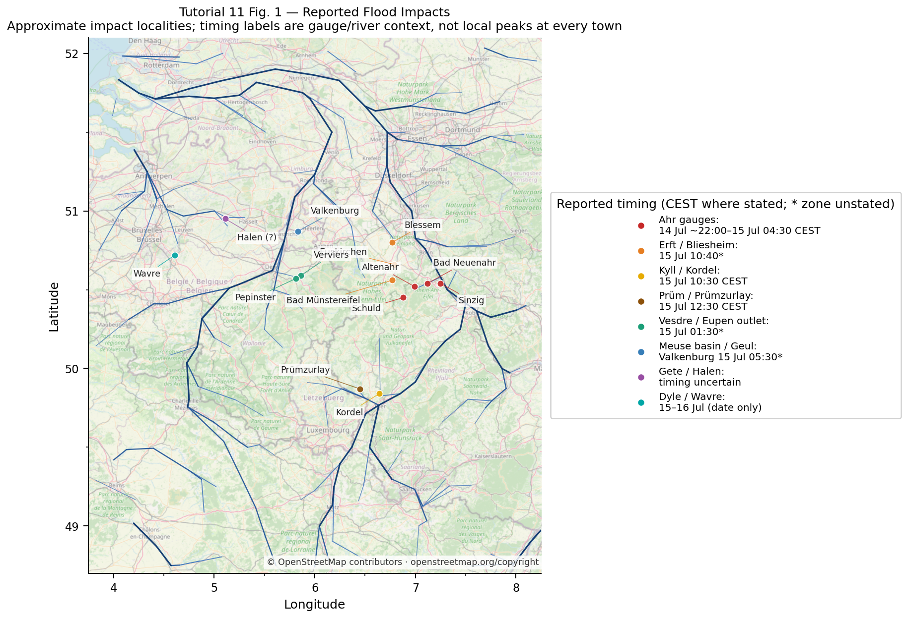

*Figure 1. Fourteen documented impact localities in their river context. The legend provides timing information for specific rivers, gauges or reservoir outlets, rather than town-wide flood-onset times. OSM and the river network provide geographic orientation. The locality and timing evidence is drawn from the GEER report, LfU, Erftverband, the Limburg evaluation, the Vesdre thesis, the Demer assessment and the Wavre municipal account ([R2–R8](#references)), with the source for each record retained in the linked inventories.*

The map showed that the reported impacts were distributed among several tributary systems, requiring more than the available Rhine main-stem discharge series for local evaluation. The locality and river-system inventory informed domain design, while the timing ledger supported Step 23.

**Table 1. River-specific timing evidence. Original source times are retained, with the basis for UTC conversion stated explicitly.**

| River system and source | Source-supported timing or event information | Use and interpretation |
| --- | --- | --- |
| Ahr — [LfU, Table 5](#r2-lfu-flood-report) | Müsch: approximately 14 July 22:00; Altenahr: approximately 15 July 02:00; Bad Bodendorf: 15 July 04:30 CEST | The MESZ/CEST label supports UTC conversion. These are reconstructed station peaks, distinct from local impact onset, and their discharge estimates are uncertain. |
| Erft/Swist — [Erftverband, p. 12](#r4-erftverband-2021) | Bliesheim exceeded HQextrem around 06:30 and reached maximum water level at 10:40 on 15 July | The source timezone is unconfirmed, so no UTC conversion is applied. The report describes flood-wave attenuation around the Blessem gravel pit; the gauge times are not transferred to other locations. |
| Kyll — [LfU, Table 5](#r2-lfu-flood-report) | Kordel maximum: 15 July 10:30 CEST | Station-specific water-level/discharge information; equivalent to 08:30 UTC. |
| Prüm — [LfU, Table 5](#r2-lfu-flood-report) | Prümzurlay maximum: 15 July 12:30 CEST | Retained as a 10:30 UTC water-level reference. A discrepancy with another source is discussed in Section 5.3. |
| Vesdre — [Thewissen, Appendix E.3](#r6-thewissen-2022) | Reconstructed Eupen reservoir-outlet peak: 15 July 01:30; timezone unspecified | Reservoir-release and downstream-wave context, rather than a measured peak at Verviers or Pepinster. |
| Meuse basin/Geul — [Limburg crisis evaluation](#r5-limburg-crisis-evaluation) | Geul peak at Valkenburg: 15 July 05:30; timezone unspecified; reported discharge 100 m³/s | A Geul tributary record rather than a Meuse main-stem observation. The original clock label is retained without an inferred UTC conversion. |
| Gete — [Demer basin assessment](#r7-demer-basin-assessment) | Halen centre flooded under the influence of the Gete and Velpe; exact onset and peak unknown | A controlled Gete dike opening on 16 July was a response action, distinct from flood onset or peak. |
| Dyle — [Wavre municipal account](#r8-wavre-municipal-account) | Impacts on 15–16 July, at daily resolution | No supported clock time or local peak was established. |

Separating these evidence types identified which records could support UTC peak comparisons and which provided qualitative event context. Reconstructed Ahr peaks were particularly important because gauges were damaged or observations were lost during the event. The LfU report supplies the original peak estimates and their uncertainty; Mohr et al. provide the broader hydrological interpretation.

Details: [Step 01 Survey Report](01_flood_event_overview.md) / [Work Report](../AI_work_report/01_event_research.md). Record-level provenance is retained in the [impact-location inventory](../metadata/01_impact_locations.csv) and [timing ledger](../metadata/01_reported_flood_timing.csv).

#### 2.2 Step 02: Designing the domains and analysis periods

Domain design considered upstream contributing areas and downstream connectivity rather than simply enclosing the reported damage locations. The affected localities and available gauges were examined against basin IDs, upstream area and the global 15 arcmin river network. Model computation, satellite analysis and detailed geographic views were assigned different spatial extents.

Many locations corresponded to model Basin ID 74, whereas Halen and Wavre corresponded to ID 1299. These groups contained 391 and 19 cells, respectively. ID 74 groups Rhine and Meuse/Vesdre routing within this model representation; it is not interchangeable with a natural watershed boundary. Establishing that distinction prevented the basin identifier from being interpreted as a direct river-name classification.

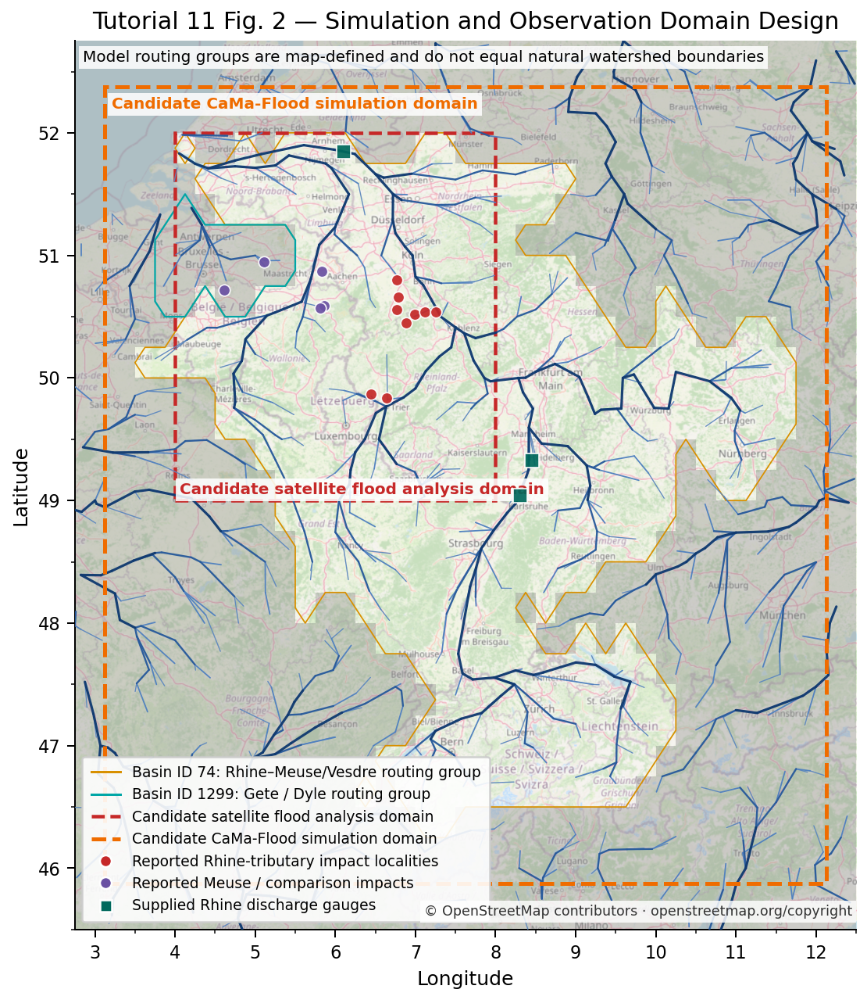

*Figure 2. River networks, impact localities, available main-stem gauges and candidate analysis domains. The larger model domain and smaller satellite domain serve different purposes. Their outlines describe analysis extents rather than observed flood boundaries or valid observation coverage.*

**Table 2. Spatial domains and periods. The model domain is defined by outer grid-cell edges and was adopted for the regional experiment.**

| Purpose | Spatial extent | Period and role |
| --- | --- | --- |
| Regional model | 3–13°E, 45–53°N | The initial event-analysis window was 10–25 July. The simulation was extended to 1 July 00:00–1 August 00:00, end-exclusive, to provide broader event context. |
| Satellite analysis | 4–8°E, 49–52°N | Availability was investigated for 14–16 July; one morning pass on 15 July was processed. |
| Detailed tributary and impact-area investigation | Ahr–Erft–Swist/Kyll–Prüm: 6.0–7.8°E, 49.4–51.1°N. Meuse–Vesdre–Gete–Dyle: 4.2–6.3°E, 49.5–51.4°N | Literature-informed candidate areas, distinct from the 15 areas later selected using satellite Flood pixels in Step 03c. |

Expressing the model extent as integer-degree outer edges avoided confusing cell centres with domain boundaries. It provided a consistent basis for the 40 × 32 regional map, runoff coverage and Input Matrix. The satellite domain was subsequently assessed through actual acquisition footprints and pixel-quality information.

Details: [Step 02 Survey Report](02_analysis_domain_design.md) / [Work Report](../AI_work_report/02_domain_design.md) / [domain-selection metadata](../metadata/02_domain_selection.json).

### 3. Observation investigation, acquisition and processing

#### 3.1 Step 03a: Investigating satellite availability

The objective was to identify satellite acquisitions around the principal flood dates. GFM STAC results for 14–16 July were linked to original Sentinel-1 products and orbit information. The 45 STAC Items represented six acquisition passes and 27 original product slices. This grouping distinguished product subdivisions from separate observation opportunities.

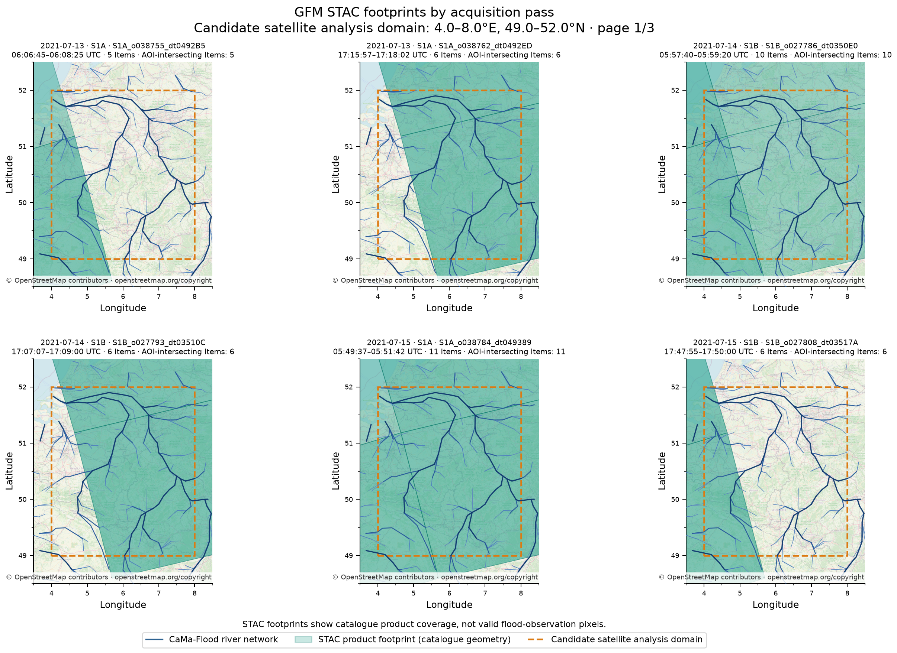

*Figure 3a. Availability maps for the six passes during 14–16 July. Orange dashed lines delimit the satellite analysis domain; filled areas are original acquisition footprints. Pixel validity within those footprints requires the subsequent quality and classification checks.*

**Table 3. All six passes identified in the availability review. Times are UTC acquisition intervals in July 2021.**

| Pass ID | Acquisition interval, July 2021, UTC | Satellite/direction | STAC Items | Original products | Original footprints intersecting the analysis domain |
| --- | --- | --- | ---: | ---: | ---: |
| S1B_o027786_dt0350E0 | 14 July 05:57:40–05:59:20 | S1B/descending | 10 | 4 | 3 |
| S1B_o027793_dt03510C | 14 July 17:07:07–17:09:00 | S1B/ascending | 6 | 5 | 1 |
| S1A_o038784_dt049389 | 15 July 05:49:37–05:51:42 | S1A/descending | 11 | 5 | 3 |
| S1B_o027808_dt03517A | 15 July 17:47:55–17:50:00 | S1B/ascending | 6 | 5 | 0 |
| S1B_o027815_dt0351B0 | 16 July 05:40:37–05:42:42 | S1B/descending | 7 | 5 | 3 |
| S1A_o038806_dt049431 | 16 July 17:40:41–17:41:56 | S1A/ascending | 5 | 3 | 2 |

A concrete finding was that the evening S1B pass on 15 July had six GFM Items overlapping the domain, while none of its five original acquisition footprints intersected it. Equi7 product-tile boundaries alone can therefore overstate actual acquisition coverage.

The morning S1A descending pass on 15 July was selected as the processing example because an existing sample could be reused. Its explicit pass identity, original products and footprint intersections defined the acquisition inputs and later supported time matching in Step 24. This was a practical selection, rather than a ranking of which pass best captured maximum event inundation.

Details: [Step 03a Survey Report](03a_satellite_availability.md) / [Work Report](../AI_work_report/03a_satellite_availability.md) / [pass inventory](../metadata/03a_satellite_pass_inventory.csv).

#### 3.2 Step 03b: Acquiring GFM data

Four layers were acquired for the selected S1A pass to retain flood detection, observed water, reference water and exclusion information. The acquisition manifest linked 44 Item–layer references across 11 Items to 37 unique COG files, approximately 50 MiB in total. Post-acquisition file checks succeeded for all 37 files, with no missing or failed files.

**Table 4. Acquired layers and their roles in subsequent processing. Original pixel data were retained.**

| Layer | Role |
| --- | --- |
| ensemble_flood_extent | Provides the Flood classification for the acquisition. |
| ensemble_water_extent | Provides the corresponding Water classification and supports consistency checking against Flood. |
| reference_water_mask | Distinguishes permanent, seasonal and other water categories using reference information. |
| exclusion_mask | Retains excluded areas separately from observed land and missing observations. |

The manifest preserved the Item–layer relationships and avoided storing the same URL-referenced asset more than once. It defined a traceable input set for Step 03c: which layers belonged to which acquisition and which files supplied the classification. Figure 3a provides the geographic acquisition context.

The resulting data set connected acquisition selection to classification and valid-observation assessment.

Details: [Step 03b Survey Report](03b_gfm_download.md) / [Work Report](../AI_work_report/03b_gfm_download.md).

#### 3.3 Step 03c: Classifying satellite observations and calculating flood fraction

The four acquired layers were combined into a single-band classification on the original 20 m grid. A 1 arcmin flood-fraction product supported regional screening. Flood, water, land, exclusion, inconsistent classifications and missing observations were retained separately; a reference-water designation alone did not establish current flooding.

**Table 5. Native 20 m classification codes and recorded pixel counts. These counts refer to the complete source raster, a different population from the 1 arcmin reconstruction used for focus-area selection.**

| Code | Class | Recorded pixel count |
| --- | --- | ---: |
| 0 | Land: observed land | 91,484,129 |
| 1 | Flood | 182,974 |
| 2 | Permanent water | 3,372,171 |
| 3 | Seasonal water | 111,433 |
| 4 | Other water | 0 |
| 5 | Exclusion | 157,602,754 |
| 6 | Inconsistent or partial classification | 62,162 |
| 255 | NoData: no valid observation information | 100,014,182 |

The 1 arcmin product was defined using the valid classified population:

**Flood fraction [%] = 100 × number of Code 1 pixels / number of Codes 0–4 pixels.**

Codes 5, 6 and 255 were excluded from the denominator. A cell with no valid classified pixels was assigned NoData. The WGS84 output contained 240 columns × 180 rows; 35,225 cells had valid classification support, with flood fractions ranging from 0 to 75.9%. The value is the flooded proportion of valid classified pixels, rather than an unconditional fraction of the full geographic cell area.

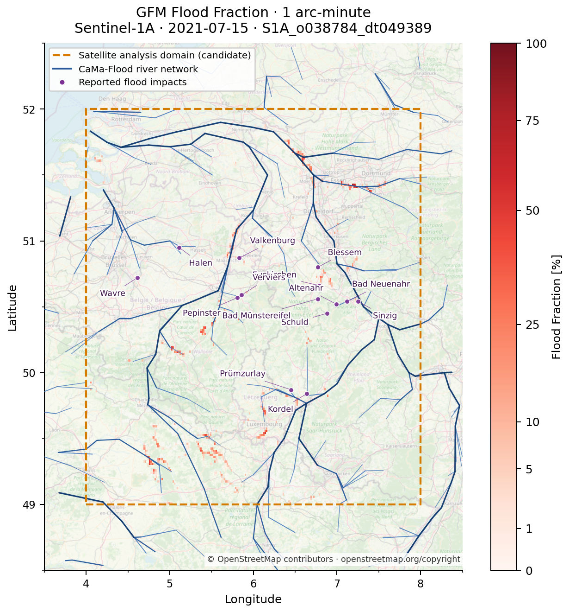

*Figure 3c. Red shading represents flood fraction conditional on valid classification support. Purple points are literature-derived impact localities; green boxes identify 15 focus areas. Dashed lines mark the satellite analysis domain. The map places reported impacts and satellite detections in a common geographic view and guides detailed inspection.*

The regional overview supported identification of Flood-class patterns and observation support. Fifteen focus areas were selected using Flood-pixel counts and valid support, rather than proximity to reported impact locations.

Their geographic union covered approximately 9,200 km², or 9.8% of the approximately 94,000 km² candidate AOI. They retained 140,228 of 160,301 Flood pixels in the 1 arcmin reconstruction used for selection, equivalent to 87.5%, and omitted 20,073, or 12.5%. The source-raster total of 182,974 Flood pixels describes a different population. After snapping extraction windows outwards to the projected grid, the union contained 34,950,179 unique pixels, a recorded 90.1% reduction from the original 352,829,805-pixel extent.

This procedure connected regional screening to a manageable set of detailed views while retaining observation-support information. The 87.5% retention rate describes that selection population, rather than model performance or complete event observation coverage.

Details: [Step 03c Survey Report](03c_gfm_classification.md) / [Work Report](../AI_work_report/03c_gfm_classification.md) / [focus-area settings and diagnostics](../metadata/03c_focus_areas.json).

#### 3.4 Step 03d: Extracting detailed analysis areas

The 15 focus areas were extracted as separate GeoTIFFs aligned with the original Equi7 20 m grid. Geographic boxes were projected, their boundaries snapped outwards to source-pixel edges, and integer pixel windows extracted. Classification codes and native grid alignment were preserved without resampling.

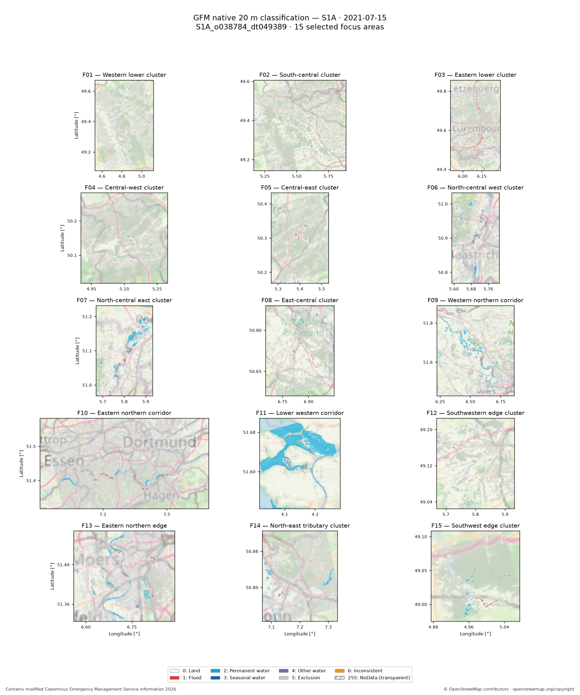

*Figure 3d. Extracted images F01–F15 share one classification legend. Red denotes Flood; cyan, blue and purple distinguish water categories; grey indicates exclusion; NoData is transparent. OSM provides geographic context, without an overlaid CaMa-Flood river network. Reprojection for display is separate from preserving the native 20 m extraction grid.*

**Table 6. All 15 extracted areas. Dimensions, class counts and file sizes refer to individual files, rather than a union with inter-area overlap removed.**

| Focus area | Dimensions, columns × rows | Flood pixels | Permanent-water pixels | Seasonal-water pixels | File size, bytes |
| --- | ---: | ---: | ---: | ---: | ---: |
| F01 — Western lower cluster | 2225 × 2865 | 25,260 | 8,975 | 39 | 281,926 |
| F02 — South-central cluster | 2419 × 2403 | 21,538 | 15,378 | 245 | 249,348 |
| F03 — Eastern lower cluster | 1523 × 2167 | 14,028 | 2,037 | 79 | 160,188 |
| F04 — Central-west cluster | 1322 × 1362 | 4,464 | 767 | 123 | 63,900 |
| F05 — Central-east cluster | 971 × 1266 | 6,009 | 207 | 0 | 53,814 |
| F06 — North-central west cluster | 847 × 1233 | 5,783 | 20,152 | 1,838 | 95,520 |
| F07 — North-central east cluster | 956 × 1261 | 5,948 | 42,229 | 2,088 | 117,814 |
| F08 — East-central cluster | 1356 × 1611 | 8,912 | 15,227 | 971 | 146,048 |
| F09 — Western northern corridor | 2091 × 2305 | 28,916 | 150,823 | 1,666 | 397,808 |
| F10 — Eastern northern corridor | 2286 × 1570 | 11,758 | 20,950 | 320 | 249,868 |
| F11 — Lower western corridor | 869 × 910 | 2,860 | 175,214 | 3,410 | 43,310 |
| F12 — Southwestern edge cluster | 912 × 997 | 3,794 | 1,705 | 29 | 49,978 |
| F13 — Eastern northern edge | 1021 × 933 | 3,994 | 21,048 | 4,847 | 117,388 |
| F14 — North-east tributary cluster | 878 × 981 | 1,898 | 11,786 | 623 | 69,358 |
| F15 — Southwest edge cluster | 650 × 595 | 1,616 | 4,483 | 29 | 17,356 |

The extracted files totalled approximately 2 MiB, about 91.0% smaller than the approximately 22 MiB source classification COG. Detailed reports retain the precise estimated and measured totals; Table 6 preserves individual byte counts as a file inventory.

Figure 3d reveals arrangements of water classes and excluded areas that are difficult to distinguish in the regional flood-fraction view alone. F09 and F11, for example, contain many permanent-water pixels, reinforcing the importance of distinguishing Flood from ordinary water. Because projected extraction windows can overlap, their class counts should not be summed as a unique event-wide inundated area. The [extraction manifest](../metadata/03d_extracted_areas.json) provides area-specific bounds and counts for further use.

Details: [Step 03d Survey Report](03d_focus_area_extraction.md) / [Work Report](../AI_work_report/03d_focus_area_extraction.md).

#### 3.5 Step 04: Preparing river discharge observations

CSV, NetCDF and station metadata supplied by Cinzia Mazzetti at ECMWF were matched by station ID. The prepared data set comprises three Rhine main-stem stations: Lobith, Speyer and Maxau.

**Table 7. Prepared main-stem stations. Supplied station coordinates are shown to four decimal places and are distinct from model cell centres and channel outlets.**

| ID | Station | Country | Longitude, °E | Latitude, °N |
| --- | --- | --- | ---: | ---: |
| 153 | Lobith | Netherlands | 6.1083 | 51.8444 |
| 63 | Speyer | Germany | 8.4488 | 49.3238 |
| 28 | Maxau | Germany | 8.3056 | 49.0390 |

Each station contained 1,460 six-hourly records from 1 January 2021 06:00 to 1 January 2022 00:00, without missing values or duplicate timestamps. CSV values converted to float32 matched NetCDF values for all 4,380 station–time pairs. The provider describes the values as means over the preceding six hours, labelled by the end of the averaging interval.

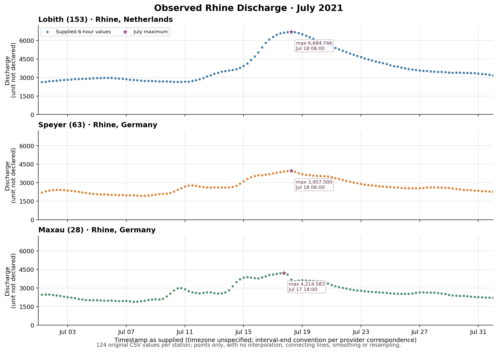

*Figure 4. July hydrographs for the three stations, showing original values as points without connecting lines. Each series contains 124 timestamps; separate symbols mark the July maximum. Axis annotations explicitly retain the unspecified discharge units and source timezone.*

**Table 8. July maxima of the supplied series. The selection contains 124 interval-end labels after 1 July 00:00 and up to and including 1 August 00:00.**

| Station | July maximum, units unspecified | Supplied timestamp label |
| --- | ---: | --- |
| Lobith (153) | 6,685 | 2021-07-18 06:00 |
| Speyer (63) | 3,958 | 2021-07-18 06:00 |
| Maxau (28) | 4,215 | 2021-07-17 18:00 |

The outcome was a consistent package of main-stem time series, station metadata, period statistics and CSV/NetCDF correspondence. These maxima belong to six-hour mean series, rather than necessarily representing instantaneous peak discharge. Units, source timezone, original observing agency and quality-control history remain to be confirmed; averaging-interval bounds are not encoded in the files. These definitions accompany the data into spatial allocation and exploratory comparison.

Details: [Step 04 Survey Report](04_discharge_observations.md) / [Work Report](../AI_work_report/04_discharge_observations.md) / [observation inventory](../metadata/04_discharge_inventory.csv) / [data definitions](../metadata/04_discharge_dataset.json). Permission to share the supplied files in the tutorial has been confirmed; no specific open-data licence has been established.

### 4. River-model preparation and simulation

#### 4.1 Step 11: Preparing regional river and terrain data

An event experiment requires connected upstream and downstream river information, channel parameters and floodplain terrain. The existing Rhine_15min regional map was inspected and reused for the 3–13°E, 45–53°N domain. It derives from glb_15min and comprises 40 columns × 32 rows at 15 arcmin, or 0.25°, resolution.

The map provided standard nextxy connectivity, basin and upstream-area fields, terrain and floodplain data, channel width and height, and bifurcation pathways. Auxiliary 1 arcmin data covered the same outer extent with 600 columns × 480 rows. The source map contains ten floodplain levels, while the bifurcation data describe 20 pathways and five layers. Binary, NetCDF and COG products were available alongside the established regionalisation, parameter and format-conversion procedures.

Reusing this foundation allowed the experiment to proceed without duplicating base-map preparation. It also clarified that the 1° climatological mapping used for channel parameters serves a different purpose from the event's ERA5-Land mapping. Step 13 addressed the specific matrix required for regional event runoff.

Details: [Step 11 Survey Report](11_regional_map_preparation.md) / [Work Report](../AI_work_report/11_regional_map_preparation.md).

#### 4.2 Step 12: Preparing ERA5-Land runoff input

Regional ERA5-Land data prepared by the researcher were organised into a common input definition. The preparation reviewed 31 original files and 31 converted daily files covering 1–31 July, together with their spatial, temporal and file-naming conventions.

The 0.1° input grid has 111 longitude points and 91 latitude points. Cell centres extend from 2.5 to 13.5°E and from 53.5 to 44.5°N, approximately 0.5° beyond the model domain on each side. Outer edges are 2.45–13.55°E and 44.45–53.55°N. Requested coverage, cell centres and cell edges are explicitly distinguished.

The converted runoff variable has 24 timestamps per daily file, dimensions (time, lat, lon) = (24, 91, 111), float32 storage and units of mm per one-hour input step. The 31 files contain 744 continuous hourly labels; storing the data in daily files does not imply daily averaging. Original ERA5-Land ro is in metres. The [event data registry](../runoff_dataset.csv) records these definitions and the model conversion factor.

This preparation supplied consistent forcing paths, coverage, units, missing-value conventions and naming across the simulation period. Handling of ERA5-Land accumulated runoff, particularly the 00 UTC value, the first converted record and period boundaries, remains an open issue affecting the attribution of runoff to time intervals. It is a priority to resolve before formal performance assessment and forcing-sensitivity tests.

Details: [Step 12 Survey Report](12_era5land_runoff_preparation.md) / [Work Report](../AI_work_report/12_era5land_runoff_preparation.md) / [runoff-preparation metadata](../metadata/12_era5land_runoff.json).

#### 4.3 Step 13: Generating the runoff Input Matrix

Equal grid spacing does not make a global Input Matrix interchangeable with one for a regional subset. ERA5land_global targets a 3600 × 1801 global grid, whereas the experiment uses a 111 × 91 subset with a different origin and array size.

The shared generation tools, 1 arcmin catchment assignments and pixel areas were therefore used to produce the regional ERA5land_Rhine2021Jul Input Matrix and diminfo. All 1,245 river-network cells received input contributions, comprising 16,963 positive contributing-area pairs. Input indices fell within 1–111 and 1–91, and contributing areas were finite and positive. The remaining 35 model cells had no assigned contribution.

The binary matrix is 460,800 bytes: for a 40 × 32 model grid, it stores up to 30 contributors in three groups of 32-bit records containing x indices, y indices and areas. The diminfo records the 40 × 32 model grid, ten floodplain levels, the 111 × 91 input grid, a maximum of 30 contributors, the matrix name and model edges at 3°E, 13°E, 53°N and 45°N. The contributor count is separate from the time dimension. Input spacing, edges and north-to-south row order are defined together with the runoff metadata.

**Table 9. Representative Input Matrix correspondences. All (ix, iy) indices in this table are one-based.**

| Representative Rhine locality | Model cell (ix, iy) | Model outlet (longitude, latitude) | Largest-contributing input cell (ix, iy) | Input-cell centre (longitude, latitude) |
| --- | --- | --- | --- | --- |
| Basel | (19, 23) | (7.589°E, 47.589°N) | (52, 62) | (7.600°E, 47.400°N) |
| Mainz | (22, 13) | (8.285°E, 50.000°N) | (62, 37) | (8.600°E, 49.900°N) |
| Cologne | (16, 9) | (6.963°E, 51.000°N) | (46, 27) | (7.000°E, 50.900°N) |
| Lobith | (14, 6) | (6.242°E, 51.828°N) | (41, 20) | (6.500°E, 51.600°N) |

These are representative river-network cells near the named localities, distinct from the station allocations established in Step 21. A model cell can receive runoff from several input cells, so the largest contributor's centre can be separated from the channel outlet. The matrix preserves area-weighted relationships between unit catchments and input cells, rather than choosing the nearest grid centre.

Details: [Step 13 Survey Report](13_runoff_input_matrix.md) / [Work Report](../AI_work_report/13_runoff_input_matrix.md) / [matrix-generation results](../metadata/13_runoff_input_matrix.json). The detailed Survey Report also reproduces and explains the diminfo contents.

#### 4.4 Step 14: Configuring and running the simulation

The regional map, prepared runoff and dedicated Input Matrix were combined into a continuous 31-day experiment using the CaMa-Flood v5 executable. The simulation used standard nextxy connectivity and covered the whole of July, providing context before and after the mid-month flood.

**Table 10. Principal experiment settings used in the comparisons.**

| Item | Setting |
| --- | --- |
| Model and region | CaMa-Flood v5, Rhine_15min |
| Model grid and outer extent | 15 arcmin (0.25°), 40 columns × 32 rows; 3–13°E, 45–53°N |
| River network and bifurcations | Standard nextxy.nc; bifurcation flow enabled, 20 pathways and five layers |
| Auxiliary terrain | 1 arcmin, 600 columns × 480 rows, covering the same outer extent |
| Runoff forcing | ERA5-Land, 0.1°, 111 columns × 91 rows, hourly; 31 daily files for 1–31 July |
| Input variable and conversion | runoff, mm per one-hour input step; DROFUNIT = 3,600,000 |
| Spatial mapping | Regional ERA5land_Rhine2021Jul Input Matrix |
| Simulation period | 2021-07-01 00:00 inclusive to 2021-08-01 00:00 exclusive; 744 hours |
| Initialisation | Cold start from standard model initial conditions; no Restart input or spin-up |
| Time stepping | Base step 3,600 s, with adaptive time stepping enabled |
| Dam operation | Disabled |
| Channel and floodplain roughness | Manning coefficients 0.03 and 0.10 s·m^(-1/3), retaining the sample settings |
| Output | Hourly NetCDF for eight variables; NetCDF Restart at the final time |
| Temporal meaning | outflw and pthflw: time: mean; flddph: time: point |

The run completed all 744 steps successfully. The regional map, bifurcation data, dedicated matrix and runoff through 31 July were read, and each of the eight output variables contained 744 timestamps. Grid variables have 32 rows × 40 columns; pthflw has five layers × 20 pathways. Outputs comprise outflw, pthflw, storge, sfcelv, rivdph, flddph, fldfrc and fldare, with a Restart at 1 August 00:00.

The experiment supplied both discharge and inundation-state variables to subsequent analysis. The first output label is 1 July 01:00 and the last is 1 August 00:00. Simulation-period boundaries, interval-mean discharge and instantaneous depth have different meanings and are used accordingly. This completed run also provides a reference experiment for future tests of initial conditions and forcing-time attribution.

Details: [Step 14 Survey Report](14_simulation_setup.md) / [Work Report: 31-day experiment](../AI_work_report/14_simulation_setup.md#current-execution--31-days-through-july-31) / [experiment metadata](../metadata/14_simulation_setup.json).

#### 4.5 Step 15: Visualising simulation outputs

To inspect spatial behaviour, each model cell's discharge was extracted at the timestamp of its maximum absolute value, retaining the sign. For bifurcation pathways, signed flows were first summed across layers with positive width at each timestamp, then the absolute maximum was selected. Peak values, times and source-record indices were saved and mapped using the established directional river-vector representation.

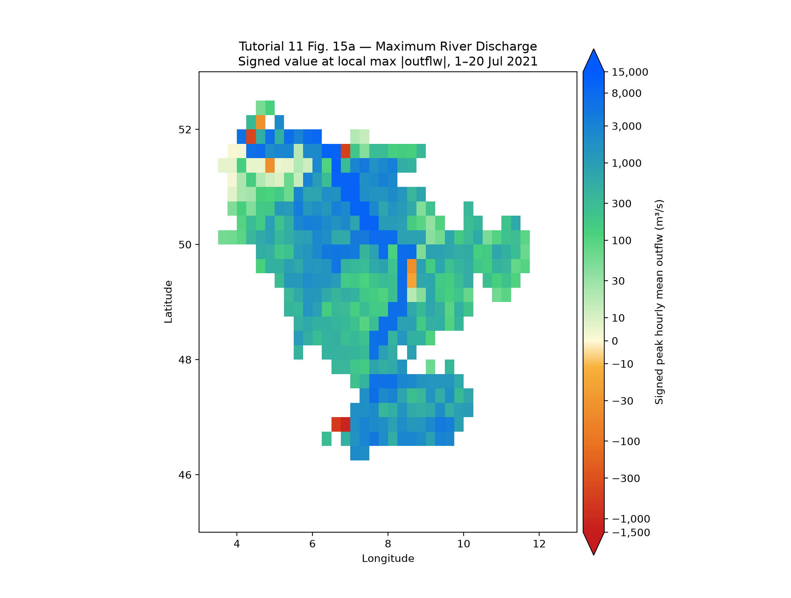

*Figure 15a. Local peak discharge on the standard nextxy network. Colour represents signed discharge, line width reflects upstream area, and arrows distinguish reverse-flow direction. Terrain provides geographic context. Peaks are selected separately for each cell, so the map combines different timestamps rather than depicting one simultaneous flow field.*

There were 1,245 valid cell peaks, ranging from approximately −1,100 to 11,600 m³/s. Eleven selected peaks were negative. Retaining those signs made simulated reverse flow visible in the network rather than treating it as missing data.

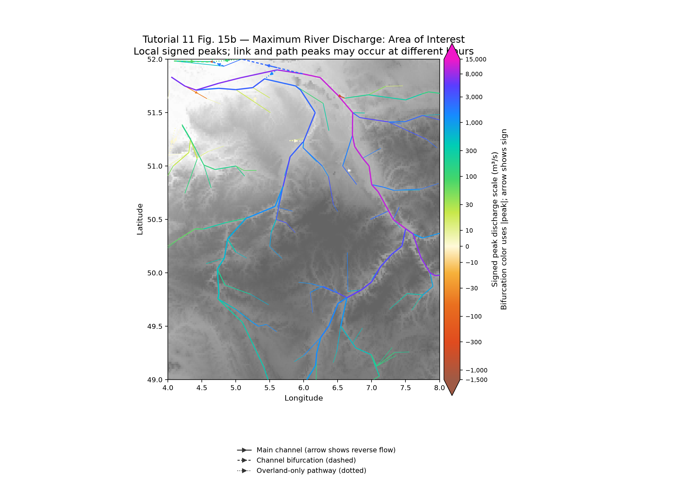

*Figure 15b. Detail for 4–8°E, 49–52°N. Dashed lines denote channel bifurcations and dotted lines overland-only pathways, alongside the main network. Background terrain is at 1 arcmin. Arrows represent the directions of the selected signed peaks, which may occur at different times.*

The 20 valid bifurcation pathways comprised seven channel and 13 overland-only pathways. Signed peaks ranged from approximately −203 to 2,370 m³/s; four pathways had negative selected peaks. Figures 15a and 15b extended spatial inspection beyond the main network to bifurcations and reverse flow. This network context informed the selection of model reaches for observations and impact locations in Step 21.

Details: [Step 15 Survey Report](15_simulation_output_visualization.md) / [Work Report: 31-day visualisation](../AI_work_report/15_simulation_output_visualization.md#current-31-day-visualization-2026-11-24) / [peak-extraction and display results](../metadata/15_simulation_output_visualization.json).

### 5. Comparing observations and simulation results

#### 5.1 Step 21: Matching gauges and impact locations to model channels

Spatial matching distinguished the geographic model cell containing a location, its assigned unit catchment and the model channel selected for comparison. Native fine-grid catmxy stores the one-based model (x, y) assignment of each pixel. In contrast, nextxy defines downstream connectivity between model cells; it does not determine the catchment containing a fine-grid point.

For the three main-stem stations, supplied global Cama15 allocations were transferred to the regional grid. Stored channel outlets, upstream areas, GRDC allocations and the downstream Maxau → Speyer → Lobith sequence were checked.

**Table 11. Regional model allocations used for the main-stem stations. Rows and columns are zero-based. Outlets are stored channel positions; displayed coordinates and areas are rounded.**

| Station | Model (row, column) | Outlet longitude, °E | Outlet latitude, °N | Model upstream area, km² |
| --- | --- | ---: | ---: | ---: |
| Maxau | (16, 21) | 8.3688 | 49.1688 | Approx. 50,800 |
| Speyer | (15, 21) | 8.4121 | 49.2496 | Approx. 52,100 |
| Lobith | (4, 12) | 5.9838 | 51.8629 | Approx. 159,000 |

Of the 22 impact and timing records, 21 received direct catmxy assignments, including 11 whose assignment differed from the geographic containing cell. The final comparison used direct assignments for 16 records and a checked one-step upstream Ahr tributary proxy for five. One Eupen record remained unassigned. These counts refer to reports, rather than independent rivers or model cells.

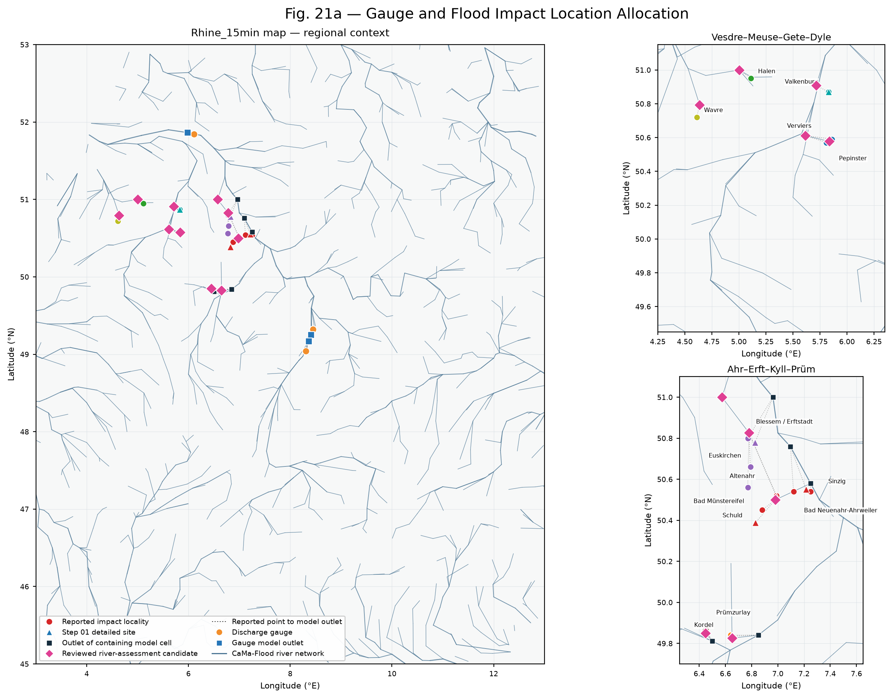

*Figure 21a. Regional and local views distinguish reported positions from the selected model outlets. Teal diamonds and connectors show the final impact/timing allocations. Connecting lines express the matching relationship rather than actual channel geometry.*

**Table 12. Examples of direct unit-catchment assignments and comparison cells. Row and column indices are zero-based; upstream areas are approximate.**

| Location | Geographic (row, column) | Direct catmxy cell and upstream area, km² | Comparison cell and upstream area, km² | Basis |
| --- | --- | --- | --- | --- |
| Schuld | (10,15) | (10,15), approx. 680 | (10,15), approx. 680 | Direct assignment, representing the coarse Ahr channel context. |
| Altenahr | (9,15) | (9,17), approx. 141,000 | (10,15), approx. 680 | Checked, immediately upstream Ahr proxy. |
| Bad Neuenahr | (9,16) | (9,17), approx. 141,000 | (10,15), approx. 680 | Upstream proxy; exact local-reach correspondence remains unresolved. |
| Blessem | (8,15) | (8,14), approx. 1,450 | (8,14), approx. 1,450 | Direct assignment to a tributary catchment. |
| Prümzurlay | (12,13) | (11,13), approx. 580 | (11,13), approx. 580 | Direct catchment assignment. |

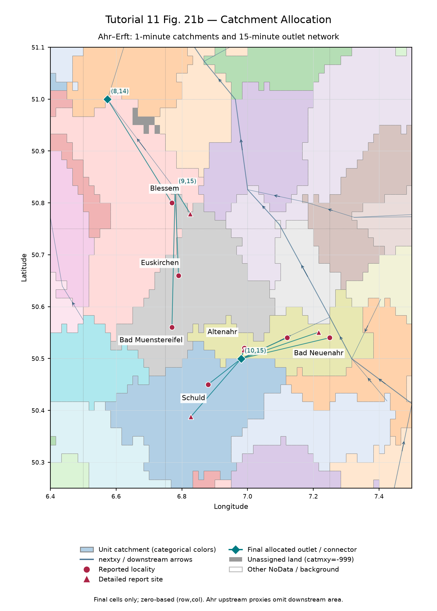

*Figure 21b. Pastel colours and boundaries identify unit catchments derived from 1 arcmin assignments. Blue nextxy arrows, selected comparison outlets and reported locations are overlaid. Colours identify catchments rather than numerical magnitude. Grey denotes unassigned land; white denotes other NoData/background. Outlet labels use zero-based row and column indices.*

The figure demonstrates that rectangular computational cells and unit catchments are geometrically different. Direct allocation of lower-Ahr locations to cell (9,17) aggregates them into a large receiving-channel cell, making an independent local Ahr discharge difficult to extract. Cell (10,15), anchored at Schuld, was selected because nextxy confirms that it drains directly into that receiving cell. The proxy therefore follows network connectivity.

Other checks established the Erft connection from upstream cell (9,15) to Blessem (8,14), distinct Kyll and Prüm catchments, and the downstream Verviers–Pepinster ordering. Spatial support for comparison was thereby made explicit. An upstream proxy omits downstream contributing area, so its discharge is not identical to discharge at the local site. Allocation confidence categories such as confirmed or plausible describe the spatial match, rather than model performance.

Details: [Step 21 Survey Report](21_gauge_allocation.md) / [Work Report](../AI_work_report/21_gauge_allocation.md) / [gauge allocations](../metadata/21_gauge_allocation.csv) / [impact and timing allocations](../metadata/21_impact_location_allocation.csv).

#### 5.2 Step 22: Comparing discharge hydrographs

Discharge was extracted from the three main-stem model cells and plotted with the prepared observations. The comparison period was 10 July 00:00–1 August 00:00, end-exclusive, containing 528 model and 88 observation timestamps per station. Model and observation series were stored separately, retaining their original allocations, values and clock labels, without temporal averaging, interpolation, unit conversion or time shifts.

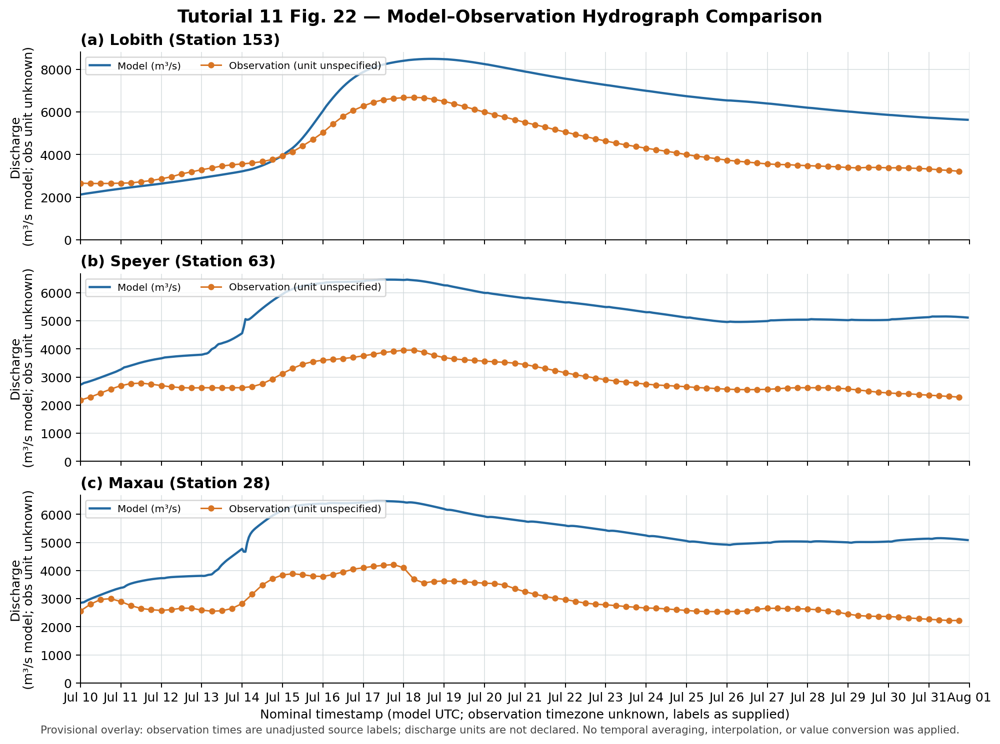

*Figure 22. Exploratory overlay of hourly model discharge and supplied six-hour observation values. Model units are m³/s, and its CF time coordinate is interpreted as UTC. Observation values and supplied labels are retained, with units and timezone still unconfirmed.*

**Table 13. Maxima within the comparison period. Model units and UTC times are distinguished from the unspecified observation units and supplied timestamp labels.**

| Station | Model maximum, m³/s, UTC | Observation maximum, units unspecified, supplied label |
| --- | --- | --- |
| Lobith (153) | Approx. 8,490; 18 July 17:00 | Approx. 6,685; 18 July 06:00 |
| Speyer (63) | Approx. 6,470; 18 July 02:00 | Approx. 3,958; 18 July 06:00 |
| Maxau (28) | Approx. 6,470; 17 July 09:00 | Approx. 4,215; 17 July 18:00 |

The overlay shows the mid-July rise and subsequent prolonged model recession. Maxima occur on 17–18 July, within the comparison period, placing the main-stem response in its event context. The spatial and observational support differs from the rapid tributary flooding examined in Step 23.

Model one-hour means and provider-described six-hour means have different temporal support. Together with the unresolved observation units and timezone, this limits interpretation of the numerical differences in Table 13 as amplitude bias or timing error. The prepared, separately documented series provide the basis for a subsequent comparison on common units and averaging intervals; formal performance metrics were not part of this overlay.

Details: [Step 22 Survey Report](22_hydrograph_comparison.md) / [Work Report](../AI_work_report/22_hydrograph_comparison.md) / [saved time series](../metadata/22_hydrograph_timeseries.csv) / [comparison summary](../metadata/22_hydrograph_comparison_summary.json).

#### 5.3 Step 23: Comparing flood-peak timing

Tributary and impact-location timing evidence from Step 01 was linked to the comparison cells from Step 21. Model peaks were searched over the 168 hours from 12 July 00:00 to 19 July 00:00, end-exclusive. The 21 coordinate-bearing reports mapped to ten model cells, yielding 1,680 hourly samples. All 22 reports were retained, while no model series was assigned to the unlocated Eupen outlet record.

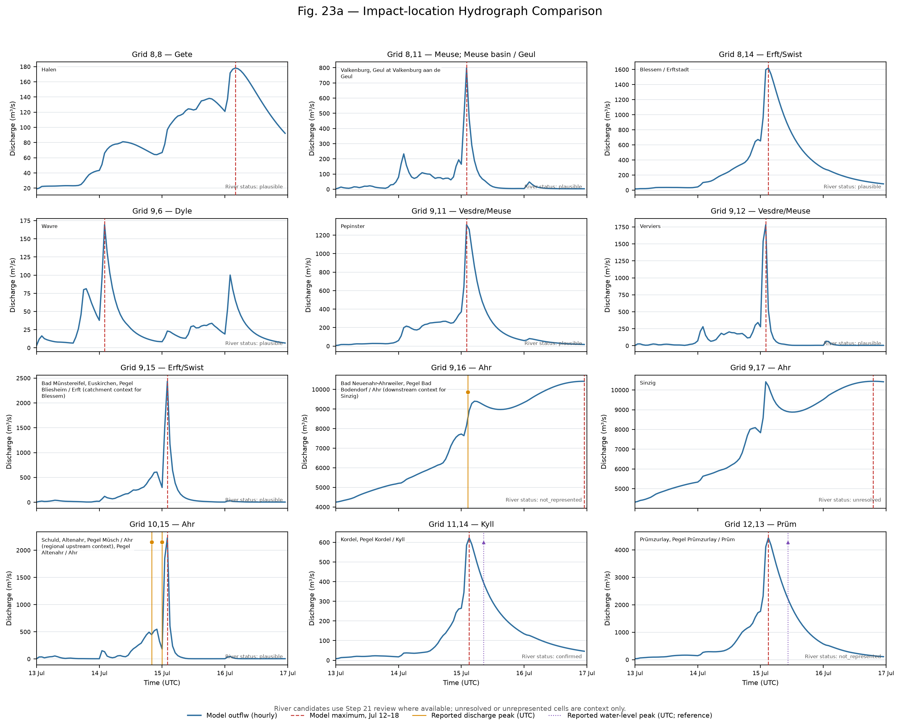

*Figure 23a. Hourly discharge for each selected model cell. Red dashed lines mark maxima within the search period, orange markers identify source-supported UTC discharge peaks, and purple markers denote reference water-level peaks. The displayed interval is 13–16 July, distinct from the peak-search window. Ahr records using the upstream proxy share one series. Ahr, Kordel and Prümzurlay timing references derive from [LfU, Table 5](#r2-lfu-flood-report); their source conventions are summarised in Table 1.*

All model maxima occurred inside the search period. The Ahr comparison cell reached approximately 2,230 m³/s at 02:00 UTC on 15 July, enabling time differences to be calculated against three UTC discharge-peak records. The source times come from the LfU Table 5 estimates, whose original MESZ/CEST labels were converted by subtracting two hours.

**Table 14. Provisional Ahr discharge-peak timing comparison using LfU Table 5 source estimates. Positive differences mean a later model peak; negative differences mean an earlier model peak.**

| Ahr record | Source peak, UTC | Model maximum, UTC | Model minus source |
| --- | --- | --- | ---: |
| Müsch | 14 July 20:00 | 15 July 02:00 | +6 h |
| Altenahr | 15 July 00:00 | 15 July 02:00 | +2 h |
| Bad Bodendorf | 15 July 02:30 | 15 July 02:00 | −0.5 h |

All three records use the same approximately 680 km² upstream proxy cell. The table therefore relates one model response to different river-reach peak records, rather than supplying three independent performance tests. The −0.5 h difference is interpreted at the resolution of an hourly model series and estimated source timing.

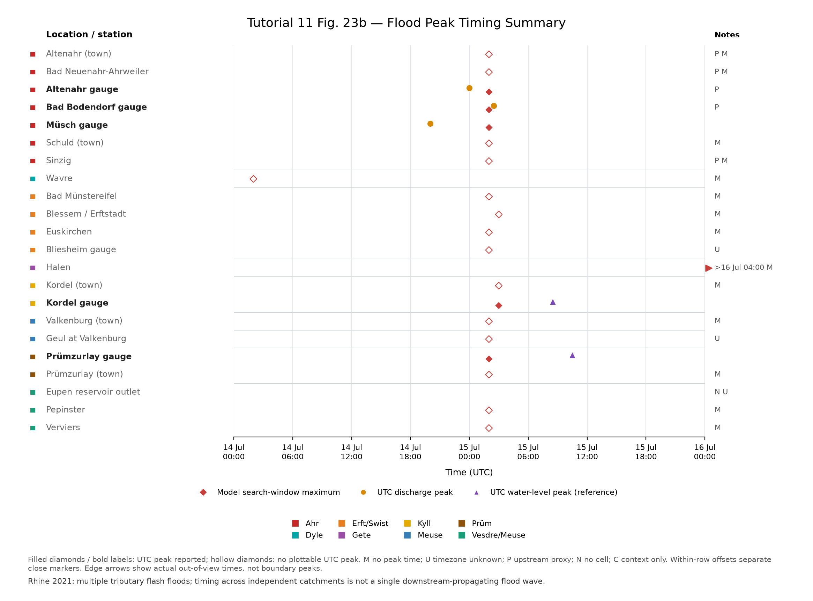

*Figure 23b. Timing summary retaining 22 records by river system. Basin-coloured squares correspond to Figure 1; red diamonds denote model maxima, orange circles discharge peaks, and purple triangles reference water-level peaks. Filled versus hollow diamonds indicate the availability of usable UTC peak information, rather than model–observation agreement. Source provenance is recorded in Table 1 and the timing ledger.*

The display covers 14 July 00:00–16 July 00:00, end-exclusive, while maxima were selected from 12–18 July. Halen's 16 July 04:00 UTC maximum is indicated beyond the axis by an arrow and its actual time. Codes identify M, no supported peak time; U, unconfirmed timezone; P, upstream proxy; N, no model cell; and C, context only.

**Table 15. Comparison categories for the 22 records. Categories distinguish the scientific use supported by each type of evidence.**

| Category | Records | Result and scope |
| --- | ---: | --- |
| Provisional discharge-peak timing comparisons | 3 | Ahr comparisons in Table 14, sharing one model series. |
| Reference water-level peaks | 2 | Kordel and Prümzurlay; no discharge-peak lag calculated. |
| Unconfirmed source timezone | 2 | Bliesheim and Valkenburg; original labels retained without inferred UTC placement. |
| No supported peak time | 14 | Impact records retained without inventing local peaks. |
| No model cell | 1 | Eupen; no inferred model series assigned. |

The Prümzurlay model cell peaked at 02:00 UTC on 15 July, approximately 1,830 m³/s; Kordel/Kyll peaked at 03:00 UTC, approximately 623 m³/s. Bliesheim/Erft and Valkenburg/Geul peaked at 02:00 UTC, approximately 2,440 and 798 m³/s, respectively. These model values were retained separately from water-level references and observations with unconfirmed timezones, allowing comparison to proceed when the required observational definitions are resolved.

One source discrepancy remains material. The LfU-derived Prümzurlay water-level reference in the ledger and Figure 23 is 10:30 UTC, whereas [Mohr et al. (2023), Section 3.2.2](https://nhess.copernicus.org/articles/23/525/2023/#section3) report 05:30 UTC. The reason for the discrepancy is unresolved; Table 1 retains the LfU-based record and flags the need for reconciliation before quantitative use. This water-level reference was not used to calculate a discharge-peak lag. The [supporting source review](../AI_work_report/24_inundation_downscaling.md#unresolved-evidence-and-knowledge-gap-review) records the issue.

The analysis thus selected comparable evidence and examined tributary responses in terms of timing type, channel support and shared series. Keeping river systems separate provides a clearer basis for local-response assessment than interpreting the ordering of independent catchments as a single propagating flood wave.

Details: [Step 23 Survey Report](23_impact_timing_comparison.md) / [Work Report](../AI_work_report/23_impact_timing_comparison.md) / [comparison ledger](../metadata/23_impact_timing_comparison.csv).

#### 5.4 Step 24: Downscaling and assessing inundation patterns

The satellite acquisition was linked to model output, terrain-based downscaling and interpretation of the resulting depth distribution. The selected observation is the S1A orbit 038784 pass used in Step 03; its five original scenes form one acquisition, rather than five independent observation times.

**Table 16. Time matching, downscaling and resulting model-depth grid.**

| Item | Result |
| --- | --- |
| Acquisition interval | 2021-07-15 05:49:37–05:51:42 UTC |
| Midpoint of the acquisition envelope | Approximately 05:50:40 UTC |
| Selected model output | 2021-07-15 06:00:00 UTC, approximately 9 min 20 s after the acquisition midpoint |
| Temporal treatment | Nearest available model output; no temporal interpolation |
| Downscaling | 15 arcmin flddph to 1 arcmin using the existing tributary- and backwater-aware method |
| Domain and grid | 4–8°E, 49–52°N; 240 columns × 180 rows |
| Valid/unassigned pixels | 42,960/240 |
| Dry/positive-depth pixels | 37,429/5,531, both within the valid population |
| Valid depth range | 0 to approximately 10.9 m |

The downscaler assigns coarse-grid depth through catmxy, uses terrain-height differences and river connectivity, and applies tributary and backwater corrections. The channel-width-based permanent-water minimum depth of 0.1 m was enabled. The method redistributes coarse-grid simulation results over finer terrain and connectivity information.

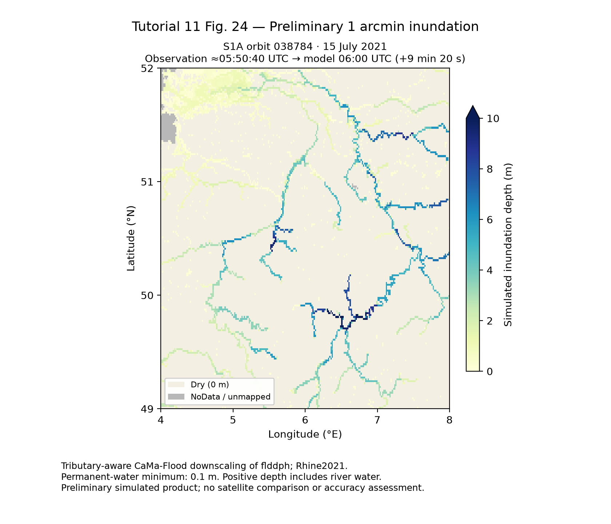

*Figure 24. Inundation depth derived from the model output at 06:00 UTC on 15 July. Beige indicates dry cells at 0 m, grey unassigned or missing cells, and colours positive depth. Values above the displayed 0–10 m range are represented by the colour-bar extension. The figure shows model depth corresponding closely in time to the satellite acquisition.*

Depth is concentrated along the river network; extensive lateral inundation is not prominent at this display resolution. The output enables examination of instantaneous model water depth against terrain at a satellite-referenced time. The 5,531 positive-depth pixels include channel water, making separation of channel water and event overbank inundation an important next step.

The comparison involves distinct quantities: GFM Code 1 is an observation-derived class, the 1 arcmin flood fraction is conditional on valid classification support, and model flddph is instantaneous depth in metres. Quantitative spatial evaluation requires common valid masks, a consistent treatment of permanent water and an explicit conversion from model depth to an inundation indicator.

Several hypotheses could explain the narrow visible inundation pattern: insufficient simulated inundation, limited representation of narrow floodplains at 1 arcmin, or differences in definitions and observation support. Existing outputs do not identify a dominant cause. Relevant factors include 15 arcmin channel representation for rapidly responding tributaries such as the Ahr, initial conditions, runoff forcing, local structures and SAR observation conditions.

This separates two research directions: improving terrain-based downscaling to examine inundation placement, and improving hydrodynamic river representation to examine simulated water volumes, levels and dynamics. The internal five-coarse-cell buffer also extends beyond the regional map on its western and northern sides; its influence remains unquantified.

Details: [Step 24 Survey Report](24_inundation_downscaling.md) / [Work Report](../AI_work_report/24_inundation_downscaling.md) / [time-matching and output metadata](../metadata/24_downscaling_verification.json).

### 6. Synthesis of case-study outcomes

#### 6.1 Outcomes across the research sequence

The study connected event investigation to comparisons and interpretation based on actual observations and model outputs. It progressed from impact mapping through acquisition identification, satellite processing that preserved valid support, matching of regional terrain and forcing grids, model execution, location-specific comparability decisions and satellite-time depth mapping. Each stage supplied identifiable outputs to the next.

**Table 17. Principal outputs of all implemented steps and their connections to subsequent research.**

| Step | Principal outputs | Subsequent use |
| --- | --- | --- |
| 01 | 14 impact localities, 22 impact/timing records, Figure 1, river-system and observation context | Evidence for domain design, impact allocation and UTC peak comparisons. |
| 02 | Distinct model domain, 3–13°E/45–53°N, and satellite domain, 4–8°E/49–52°N; Figure 2 | Common spatial definitions for maps, input preparation, acquisition searches and downscaling. |
| 03a | Review of 45 Items, six passes and 27 original products; Figure 3a | Acquisition selection based on actual source footprints. |
| 03b | Four layers, 37 unique COGs and acquisition/file-check manifests | Traceable inputs belonging to one pass for classification. |
| 03c | Native 20 m classes, 1 arcmin flood fraction and 15 focus areas; Figure 3c | Regional screening, observation-support assessment and detailed-area selection. |
| 03d | Fifteen native-grid GeoTIFFs, approximately 2 MiB total; Figure 3d | Local classification inspection and subsequent spatial matching. |
| 04 | Three main-stem stations × 1,460 six-hour values, format correspondence; Figure 4 | Station matching and exploratory hydrograph comparison. |
| 11 | Reused and inspected 40 × 32 regional map and 600 × 480 auxiliary grid | Terrain, channel and bifurcation inputs for the experiment. |
| 12 | Regional ERA5-Land inputs for 31 days/744 hours and documented definitions | Input Matrix generation and forcing throughout the simulation. |
| 13 | Dedicated Input Matrix, 1,245 river cells and 16,963 contributing-area pairs | Correct spatial mapping from the regional runoff grid. |
| 14 | Continuous 31-day standard-nextxy run, hourly outputs for eight variables and Restart | Source data for discharge peaks, hydrograph comparisons and time-selected depths. |
| 15 | Signed local peaks and their timestamps; Figures 15a/b | Spatial inspection of main channels, bifurcations and reverse flow. |
| 21 | Spatial allocation of three main-stem gauges and 22 reports; Figures 21a/b | Series extraction distinguishing direct catchments from upstream proxies. |
| 22 | Exploratory overlays at three stations, separately retained source series; Figure 22 | Comparison of hydrograph shape and peaks, followed by formal unit/time alignment. |
| 23 | Ten model cells, 1,680 hourly samples, all 22 reports and three provisional discharge-peak comparisons; Figures 23a/b | Timing interpretation conditional on source type and channel support. |
| 24 | One satellite-time-matched 1 arcmin depth field, Figure 24 and scientific assessment | A working connection between model inundation and satellite observation, with requirements for quantitative evaluation. |

The results demonstrate that this regional event requires separate consideration of main-stem and tributary responses; that a 15 arcmin river representation can aggregate locations that need distinct local evaluations; and that compatible time and water definitions are essential for comparison. Figures 21 and 23 connect channel support to timing interpretation. Figures 3c/d and 24 show why satellite classifications and model depth need a common evaluation definition.

#### 6.2 Scientific findings, hypotheses and further evaluation

The achieved outcome is a connected set of observation and modelling products supporting exploratory discharge and timing comparison and interpretation of inundation patterns. The following five themes distinguish **established results**, **interpretation and hypotheses**, and **additional analyses needed to test them**. The proposed analyses are future work.

##### Spatial and temporal characteristics of the flood

**Established results.** Figure 1 and Table 1 place the reported impacts in the Ahr and Erft, Moselle tributaries and Meuse system. The reconstructed Ahr peaks occurred from the evening of 14 July into the early hours of 15 July UTC, while the three supplied main-stem six-hour series reached their maxima on 17–18 July. Model main-stem maxima also occurred on 17–18 July. Combining tributary timing evidence with main-stem hydrographs therefore provided more specific evaluation targets than assigning one regional peak date to the entire event. The event literature and official reports supply the context for these distinctions ([Mohr et al., 2023](#r1-mohr-et-al-2023); [LfU](#r2-lfu-flood-report); [Erftverband](#r4-erftverband-2021)).

**Interpretation and hypotheses.** Rapid tributary responses to locally intense rainfall and the integration and routing of runoff over larger main-stem contributing areas plausibly contribute to this temporal contrast. This is a hypothesis based on comparisons across different rivers and observation supports; the date differences are not estimates of one flood wave's travel time.

**Additional analyses needed.** Align catchment-scale rainfall and runoff timing with upstream and downstream observed hydrographs within the same river system. Such an analysis could separate the contributions of rainfall distribution, catchment response and channel propagation.

##### Satellite availability and selection of evaluation areas

**Established results.** The six-pass review identified a concrete mismatch between product-tile intersection and original acquisition-footprint intersection. The evening pass on 15 July had six Items but no original footprints intersecting the analysis domain. The morning pass provided a processing example with valid classification support in 35,225 one-arcminute cells and 15 detailed classification images. Those focus areas retained 87.5% of the Flood pixels used for selection, concentrating inspection on a smaller geographic extent (Figures 3a/c/d; Tables 3–6).

**Interpretation and hypotheses.** The morning acquisition followed the reconstructed Ahr peak records. For rapidly changing tributary inundation, the maximum flooded area and the water distribution at SAR acquisition could therefore differ. Uneven valid classification coverage also means that cells with the same flood fraction can contain different amounts of observational information about their full geographic area.

**Additional analyses needed.** Examine the remaining 14–16 July passes using actual footprints and valid-observation masks, then relate acquisitions to river-specific water-level and discharge evolution. Compare changes within observed areas while retaining unobserved and excluded pixels separately. This would distinguish temporal sampling limitations from spatial gaps in observational support.

##### Model resolution and site-specific evaluation

**Established results.** Eleven of the 21 successful direct catmxy assignments differed from the geographic containing cell. Lower-Ahr direct assignments led to a receiving-channel cell with approximately 141,000 km² upstream area, while the comparison adopted an approximately 680 km² upstream Ahr proxy (Figure 21; Table 12). This is direct evidence that coarse channel aggregation constrains the representation of local flood-evaluation sites.

**Interpretation and hypotheses.** A finer river grid could represent lower tributary reaches and contributing areas more independently, allowing more direct comparison of local discharge and peak propagation. Redistributing the same coarse simulation over finer terrain, however, does not create independently simulated tributary hydrographs.

**Additional analyses needed.** Check location assignments, upstream areas and connectivity on a higher-resolution river map. Compare channel representations under common forcing and initial conditions. Where proxies remain necessary, quantify the downstream contributing area omitted and examine how its runoff affects discharge at the target site.

##### Hydrographs and peak timing

**Established results.** Main-stem overlays covered the rise and recession, while tributary evidence was organised into explicit comparison categories. The shared Ahr proxy peaked at 02:00 UTC on 15 July, giving differences of +6, +2 and −0.5 h relative to the Müsch, Altenahr and Bad Bodendorf reconstructed peaks. The results show how one model response relates to different reach-specific source records (Figures 22–23; Tables 13–15).

**Interpretation and hypotheses.** The progressively closer agreement with downstream source times may partly reflect aggregation into one proxy series. Reach-specific hydrographs are needed to distinguish local peaks and propagation. Main-stem model maxima also exceed the supplied observation values numerically. If a difference persists after units and averaging intervals are made consistent, runoff forcing, initial conditions and channel or floodplain storage would be plausible candidates for its explanation.

**Additional analyses needed.** Resolve observation units, timezone and averaging bounds, reconcile the inconsistent peak sources, and compare model and observations on common temporal support. Establish the ERA5-Land accumulation and boundary conventions before testing initial-state/spin-up and channel-representation sensitivities separately. This would distinguish differences introduced by comparison conventions from differences in model response.

##### Inundation representation and spatial evaluation

**Established results.** Model depth approximately 9 min 20 s after the acquisition midpoint was downscaled to a 240 × 180 one-arcminute grid. Of 42,960 valid pixels, 5,531 had positive depth, with a maximum of approximately 10.9 m. The mapped distribution was mainly narrow and aligned with the river network. Observation products distinguished Flood, permanent water, exclusion and NoData, while model outputs distinguished dry, positive-depth and unassigned cells. These products together establish the basis for designing an explicit spatial evaluation.

**Interpretation and hypotheses.** Limited visible lateral inundation could reflect simulated water volumes or levels, insufficient resolution of narrow floodplains, or differences in water definitions and valid support between model and observations. The existing maps motivate these hypotheses but do not distinguish a dominant cause.

**Additional analyses needed.** Compare inundation using consistent acquisition times, valid masks, treatment of channel and permanent water, depth thresholds and area support. Inspect model levels and storage alongside local terrain, then distinguish finer-terrain redistribution from simulations on finer river maps. Regional-boundary/internal-buffer effects and SAR observation conditions over urban or vegetated areas also require assessment.

These hypotheses specify the causal relationships that a subsequent evaluation should test. The [general evaluation workflow](https://github.com/global-hydrodynamics/cmf_v5_beta/blob/d424a4ad2d69745acb7d72e1465c401a52e64d18/tutorial/tutorial11-event_evaluation/AI_survey_report/00_flood_event_evaluation_workflow.md) distinguishes transferable data contracts from the pass, period and proxy-cell choices specific to this case.

#### 6.3 A reference case for other flood events

The case study shows how human–AI collaboration connected event investigation, observation preparation, a CaMa-Flood v5 regional experiment, comparative analysis and scientific interpretation to figures, tables and traceable data definitions. Scientific objectives and judgement were expressed as choices whose consequences can be inspected in the resulting products.

Application to another event requires its own river-system context, acquisition opportunities, runoff grid, initial conditions and comparison targets. The outputs and references assembled here make those requirements concrete. As supporting material for the ECMWF Event-based Benchmark prototype, the report presents both the exploratory comparisons achieved and the research workflow needed to develop them into a quantitative evaluation.

### References

The public sources below support the event and timing evidence. Provider-supplied station data and experiment-specific processing results are documented in the linked step reports and metadata. Source-specific time conventions are retained in Table 1 and the timing ledger.

#### R1. Mohr et al. (2023)

Mohr, S., et al. (2023). *A multi-disciplinary analysis of the exceptional flood event of July 2021 in central Europe – Part 1: Event description and analysis*. Natural Hazards and Earth System Sciences, 23, 525–551. DOI: 10.5194/nhess-23-525-2023. [Publisher article and bibliographic record](https://nhess.copernicus.org/articles/23/525/2023/). Event context and hydrology; Section 3.2.2 includes the Prümzurlay peak-time statement discussed in Section 5.3 of this report.

#### R2. LfU flood report

Landesamt für Umwelt Rheinland-Pfalz. *Hochwasser im Juli 2021*. [Official report PDF](https://lfu.rlp.de/fileadmin/lfu/Service/Publikationen/Bestellkatalog/Hochwasser_im_Juli2021_barrierefrei.pdf); [official publication record](https://lfu.rlp.de/service/publikationen/details/publikation/bericht-hochwasser-im-juli-2021). Table 5 is the retained source for Ahr, Kordel and Prümzurlay maxima and the MESZ/CEST time convention.

#### R3. GEER reconnaissance report

GEER Association. *Report on the 2021 Western European floods* (reconnaissance report identified in the locality inventory). [Report PDF](https://www.geerassociation.org/components/com_geer_reports/geerfiles/GEER%20Report%202021%20Western%20European%20Floods%20Final%20w%20GPS%20coordinates_comp.pdf). Used for documented impact localities and river-valley context, with record-specific attribution in the impact inventory.

#### R4. Erftverband (2021)

Erftverband (2021). *Hochwasser an der Erft und ihren Nebengewässern, 14. bis 16.07.2021: Erste Auswertung des Niederschlags- und Abflussgeschehens*. Revision 2, 20 August 2021. [Official report PDF](https://www.erftverband.de/wp-content/uploads/2021/08/20210820_ev_auswertung_hw_20210714.pdf). The printed p. 12 describes Bliesheim timing and the Blessem gravel-pit effects.

#### R5. Limburg crisis evaluation

Waterschap Limburg/COT (2022). *Een crisis van ongekende omvang: Leerevaluatie watercrisis juli 2021*. [Institutional reference listing at NIPV](https://nipv.nl/waterveiligheid/leren-en-evalueren/). The original report is identified in the timing ledger and supplies the Valkenburg/Geul timing and reported discharge. The institutional listing provides a discovery route; source timezone remains unconfirmed.

#### R6. Thewissen (2022)

Thewissen, A. (2022). *Flood event of July 2021: How extreme were the floods in the Ahr, Vesdre and Geul catchments?* Master's thesis, Delft University of Technology. [Repository bibliographic record](https://repository.tudelft.nl/record/uuid%3Aa7436524-e11b-4922-8637-6a74a1868f04). Appendix E.3 discusses reconstructed Eupen reservoir outflow, attributing the reconstruction to Ziemetz et al. (2021). The reconstruction is cited here through the thesis; its original source has not been independently verified for this case study.

#### R7. Demer basin assessment

*Overstromingen juli 2021 Demerbekken: aan een catastrofe ontsnapt*. [Assessment PDF](https://cdn.nimbu.io/s/3putlmp/assets/Overstromingen%20juli%202021%20Demerbekken_aan%20een%20catastrofe%20ontsnapt.pdf). The Halen and Herk-de-Stad discussion supports the Halen impact context and distinguishes the 16 July controlled dike opening from a flood-onset or peak observation.

#### R8. Wavre municipal account

Ville de Wavre. *Le bilan à mi-parcours, Programme Stratégique Transversal 2019–2024*. [Municipal report PDF](https://www.wavre.be/sites/wavre/files/2022-01/2021_WAVRE_Bilan%20Mi-Mandat_vf.pdf). The flooding discussion supplies the date-level Wavre impact account used in the timing ledger.

#### R9. Copernicus EMS event account

Copernicus Emergency Management Service. [Account of the July 2021 floods in Germany, the Netherlands, Belgium and Switzerland](https://mapping.emergency.copernicus.eu/news/the-copernicus-emergency-management-service-forecasts-notifies-and-monitors-devastating-floods-in-germany-netherlands-belgium-and-switzerland/). Public event and emergency-mapping context, distinct from the GFM acquisition-specific classifications processed in this study.
