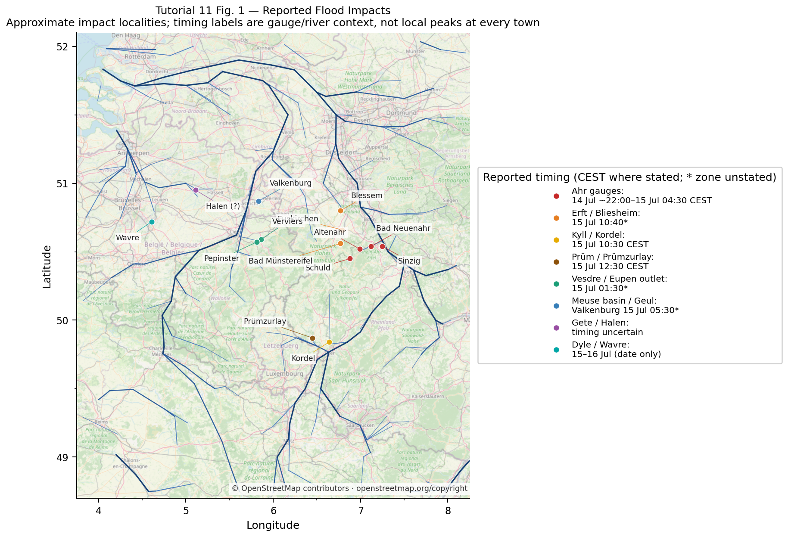

# July 2021 Western European Floods — Survey Report

## Executive Summary

The July 2021 event affected western Germany, Belgium, Luxembourg and the Netherlands. Intense rainfall during 13–15 July over the Eifel and Ardennes produced destructive flooding in tributaries including the Ahr and Erft; flooding also affected the Moselle system and the separate Meuse basin. The Rhine main stem experienced elevated flow, but that response should not be conflated with the rapid, locally destructive tributary floods.

The event overview identifies candidate observations and uncertainties; it does not define a completed model evaluation. Figure 1 locates 14 reported towns/localities from the event inventory. Their plotted coordinates are approximate locality positions, not surveyed flood extents.

## Investigation and Results

### Event and hydrologic context

The core rainfall/event context used here is 13–15 July 2021. A broader 10–25 July window was proposed for later event analysis, but the simulation period and endpoint convention remain undecided. The Ahr and Erft are Rhine tributaries; Kyll and Prüm belong to the Moselle system; the Meuse is a separate basin. This distinction matters when relating impact reports and observations to a model routing network.

Public sources retained with the event review include Mohr et al. (2023), the Copernicus Emergency Management Service event account, and the Rhineland-Palatinate environmental authority report on the July 2021 flood. Product and event references are listed below and in the retained research record.

### Reported locations

The inventory contains 14 mapped localities, including affected reaches in the Ahr/Erft, Moselle and Meuse systems. The list is a selected set of documented locations, not an exhaustive damage inventory. See [`metadata/01_impact_locations.csv`](../metadata/01_impact_locations.csv) for coordinates, group, display labels, source fields and location confidence. The CSV supports plotting and spatial handoff; it does not turn a town-centre coordinate into a measured inundation boundary.

### Candidate observations

Three supplied discharge series are Lobith (153), Speyer (63) and Maxau (28), at six-hour intervals. The source files describe the values as six-hour means and timestamps as interval ends. Bonn/6, named in an initial correspondence summary, is absent from the inspected files. Units, source timezone and original observing agency remain unresolved. Candidate satellite/event products include GFM, NASA MODIS MCDWD, Kuro Siwo event samples 518/520, and Copernicus EMSR517; availability and suitability for this event must be verified product by product.

A collaboration summary also identifies ECMWF experiments `j1ee` and `j1w9` as possible model sources. This information was supplied second-hand and was not verified against MARS fields or experiment metadata. It must not be treated as confirmed availability.

## Figures and Interpretation

*Figure 1. Reported flood-impact localities and river context. Markers show approximate named places; they do not delineate observed floodwater.* The map helps relate the literature review to later basin/domain analysis. OSM and mapped river context are geographic orientation aids, not independent evidence of flood extent.

## Findings and Limitations

- The event is a multi-basin regional flood; a Rhine-only interpretation does not cover all documented affected systems.
- Three supplied gauges describe Rhine main-stem context but do not directly observe Ahr or Erft tributary discharge.
- Gauge units, time zone, source agency and coordinate convention need confirmation before quantitative matching. The maintainer confirmed permission to redistribute the supplied station files, but no named open-data licence was identified.
- Candidate satellite products differ in sensor, acquisition/composite timing, resolution, validity masks and coverage. None should automatically be interpreted as a complete event-maximum map.
- Kuro Siwo identifiers and the ECMWF experiment details remain collaboration-supplied candidates rather than independently confirmed source records.

## Recommendations / Next Steps

Use the reported river/locality inventory as Step 2 input. Trace the relevant reaches and upstream networks on the selected CaMa-Flood map; keep Meuse distinct from Rhine tributaries. Before evaluation, resolve gauge units/time convention and verify any candidate simulation product and satellite acquisitions. Do not infer missing observations as dry conditions.

### Key sources

- [Mohr et al. (2023), Natural Hazards and Earth System Sciences](https://nhess.copernicus.org/articles/23/525/2023/)
- [Copernicus EMS account of the July floods](https://mapping.emergency.copernicus.eu/news/the-copernicus-emergency-management-service-forecasts-notifies-and-monitors-devastating-floods-in-germany-netherlands-belgium-and-switzerland/)
- [Rhineland-Palatinate environmental authority, July 2021 flood report (PDF)](https://lfu.rlp.de/fileadmin/lfu/Startseitenbeitraege/2022/Hochwasser_im_Juli2021_1_.pdf)
- [GFM product documentation](https://extwiki.eodc.eu/GFM/PUM/Products); [NASA MCDWD product](https://ladsweb.modaps.eosdis.nasa.gov/missions-and-measurements/products/MCDWD_L3); [Kuro Siwo](https://github.com/Orion-AI-Lab/KuroSiwo); [Copernicus EMSR517](https://mapping.emergency.copernicus.eu/activations/EMSR517/)

See also the [observation data guide](../observation/README.md), the [Step 4 discharge report](04_discharge_observations.md), and the [Step 3a availability report](03a_satellite_availability.md).
