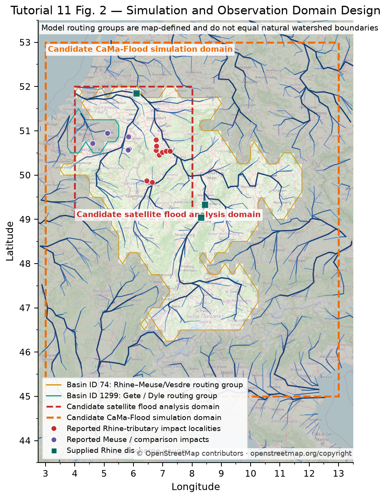

# Spatial Domain and Observation Design — Survey Report

## Executive Summary

The existing `glb_15min` (0.25°) CaMa-Flood map associates sampled Rhine, Ahr/Erft, Moselle and Vesdre locations and the supplied gauges with model Basin ID 74; Halen and Wavre associate with Basin ID 1299. Basin 74 is a model Rhine–Meuse/Vesdre routing group, not a pure natural watershed. The proposed simulation window is now **3–13°E, 45–53°N**, expressed as outer cell-boundary edges and aligned to integer degrees. The earlier `[3.125, 45.875, 12.125, 52.375]` values described corner-cell centers and are retained separately in the JSON rather than used as rectangle edges. This is a candidate window; upstream/outlet, active-cell and boundary checks remain. The satellite analysis area remains 4–8°E, 49–52°N.

## Investigation and Results

### Map and routing evidence

The domain review used the `glb_15min` basin, upstream-area and river-network information together with Step 1 impact localities and supplied gauge coordinates. Basin 74 contains 391 cells in this map; its approximate cell-centre envelope is 3.625–11.625°E, 46.375–51.875°N. Basin 1299 contains 19 cells, with envelope approximately 3.875–5.375°E, 50.625–51.375°N. These are map-derived routing groups and should not be equated automatically with natural catchment boundaries.

The simulation candidate is a rectangular model window, not a basin mask. Its outer edges are 3°E, 45°N, 13°E and 53°N, matching the selected integer-aligned simulation extent. The corner-cell-center candidate values are kept as a separate metadata field so they cannot be mistaken for bounds. The selected window covers the sampled groups, impacts and gauges. The sizing principle remains to include the target river's required upstream contributing area and downstream outlet; minimizing the rectangle is not the objective. Whether the evaluation should include only Rhine behavior, the complete Basin 74 routing group, or Basin 1299 as an additional/separate system remains unresolved.

### Observation domain

The 4–8°E, 49–52°N candidate satellite-analysis extent reuses the existing processed GFM target-grid bounds. It is not a verified acquisition boundary or a final valid-observation footprint. Smaller literature-informed search areas were also identified: Ahr–Erft–Swist and nearby Kyll/Prüm (6.0–7.8°E, 49.4–51.1°N), and Meuse–Vesdre–Gete–Dyle (4.2–6.3°E, 49.5–51.4°N). These areas address distinct river systems and are candidates, not flood perimeters.

The later processed GFM 15 July product reports usable support in 7,258,263 of 17,280,000 target cells (42.0038%). This is patchy support for that specific product, not evidence that unsupported cells were dry. The 1-arc-minute GFM sample's coverage statistic is from a different product/grid and is not interchangeable.

### Gauges and additional observation priorities

The supplied gauge coordinates are Lobith (153; 6.10833°E, 51.84444°N), Speyer (63; 8.44876°E, 49.32379°N) and Maxau (28; 8.30561°E, 49.03896°N). They provide Rhine main-stem context but do not directly measure Ahr or Erft discharge. Candidate reach-level searches include Ahr (Altenahr–Sinzig), Erft/Swist (Euskirchen–Blessem/Erftstadt) and Vesdre (Verviers–Pepinster). These are priorities for locating records, not verified gauge sites.

## Figures and Interpretation

*Figure 2. CaMa-Flood routing context, impacts, available gauge locations and candidate domains.* The map carries Figure 1 impact points into the domain discussion. Candidate boxes indicate proposed geographic bounds, not configured model dimensions or confirmed observed coverage.

## Findings and Limitations

- Basin IDs and envelopes are specific to the inspected `glb_15min` map. `nextxy` connectivity, the complete natural upstream basin, model active-cell mask, boundary conventions and forcing coverage need confirmation before a model run.
- The current map's coarse resolution and sampled locations cannot establish a high-resolution natural divide.
- The simulation candidate and satellite-analysis candidate answer different questions and must remain distinct.
- No simulation was configured or run, and no new observations were acquired for this domain-design report.
- Coordinates for gauges were copied from the supplied station table; datum and station/model-cell convention are undocumented.

## Recommendations / Next Steps

Carry both candidate bounds forward as proposed handoffs. Decide the hydrologic scope (Rhine-only versus combined routing group; handling of ID 1299) after checking appropriate native/high-resolution routing and outlet connections. Confirm model grid/boundary conventions and forcing support. Treat satellite bounds as provisional until acquisition footprints and valid data support are assessed. See the machine-readable [`metadata/02_domain_selection.json`](../metadata/02_domain_selection.json), [Step 3a report](03a_satellite_availability.md), and [event process](../00_event_evaluation_process.md).
