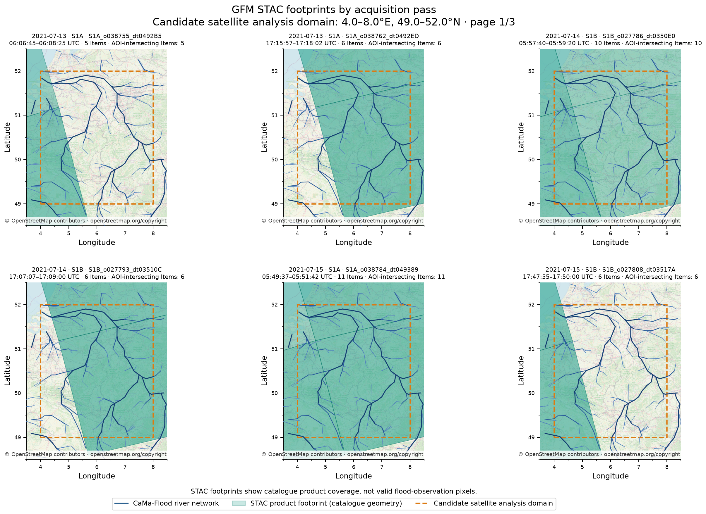

# Satellite Availability Survey — 14–16 July 2021

## Executive Summary

The focused catalogue search for the three days around 15 July returned **45 GFM STAC Items grouped into 6 Sentinel-1 acquisition passes and 27 source product slices**. Multiple Items and products are not independent overpasses. The 15 July morning descending S1A pass, `S1A_o038784_dt049389`, is proposed as the first processing example because a native sample already existed; this is a practical handoff, not a scientific ranking. Three of its five source product footprints intersect the candidate 4–8°E, 49–52°N area.

## Investigation and Results

The initial event window uses 14–16 July inclusive, centered on 15 July as the main disaster date for this survey. Catalogue search bounds come from [`metadata/02_domain_selection.json`](../metadata/02_domain_selection.json). Search results distinguish STAC Item, Equi7 tile, source GRD slice and acquisition pass. Pass metadata and geometry provenance are recorded in the [pass inventory](../metadata/03a_satellite_pass_inventory.csv), [orbit table](../metadata/03a_satellite_orbit_metadata.csv) and [source-footprint GeoJSON](../metadata/03a_sentinel1_acquisition_footprints.geojson).

| Pass ID | UTC interval | Satellite / direction | STAC Items | Source products | Source footprints intersect AOI |
| --- | --- | --- | ---: | ---: | ---: |
| `S1B_o027786_dt0350E0` | Jul 14T05:57:40Z–Jul 14T05:59:20Z | S1B / DESCENDING | 10 | 4 | 3 |
| `S1B_o027793_dt03510C` | Jul 14T17:07:07Z–Jul 14T17:09:00Z | S1B / ASCENDING | 6 | 5 | 1 |
| `S1A_o038784_dt049389` | Jul 15T05:49:37Z–Jul 15T05:51:42Z | S1A / DESCENDING | 11 | 5 | 3 |
| `S1B_o027808_dt03517A` | Jul 15T17:47:55Z–Jul 15T17:50:00Z | S1B / ASCENDING | 6 | 5 | 0 |
| `S1B_o027815_dt0351B0` | Jul 16T05:40:37Z–Jul 16T05:42:42Z | S1B / DESCENDING | 7 | 5 | 3 |
| `S1A_o038806_dt049431` | Jul 16T17:40:41Z–Jul 16T17:41:56Z | S1A / ASCENDING | 5 | 3 | 2 |

The STAC geometry is GFM Equi7 tile coverage, not Sentinel-1 swath geometry. Source GRD `GeoFootprint` geometries and acquisition/orbit fields were matched through Copernicus Data Space OData metadata. For the July 15 evening S1B pass, six Items overlap the AOI, but none of its five source-product footprints intersects it. Therefore, tile bounds alone would have overstated acquisition coverage.

## Figures and Interpretation

*Figure 3a. One panel per pass; the orange dashed box is the common candidate analysis area and the filled outlines represent source-product acquisition footprints.* A source-product footprint is catalogue coverage, not evidence of valid GFM flood classification pixels, quality, or useful coverage of a particular river reach. The geometry comparison shows why the evening July 15 S1B tile intersection does not imply source-scene coverage of the current AOI.

## Findings and Limitations

- Search totals describe catalogue metadata, not downloaded assets or valid observation pixels.
- The existing local Atlantis links to `old/source` and `old/pixi/bin/pixi` were unavailable at survey time. The July 15 cache was reused and remaining dates were queried read-only from the EODC GFM STAC API; the environment was not reinstalled.
- The comparison is based on the fixed 14–16 July window and candidate bounds. It does not establish the event peak, valid-pixel support, or all useful satellite products.
- No GFM COG or Sentinel-1 SAR image was downloaded during this availability survey.

## Recommendations / Next Steps

The selected-pass JSON proposes the 15 July S1A descending pass to exercise the native-data workflow. Before using it as event evidence, evaluate acquisition timing against hydrology, valid/exclusion masks, layer availability, and data-use terms. The 14 and 16 July passes remain potential before/after context; the evening S1B pass requires an explicitly expanded westward domain if it is to be considered. The selection is `proposed` and does not block processing.
