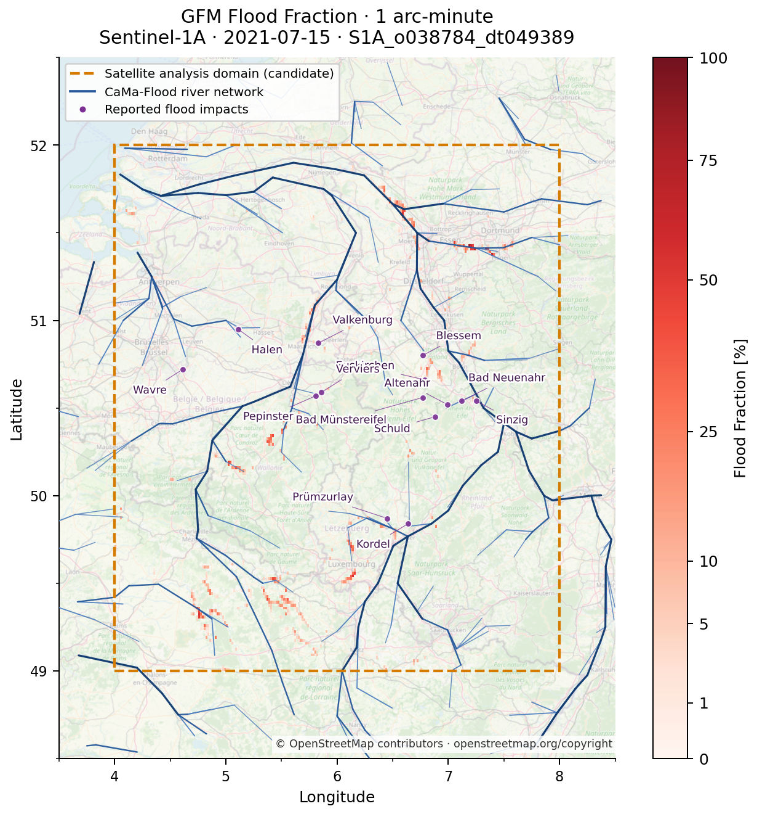

# GFM Classification and Focus-Area Screening — Survey Report

## Executive Summary

For the 15 July 2021 S1A descending pass, the retained processing record describes a source-aligned, single-band uint8 20 m classification over the candidate 4–8°E, 49–52°N area. It reports 182,974 Flood-class pixels (Code 1) in the full source raster. A 1-arc-minute Flood Fraction product contains 240 × 180 cells; 35,225 cells have valid classes 0–4 and the fraction ranges from 0 to 75.91241%. Fifteen proposed focus boxes retain 140,228 of 160,301 reconstructed one-minute Flood pixels (87.48%) while covering about 9.78% of the candidate AOI area.

The monolithic source 20 m raster is absent from the current worktree. Its size and class counts below are inherited from the retained provenance JSON, not freshly re-read in this report task.

## Investigation and Results

### Classification meaning

The source record defines Code 0 as observed Land, 1 as Flood, 2 as Permanent water, 3 as Seasonal water, 4 as Other water, 5 as Exclusion, 6 as Inconsistent, and 255 as NoData. The recorded pixel counts are: Land 91,484,129; Flood 182,974; Permanent water 3,372,171; Seasonal water 111,433; Other water 0; Exclusion 157,602,754; Inconsistent 62,162; NoData 100,014,182. Reference-water-only support is not classified as current flood; missing and excluded observation support is not treated as dry.

The one-minute percentage is computed as Code 1 divided by valid classified classes 0–4. Codes 5, 6 and 255 are not in the denominator; a cell with no valid support is NoData. This is a fraction conditional on usable classification, not the percentage of the full geographic cell inundated. The retained raster is WGS84, 1/60° and has NoData -9999; its recorded dimensions are 240 × 180, extent 4–8°E and 49–52°N.

### Focus-area tradeoff

The fifteen manually selected boxes were based on Flood pixel counts and valid support, not proximity to the reported impact markers. Their union is approximately 9,232.08 km² (9.78% of the 94,365.51 km² candidate AOI). They retain 140,228/160,301 (87.48%) of the reconstructed one-minute Flood pixels and omit 20,073 (12.52%). Projected outward-aligned source-grid windows cover 34,950,179 unique pixels, a 90.09% reduction from the recorded source extent of 352,829,805 pixels. Summed per-area ZSTD size was estimated in memory at 2,098,447 bytes; this was an estimate before extraction, not the later measured output.

The exact selected bboxes and per-area support/count diagnostics are in [`metadata/03c_focus_areas.json`](../metadata/03c_focus_areas.json).

## Figures and Interpretation

*Figure 3c. Red shading shows Flood Fraction; purple markers are reported impact localities; green outlines identify the fifteen proposed 20 m focus areas; the dashed outline shows the candidate satellite-analysis domain.* The image supports regional screening, not validation. Flood Fraction alone can be high where valid support is sparse; the selection diagnostics therefore also use Flood pixel counts and support. Reported impacts were deliberately not a focus-box selection criterion.

## Findings and Limitations

- GFM Code 1 is an observation-derived class, not independent ground truth.
- Valid support is patchy; outside the valid-class denominator, no-detection cannot be inferred.
- The source raster includes many exclusion and NoData pixels; these represent distinct unavailable/filtered support, not Land.
- Focus boxes are a storage and inspection subset, not a complete flood inventory. About 12.52% of the reconstructed one-minute Flood pixels fall outside them.
- The size estimate used in-memory ZSTD encoding and can differ from actual crop files.
- Source-raster statistics and hash are inherited from the provenance JSON because the source raster is absent in the current worktree.

## Recommendations / Next Steps

The focus selection can be used by p03d while it remains `proposed`; the status is descriptive, not an execution gate. The next step should preserve the source Equi7 20 m grid and class codes when extracting boxes, and should record measured files and bounds. Do not interpret cropped extents as independent observations or as a map of the complete flood.
