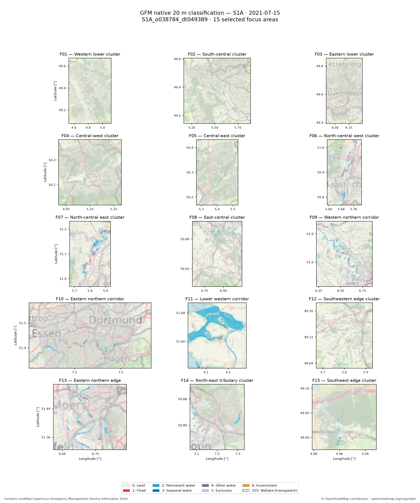

# GFM Focus-Area Extraction — Survey Report

## Executive Summary

Fifteen proposed WGS84 focus boxes were extracted to separate, losslessly compressed uint8 GeoTIFFs, preserving the source Equi7 CRS and integer source-pixel windows at 20 m. The retained extraction metadata totals **2,113,624 bytes (2.016 MiB)** across all crops. Relative to the recorded 23,445,565-byte full-area source COG, that is about a **90.98% reduction in file bytes**. The crops retain regional flood clusters but are a subset, not a complete event map.

## Investigation and Results

The extraction metadata records the source pass as S1A, 2021-07-15, `S1A_o038784_dt049389`, descending. Each bbox edge was transformed/densified and snapped outward to source-grid pixel boundaries. No reclassification or resampling is recorded. The source CRS is stored as WKT with no EPSG authority identifier; this report therefore does not assert an EPSG code based only on the CRS name.

| Focus area | Dimensions | Flood pixels | Permanent-water pixels | Seasonal-water pixels | File bytes |
| --- | ---: | ---: | ---: | ---: | ---: |
| F01 — Western lower cluster | 2225 × 2865 | 25,260 | 8,975 | 39 | 281,926 |
| F02 — South-central cluster | 2419 × 2403 | 21,538 | 15,378 | 245 | 249,348 |
| F03 — Eastern lower cluster | 1523 × 2167 | 14,028 | 2,037 | 79 | 160,188 |
| F04 — Central-west cluster | 1322 × 1362 | 4,464 | 767 | 123 | 63,900 |
| F05 — Central-east cluster | 971 × 1266 | 6,009 | 207 | 0 | 53,814 |
| F06 — North-central west cluster | 847 × 1233 | 5,783 | 20,152 | 1,838 | 95,520 |
| F07 — North-central east cluster | 956 × 1261 | 5,948 | 42,229 | 2,088 | 117,814 |
| F08 — East-central cluster | 1356 × 1611 | 8,912 | 15,227 | 971 | 146,048 |
| F09 — Western northern corridor | 2091 × 2305 | 28,916 | 150,823 | 1,666 | 397,808 |
| F10 — Eastern northern corridor | 2286 × 1570 | 11,758 | 20,950 | 320 | 249,868 |
| F11 — Lower western corridor | 869 × 910 | 2,860 | 175,214 | 3,410 | 43,310 |
| F12 — Southwestern edge cluster | 912 × 997 | 3,794 | 1,705 | 29 | 49,978 |
| F13 — Eastern northern edge | 1021 × 933 | 3,994 | 21,048 | 4,847 | 117,388 |
| F14 — North-east tributary cluster | 878 × 981 | 1,898 | 11,786 | 623 | 69,358 |
| F15 — Southwest edge cluster | 650 × 595 | 1,616 | 4,483 | 29 | 17,356 |

Class counts are from each crop's metadata; they describe extracted pixels, including NoData and Exclusion where present. The crop windows may overlap in projected space and are individual files. Their count totals should not be interpreted as a unique spatial union unless overlaps are explicitly reconciled.

## Figures and Interpretation

*Figure 3d. Fifteen extracted focus areas displayed on OSM context. Land and Exclusion are visually differentiated from water classes; the CaMa-Flood river network is intentionally omitted.* This figure shows classification subsets, not flood boundaries established by independent ground truth. The native-resolution maps preserve fine spatial patterns but class interpretation remains conditional on the source GFM product and its masks.

## Findings and Limitations

- All 15 crop paths listed in the retained metadata and the Figure are present in the current worktree. This is a current filesystem check; it does not re-open the absent full-area source raster.
- Per-area file size is recorded in `metadata/03d_extracted_areas.json`; the full source size is inherited from its provenance record.
- Outward pixel snapping can include pixels slightly outside the WGS84 focus rectangles.
- Combined class counts may count overlapping projected windows more than once.
- The `proposed` selection status is descriptive. Crops are consumable by the following workflow without an approval gate.
- No model-observation matching, CaMa-Flood simulation, or event skill evaluation is demonstrated by these files.

## Recommendations / Next Steps

Use the extraction JSON as the downstream file index, including each crop's bounds, dimensions, hash, byte count and class counts. Before any quantitative comparison, define model-grid mapping, valid support, temporal correspondence, permanent-water handling and uncertainty. Retain the uncropped acquisition products locally as provenance when available.
