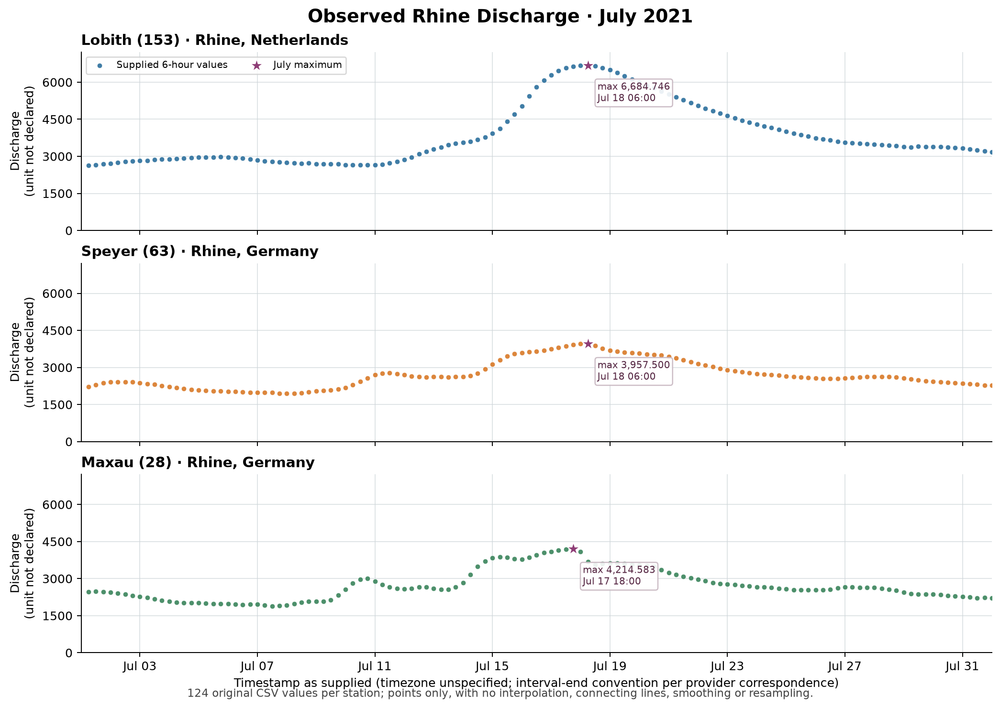

# Step 4 — River Discharge Observation Preparation

## Executive Summary

Three ECMWF-supplied Rhine station series are available for 2021: Lobith (153),
Speyer (63) and Maxau (28). Each has 1,460 regularly spaced six-hour values
from `2021-01-01 06:00` through `2022-01-01 00:00` as supplied. The CSV and
NetCDF records agree exactly after casting CSV decimals to the NetCDF
float32 representation. The supplied records contain no missing values.

The original files do not declare discharge units or time zone. Provider
correspondence describes the values as six-hour means labelled at interval
end, but the files have no explicit interval bounds or averaging attributes.
The series therefore support a documented observation handoff, not yet a
quantitative model comparison.

## July 2021 observations

The Figure shows the 124 supplied timestamps with end labels in
`(2021-07-01 00:00, 2021-08-01 00:00]`. Points are plotted without connecting
segments, interpolation, smoothing or resampling.

*Figure 4. Provider-supplied values for three Rhine gauges. The symbol marks
each series' maximum in the selected July window. The vertical quantity is
labelled with its unit unspecified; the horizontal times are shown as supplied
without asserting UTC or local time.*

| Station | July maximum (unit not declared) | Timestamp as supplied |
| --- | ---: | --- |
| Lobith (153) | 6,684.746 | 2021-07-18 06:00 |
| Speyer (63) | 3,957.500 | 2021-07-18 06:00 |
| Maxau (28) | 4,214.583 | 2021-07-17 18:00 |

These are maxima of the provider-described six-hour mean series, not confirmed
instantaneous peaks. Their timestamp differences are data characteristics;
they are not interpreted here as travel time or as model error. The full-year
minimum, maximum and mean are available by station in the machine-readable
[`discharge inventory`](../metadata/04_discharge_inventory.csv).

## Data coverage and interpretation

The actual files contain Speyer/63; Bonn/6, mentioned in an initial
correspondence summary, is absent. Speyer must not be renamed or treated as a
Bonn substitute. The three stations are all labelled Rhine and provide
main-stem context; none directly observes the Ahr or Erft tributaries.

`allstations.csv` supplies station longitude/latitude and `Cama1`, `Cama3`,
`Cama6`, and `Cama15` coordinate/area/row/column bundles. The latter are kept
separate from station coordinates in the dataset JSON. Their grid version,
units, coordinate role and allocation meaning have not been verified against
the target CaMa-Flood maps, so they are not used here as model-cell assignments.

The maintainer confirmed that these files may be shared in this Tutorial; no
formal open-data licence identifier or original observing agency is identified
in the files. The source time zone, discharge unit, area units, quality-control
history and Bonn discrepancy remain open. No quality flags are provided.

## Handoff

Use the original time-series file and station-ID mapping in
[`observation/README.md`](../observation/README.md),
[`metadata/04_discharge_inventory.csv`](../metadata/04_discharge_inventory.csv)
and [`metadata/04_discharge_dataset.json`](../metadata/04_discharge_dataset.json)
for later matching. Before quantitative use, resolve or explicitly bound unit,
time convention and model-grid correspondence. Do not infer model performance
from this observational hydrograph.
