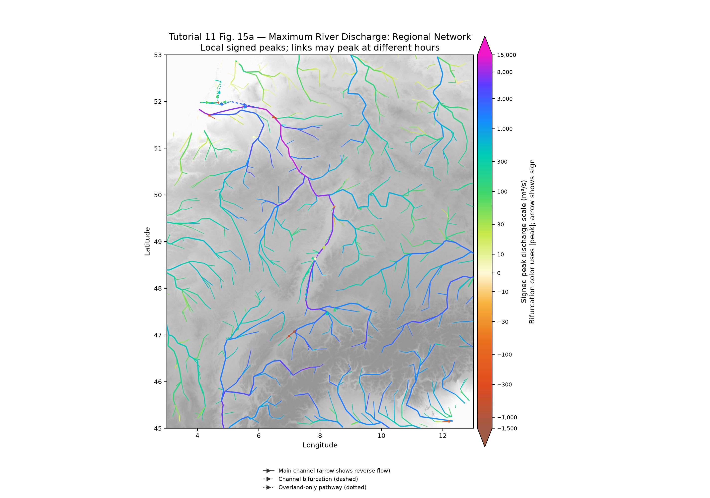
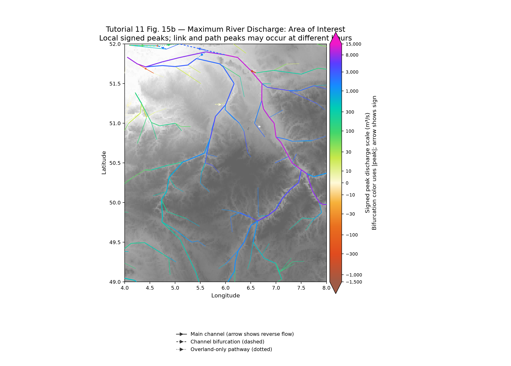

# Simulation Output Visualization — Survey Report

## Purpose and scope

Step 15 inspects the spatial distribution of the retained Step 14 hourly river
discharge outputs. It creates local peak maps for July 1–31, 2021. This is a
visual output review, not an observation comparison or assessment of model
accuracy.

## Fig. 15a — Regional maximum discharge

The full Rhine river network is drawn using standard `nextxy.nc` links. Main
channel links are colored by the signed `outflw` value at the hour when the
absolute hourly mean was largest; increased upstream-area-scaled line widths make the
network easier to follow across the complete map. Bifurcations use dashed channel
paths and dotted overland-only paths. The subdued elevation background
provides geographic context. Eleven of the 1,245 valid peak cells have
negative signed peaks; the corresponding arrows mark reverse flow.

## Fig. 15b — Area of Interest network

The 4–8°E, 49–52°N view combines the Rhine main-channel link peaks with
bifurcation-path peaks over the existing 1-minute elevation background.
Dashed paths indicate channel bifurcations and dotted paths indicate
overland-only pathways. Arrow direction marks reverse flow according to the
selected signed peak; color represents the discharge scale.

## Interpretation and limits

Every cell and path selects its own peak hour. The regional and AOI maps are
therefore not a common-time flow state, and apparent spatial patterns should
not be read as a flood wave at a single instant. The run is a 31-day cold-start
execution with no spin-up, so initial conditions may affect storage and flow.
Operational completion and readable outputs do not establish hydrologic
plausibility or skill. KG-0019, concerning ERA5-Land accumulation timing and
converter boundary handling, remains open. No quantitative model accuracy
evaluation was performed.

The derived variables, input checks and exact method are recorded in
[`metadata/15_simulation_output_visualization.json`](../metadata/15_simulation_output_visualization.json).
The technical execution record is the [Step 15 Work Report](../AI_work_report/15_simulation_output_visualization.md).
