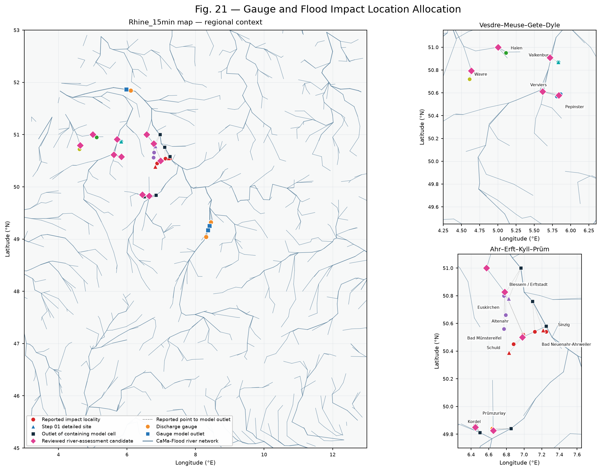
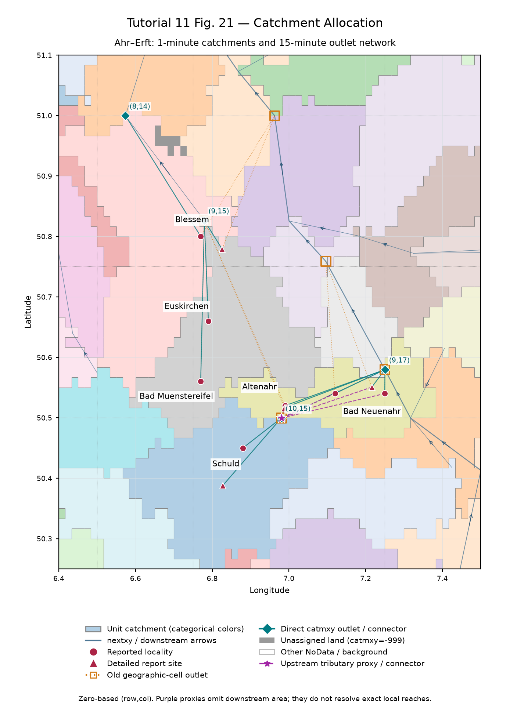

# Step 21 — Catchment and Tributary Evaluation Allocation

## Integrated finding — 2026-11-24

The maintainer adopts direct one-minute catmxy as the base assignment and permits
a reviewed upstream-catchment proxy when a tributary town falls in a mixed
mainstem catchment. The remote scientific review (`72aee06c` / `d3016eac`) and
local direct-lookup review (`8871bcfa`) are integrated without losing either
record. The three-gauge CSV is unchanged.

All 22 report rows remain. Twenty-one have direct catmxy assignments; 11 differ
from their original geographic cell. Final evaluation uses **16 direct catmxy
cells and five one-step upstream Ahr proxies**; Eupen remains unassigned.
Final status is 2 confirmed (Kordel, inherited basin/cell-scale review), 19
plausible, and one unresolved. No new independent river-name confirmation or
model-skill validation is claimed.

| Site | Geographic (row,col) | Direct catmxy, km² | Final evaluation, km² | Basis |
|---|---|---|---|---|
| Schuld | (10,15) | (10,15), 680.265 | (10,15), 680.265 | Direct lookup; coarse Ahr context. |
| Altenahr | (9,15) | (9,17), 140,560.780 | (10,15), 680.265 | Reviewed immediate upstream Ahr proxy. |
| Bad Neuenahr | (9,16) | (9,17), 140,560.780 | (10,15), 680.265 | Upstream proxy; exact local reach remains unresolved. |
| Blessem | (8,15) | (8,14), 1,450.238 | (8,14), 1,450.238 | Direct tributary catchment, no correction. |
| Prümzurlay | (12,13) | (11,13), 580.627 | (11,13), 580.627 | Direct lookup corrects the older downstream-cell interpretation. |

## Why an upstream proxy is needed

The direct lower-Ahr assignments share (9,17), a large receiving-channel cell.
The independently retained Ahr candidate at Schuld/near Altenahr, (10,15),
drains directly into it: nextxy=(18,10), one-based x/y. Its area is 680.265 km²,
far below the receiving cell. The remote review already supports this candidate
for Altenahr through outlet proximity and catchment context. Under the
maintainer's new rule it is also a **proxy**, not an exact reach allocation, for
Bad Neuenahr, Sinzig and Bad Bodendorf. The five corrected reports include both
Altenahr locality/gauge records. Missing downstream tributary area and unresolved
local channel support must remain explicit. Their model series will coincide;
that does not make the local observations independent model validations.

This is an event-specific reviewed branch choice, not generic snapping. A
confluence can have several immediate upstream cells; topology alone does not
identify which river to use. The known Ahr anchor plus its actual nextxy edge
is required. If the anchor/edge fails validation, the correction is unresolved.

## Other connections and the remote review

Erft upper sites/Bliesheim (9,15; 630 km²) → Blessem (8,14; 1,450 km²) →
(7,14; 147,646 km²). Kordel (11,14; 819.941 km²) drains to (12,14;
25,093 km²). Prümzurlay's actual catmxy is (11,13; 580.627 km²), followed by
(12,13; 4,221.565 km²). The remote no-independent-Prüm-candidate interpretation
used the latter downstream cell; it is superseded by the verified direct lookup.
Verviers (9,12; 351 km²) → Pepinster (9,11; 699 km²) also retains its order.
All selected direct downstream paths terminate without cycles or area decreases;
this is map consistency evidence, not proof of named-river identity.

The prior remote review and its reasons/notes are retained in `prior_*` columns,
including Kordel's reported official 819 km² comparison. Those external-source
claims were inherited, not independently re-investigated in this integration.
Prior source links: [RLP flood report](https://lfu.rlp.de/fileadmin/lfu/Service/Publikationen/Bestellkatalog/Hochwasser_im_Juli2021_barrierefrei.pdf)
and [Erftverband Bliesheim record](https://www.erftverband.de/mapserver/arcshp/flussgebiet/klima_abfluss/howis/html/pegel/Pegel_Bliesheim_zr.html).

## Figures and interpretation

The retained regional layout now shows final reviewed evaluation candidates
as magenta diamonds, separate from geographic-cell outlets.

Discrete pastel regions and exact pixel-edge boundaries show one-minute unit
catchments, with geographic grid lines only as context. Blue nextxy arrows are
downstream. Orange open squares/dotted lines show geographic outlets; teal
diamonds/solid lines show direct catmxy outlets. Purple stars/dashed point
connectors identify corrected upstream proxies. The connectors are assignment
guides, not actual river courses. Unassigned land is gray; other NoData is white.

## Handoff and limits

Keep geographic `model_*`, raw `catmxy_*`, and final `river_model_*` separate.
Use the final fields with river-status, correction method/reason and coordinate
uncertainty for later extraction; never fill an invalid lookup by a nearby
channel. Original notes and all IDs are retained, with ai_notes rightmost.
The unchanged three-gauge CSV remains the Step22 handoff.

Remote Step23 code and outputs are retained, but **five report selections have
changed relative to those outputs**. Their CSVs/figures are not regenerated in
this task and must not be treated as results for the integrated allocation.
See `metadata/23_handoff_status.json`. No new peak-time comparison, model run,
map regeneration or Gallery publication was performed. Existing time/units and
forcing-attribution limitations, town-coordinate precision, and lower-Ahr exact
reach representation remain open.
