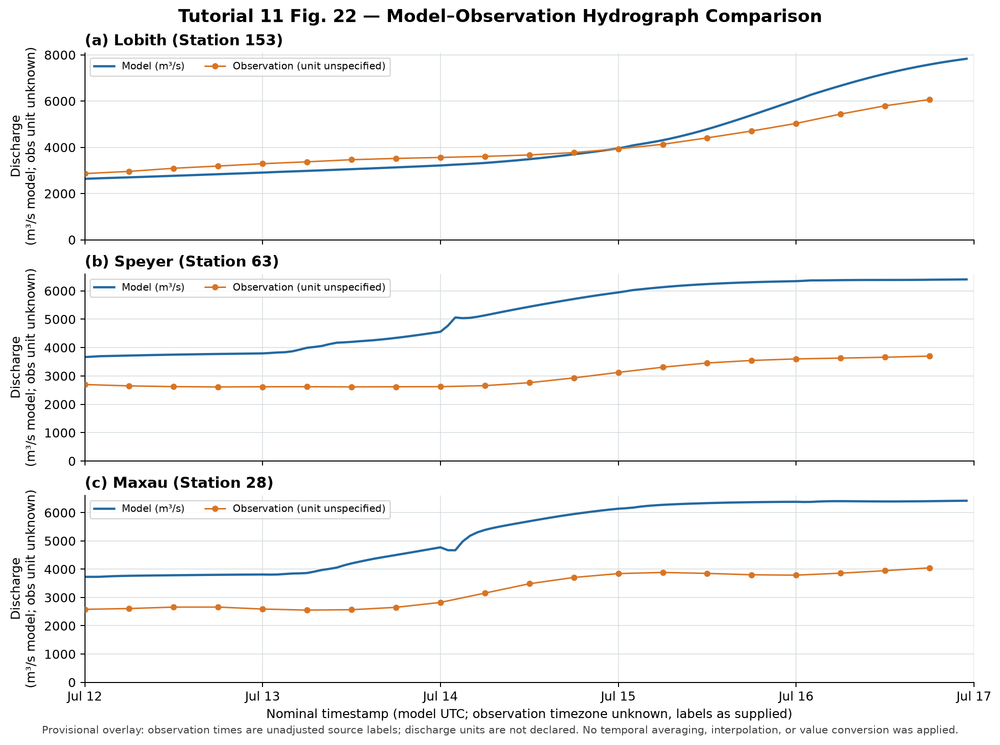

# Step 22 — Model–Observation Hydrograph Comparison

## Scope and evidence

The exploratory comparison uses the Step 21 allocated cells for Lobith (153), Speyer (63), and Maxau (28), the Step 14 `outflw` output, and the supplied ECMWF observation CSV. The requested window is July 12 through July 16, 2021. It contains 120 hourly model records per gauge and 20 six-hour observation labels per gauge.

*Figure 22. Hourly model outflow at the Step 21 grid cells and provider-supplied six-hour mean observations shown at their source timestamp labels. Model outflow is m³/s. The observation unit and timezone are not declared, so the numerical and timing overlay is provisional; no conversion, resampling, or interpolation was applied.*

## Preliminary visual findings

| Station | Model maximum in window | Observation maximum as supplied |
| --- | --- | --- |
| Lobith (153) | 7,831.6 at Jul 16 23:00 UTC | 6,068.1 at Jul 16 18:00 |
| Speyer (63) | 6,403.0 at Jul 16 23:00 UTC | 3,699.2 at Jul 16 18:00 |
| Maxau (28) | 6,420.3 at Jul 16 23:00 UTC | 4,047.1 at Jul 16 18:00 |

Within this short window, the model series rise at all three locations. At Lobith, the curves are close early in the window, then the model rises above the observations after July 15. At Speyer and Maxau, model values are already higher at the start of the window and the separation grows as the modeled hydrographs rise. The observations at Speyer and Maxau rise more gradually; Lobith observations rise more strongly late in the plotted period. These are descriptive comparisons of the plotted numbers, not confirmed discharge-unit comparisons.

The model maxima occur at the last included hourly record. They are therefore window-edge maxima, not necessarily event peaks. The observed maxima likewise occur at the last supplied six-hour label in the window and represent provider-described interval means labeled at interval end, not instantaneous peaks. The apparent several-hour difference between the labels must not be interpreted as a travel-time or model timing error because the observation timezone is unknown.

## Time, units and limitations

The model file records `time` as seconds since `2021-07-01 00:00` and `outflw` in `m3/s`, with `cell_methods="time: mean"`. The time string is interpreted using the CF time-coordinate convention, under which an omitted timezone defaults to UTC; the model file itself has no global `Conventions` attribute. The observation CSV timestamps have no timezone suffix, and the observation dataset metadata has no discharge unit. See the [CF Conventions, Time Coordinate](https://cfconventions.org/Data/cf-conventions/cf-conventions-1.11/cf-conventions.html) specification. Provider correspondence describes the observations as six-hour mean values with interval-end labels, but the source file does not encode interval bounds or `cell_methods`.

The Figure therefore uses UTC model timestamps and unmodified observation labels on the same nominal date/time axis. It is suitable for exploratory shape inspection only. Resolve the observation unit and time basis, and assess the Step 14 cold-start and simulation/observation temporal support before calculating metrics or making a skill claim.

## Handoff

The separate model and observation records and their provenance are in [`22_hydrograph_timeseries.csv`](../metadata/22_hydrograph_timeseries.csv) and [`22_hydrograph_comparison_summary.json`](../metadata/22_hydrograph_comparison_summary.json). No temporal pairs or performance scores were generated. Formal time/variable matching and metric selection remain for a later evaluation step.
