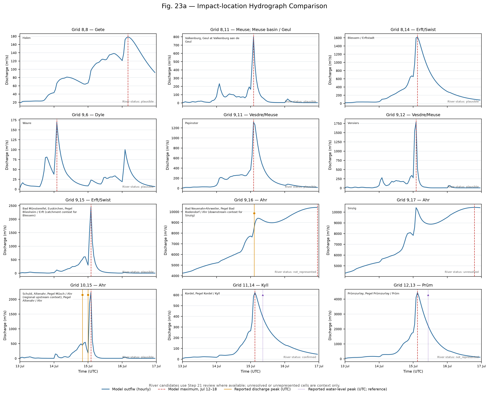
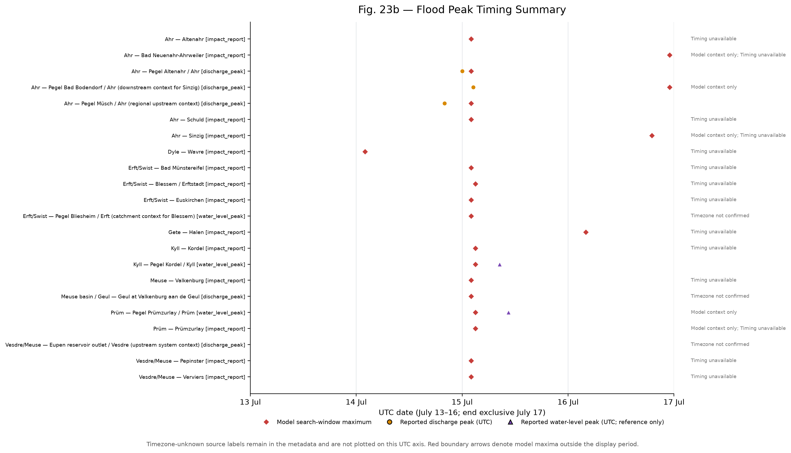

# Step 23 — Flood Impact Timing Comparison

## Scope and figures

This exploratory comparison uses the 22 source-linked Step 01 timing records,
the reviewed Step 21 report allocation, and the hourly Step 14
`experiment/Rhine2021/o_outflwRhine2021Jul.nc` output. The model maximum was
searched over `[2021-07-12 00:00, 2021-07-19 00:00) UTC`; figures show
2021-07-13 through 2021-07-16 UTC. The maximum at every extracted grid cell
occurred inside the search window. This does not establish that every
maximum is a local event peak because some cells are context-only allocations.

*Figure 23a. Hourly modeled discharge by distinct selected model cell. Red
dashed lines mark the July 12–18 search-window maximum. Orange lines identify
reported UTC discharge peaks; purple dotted lines identify UTC water-level
peaks as separate reference information. Cells rated unresolved or not
represented are explicitly labeled as context only.*

*Figure 23b. Each source report remains a separate row. Red diamonds mark
model maxima, orange circles source-supported UTC discharge peaks, and purple
triangles UTC water-level peaks. Timezone-unknown and date-only reports are not
plotted as UTC observations.*

The model outflow has 744 hourly values on `time` (`seconds since 2021-07-01
00:00`), `units=m3/s`, and `cell_methods=time: mean`. Consistent with the
existing Step 22 interpretation, the CF time reference is treated as UTC.
Step 21's reviewed `river_model_*` cells were used for `confirmed` or
`plausible` river assessments. The geographic containing-cell result remains
separate; where the river is unresolved or unrepresented, its containing-cell
hydrograph is shown only for regional context. The 21 coordinate-bearing
reports map to **12 distinct selected model cells** after that rule; the
coordinate-less Eupen outlet report has no model series. Extraction retained
2,016 hourly values (12 cells × 168 hours), while preserving 22 independent
report rows in the comparison table.

## Preliminary timing findings

Only two observations have a source-supported UTC discharge-peak time and a
usable, though still *plausible*, Ahr river-cell candidate:

| Report | Observed peak (UTC) | Model maximum (UTC) | Model minus observed | Interpretation |
|---|---|---|---:|---|
| Müsch / Ahr | 14 Jul 20:00 (reported approximately) | 15 Jul 02:00, 2,227 m³/s | +6 h | Provisional basin-scale Ahr timing comparison. |
| Altenahr / Ahr | 15 Jul 00:00 (reported approximately) | 15 Jul 02:00, 2,227 m³/s | +2 h | Provisional; the coarse candidate is not a gauge-cell measurement. |

Both source times derive from the Rhineland-Palatinate July 2021 flood report;
its estimated peak values and times should not be read as exact observations.
The report describes the Ahr gauge/catchment sequence, while the model support
is a 0.25-degree unit-catchment cell.

Several other records are useful context but do not support the same direct
comparison:

- Kordel's Kyll model candidate peaks at 15 Jul 03:00 UTC (622.6 m³/s). The
  source-supported gauge **water-level** maximum is 08:30 UTC. The 5.5-hour
  separation is shown visually, but no discharge-peak lag is calculated.
- The Erft/Bliesheim report gives a water-level maximum at 10:40 on 15 July
  without a confirmed timezone. It remains off the UTC axis. The Erft candidate
  series peaks at 02:00 UTC (2,435.8 m³/s), but those clock labels cannot yet
  be compared.
- Valkenburg's source gives 05:30 on 15 July but does not state the timezone;
  the time is retained verbatim and not plotted on the UTC axis. Its candidate
  Geul-basin series peaks at 02:00 UTC (797.9 m³/s).
- Prümzurlay has no separate Prüm channel candidate in this map. Its
  containing-cell context peaks at 03:00 UTC (4,437.0 m³/s), but the cell is
  near combined Prüm–Sauer routing and is not treated as Prüm discharge. The
  source water-level maximum at 10:30 UTC is retained only as a reference.
- The Bad Neuenahr/Bad Bodendorf and Sinzig series are mixed Rhine/confluence
  context, not isolated Ahr discharge. Their late model maxima (16 Jul 23:00
  and 16 Jul 19:00 UTC) are not direct local-Ahr timing comparisons.

The official source records used for catchment and timing context are the
[RLP July 2021 flood report](https://lfu.rlp.de/fileadmin/lfu/Service/Publikationen/Bestellkatalog/Hochwasser_im_Juli2021_barrierefrei.pdf)
and the [Erftverband Bliesheim gauge record](https://www.erftverband.de/mapserver/arcshp/flussgebiet/klima_abfluss/howis/html/pegel/Pegel_Bliesheim_zr.html).

## Limits and handoff

The time-difference calculation is limited to the two UTC `discharge_peak`
records above, and both are labeled `provisional_river_match`. Water-level
peaks are not interchangeable with discharge peaks. Date-only impact reports
have no local peak time; Bliesheim, Valkenburg and Eupen include source clock
labels without confirmed timezones. Do not infer time offsets from visual
alignment. The output CSV preserves each report's original time and timezone
text, the selected model cell basis, search-window maximum, status, and any
provisional lag.

These plots are exploratory timing summaries, not a formal performance
evaluation. Small tributaries missing or merged in the 15-minute network,
uncertain gauge/location support, source timing uncertainty, and the model's
hourly temporal means all limit interpretation. Do not infer model skill from
the two comparatively close Ahr timings alone.
