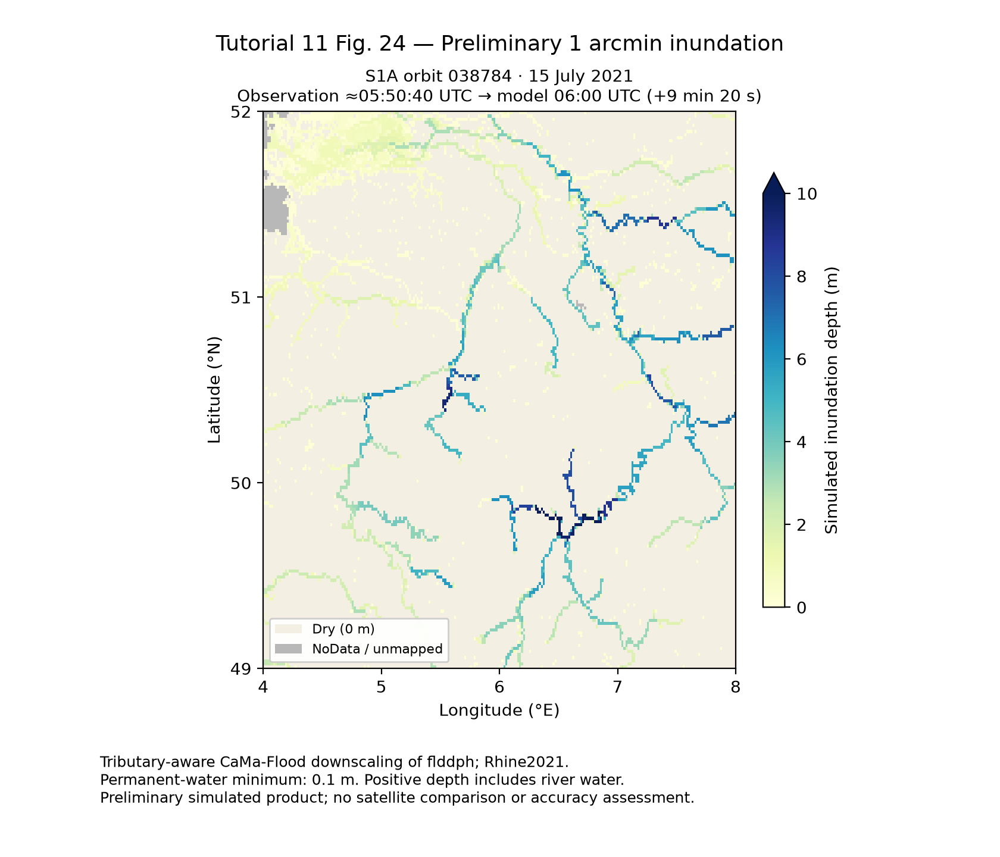

# Step 24 — Flood Inundation Downscaling, Visualization, and Assessment

## 1. Objective and method

Step 24 connects the selected satellite acquisition to an existing simulated
inundation field, adds terrain-based spatial detail, and assesses what the result
can establish. This completes a preliminary workflow, not quantitative flood
validation. The Rhine 2021 simulation uses a **15 arcmin**, 40×32 river map over
3–13°E, 45–53°N and hourly ERA5-Land runoff. Its July 1–August 1-exclusive run
contains 744 hourly records and has no Restart/spin-up
([Step 14 metadata](../metadata/14_simulation_setup.json)). Existing output headers
confirm `flddph` in metres as `time: point`; outflow is `time: mean`.

Only **Sentinel-1A orbit 038784** is processed. Five source scenes form one
acquisition spanning **15 July 2021 05:49:37.397–05:51:42.396 UTC**. Its envelope
midpoint, **05:50:39.8965 UTC**, selects the nearest existing **06:00 UTC** model
output, **560.1035 seconds later**, without temporal interpolation. The
[Step 24 handoff](../metadata/24_downscaling_verification.json) records these
exact times, source files, options and output checks.

The maintained tributary-aware CaMa-Flood Python port uses catchment mapping,
terrain height differences and river connectivity to downscale `flddph` to
**1 arcmin** over the Step 02 satellite-analysis domain,4–8°E, 49–52°N. This is
not interpolation of coarse depth or a new high-resolution hydrodynamic run.

## 2. Results: simulated inundation distribution

Figure 24. The time-selected simulated depth is concentrated along river networks,
with relatively little visually apparent lateral inundation at this display
resolution. Beige denotes dry cells; gray denotes missing/unmapped cells.
The 0–10 m color scale has an upper extension. These are model depths, not
satellite classifications or model–observation agreement.

The saved metadata record a 180×240 grid with 42,960 valid and 240 unmapped cells;
37,429 valid cells are dry and 5,531 have positive depth. Valid depths range from
0 to 10.874 m. These are retained Step 24 results, not a new pixel analysis.
Positive depth includes river water: the existing permanent-water option
applies a **0.1 m minimum** at river-width pixels. The 5,531 positive cells therefore
cannot be counted as overbank-event flooding or converted into a validation score.

## 3. Characteristics of the July 2021 flood

Severe flooding involved rapidly responding tributary catchments, including
Ahr, Erft and Kyll. The [Step 01 review](01_flood_event_overview.md) and
[Mohr et al. (2023)](https://nhess.copernicus.org/articles/23/525/2023/)
describe intense rainfall, steep tributary responses and locally complex flood
conditions. Narrow valleys and local channel/infrastructure effects make this
a demanding application for coarse global river models. The event is not one
homogeneous Rhine flood: Ahr/Erft drain to the Rhine, Kyll/Prüm to the Moselle,
and neighboring Meuse systems are distinct. Propagation within a connected
river must be distinguished from comparing independent tributary responses.

[Figure 1](../figure/f01-reported_flood_impacts.png) provides approximate impact
localities and river/gauge context, not measured flood perimeters. The
[Step 23 report](23_impact_timing_comparison.md) and
[Fig 23b](../figure/f23b-impact_timing_summary.png) retain 22 timing records but only
three provisional discharge-peak comparisons; 14 reports lack supported UTC peak
times, two have unknown timezones, two are water-level references, and one has no
model cell. Ahr offsets of +6, +2 and −0.5 hours all use the same model cell and are
not three independent validations. Filled/hollow diamonds indicate availability
of usable UTC peak observations, not agreement. Upstream proxies and hourly
mean semantics limit interpretation. These records cannot establish local
inundation timing or extent at every reported town.

## 4. Limitations of the simulation and downscaling

### A. Model resolution and hydrodynamics

The 15 arcmin network and channel/floodplain geometry may merge small tributaries
or inadequately resolve narrow valleys and local hydraulic behavior. There is
concrete spatial-support evidence: [Step 21](21_gauge_allocation.md) required
five reviewed upstream Ahr proxies where direct catchment assignment entered
a large receiving-channel cell. This demonstrates allocation limitations, not
the magnitude or cause of a simulated inundation error. Adequacy of local channel
parameters, levees, bridges and other infrastructure has not been audited.
The cold start and regional boundary treatment are additional uncertainties.

### B. Hydrological forcing

Localized runoff and rapid responses may not be fully represented by the 0.1°
forcing grid and 15 arcmin routing system, even with hourly input/output. No
attribution experiment separates forcing errors from channel geometry, routing
or initial conditions. KG-0019, concerning ERA5-Land accumulation-time attribution
and converter boundary handling, remains unresolved. These are diagnostic
questions, not evidence that the forcing caused a particular discrepancy.

### C. Inundation downscaling

One arcmin may be too coarse to depict narrow floodplains clearly. Finer terrain
could improve spatial representation conditional on the simulated depth, but
cannot recover missing flood volume, water level or flood dynamics. The 0.1 m
permanent-water floor must be distinguished from overbank inundation. The
internal five-coarse-cell buffer reaches beyond the regional map at west/north;
its influence on boundary-adjacent tributary/backwater behavior is unquantified.

### D. Satellite observation comparability

The [Step 03 classification report](03c_gfm_classification.md) describes 20 m GFM
classes and a 1 arcmin Flood Fraction. Its denominator is **valid classified
pixels (classes 0–4)**; flood class 1 divided by this denominator is not the
inundated fraction of the full geographic cell. Exclusion, Inconsistent and
NoData are excluded, never treated as dry. The retained report records 35,225
cells with some valid classification, but their support may still be sparse.
Those counts are inherited provenance, not a new classification check. The full
classified 20 m TIFF is currently absent; its provenance, fraction product and
selected focus crops remain. Crops are not a complete flood inventory.

The official [GFM recommendations](https://extwiki.eodc.eu/GFM/PUM/Recommendations)
identify missed-detection risks in urban/densely vegetated areas and radar-shadow
or other low-sensitivity conditions. This general guidance does not establish
which error occurred here or the exact processing version of the retained data.
Permanent/reference/seasonal water, valid coverage, spatial support and acquisition
timing require explicit treatment. A near-coincident acquisition and a shared
nominal 1 arcmin grid do not make simulated depth and GFM flood classes equivalent.
One acquisition also cannot establish the maximum extent at all reaches.

## 5. Scientific interpretation

Three plausible explanations for the limited visible lateral inundation remain
open: **insufficient inundation simulated by the model; inundation insufficiently
resolved at 1 arcmin; and differences between modeled water depth and observed
flood classification**. Existing evidence does not establish which dominates.
A river-aligned image alone cannot demonstrate underestimation. A broader or
deeper visible pattern would likewise not establish accuracy. No overbank-water
diagnosis or spatially matched satellite assessment has been completed.

Verified findings are the time-selected output, terrain-based calculation, grid
and recorded values, and the displayed river-aligned pattern. Hypotheses concern
the contributions of forcing, hydraulics and unresolved spatial detail. Unresolved
questions include the depth-to-event-flood definition, valid observation support,
local river identity and temporal comparability. The
[Step 22 mainstem overlay](22_hydrograph_comparison.md) also remains provisional
because observation units/timezone are unspecified. Neither that overlay nor
Step 23's exploratory lags supply inundation accuracy evidence.

## 6. Future improvements

A useful first diagnosis would separate river water from overbank inundation
and examine simulated storage, volume, levels and floodplain response together.
Higher-resolution DEM-based downscaling, possibly using 3 arcsec or finer terrain,
could clarify spatial placement after checking vertical datum, connectivity and
map compatibility. This changes the spatial depiction, not the underlying dynamics.

Higher-resolution **hydrodynamic river maps**, such as 6 arcmin or 1 arcmin, could
represent more tributaries and floodplain detail but require suitable channel
geometry, runoff mapping and initial conditions. Improved runoff treatment and
justified infrastructure representation are further research opportunities,
not guaranteed solutions. Modeling refinement and downscaling refinement address
different uncertainties and should be tested separately.

A future GFM comparison needs consistent time semantics, common spatial support,
area weighting, quality masks, water definitions and a documented depth-to-flood
criterion with uncertainty treatment. Gauge units/timezones, source timing
discrepancies, forcing attribution and regional-edge sensitivity require
resolution where relevant. These are possible future developments, not additional
requirements or analyses initiated by this Step.

## 7. Conclusions

Step 24 demonstrates a reproducible link from satellite acquisition timing to
existing simulated inundation downscaling, visualization and scientific assessment.
The output supports inspection of river-network water-depth patterns, but the
small-basin rapid-flood setting and available model/terrain resolution limit
interpretation. The relative roles of forcing, hydraulics, downscaling and observation
support have not been isolated. The result establishes workflow feasibility,
**not quantitative inundation-reproduction skill**. Finer modeling/terrain and
rigorous observation matching could support stronger evaluation without ensuring
that any single refinement resolves the limitations.

## References and evidence

Local reports and metadata are linked at the relevant claims. External sources
checked 2026-11-24:

- Mohr, S., et al. (2023). A multi-disciplinary analysis of the exceptional flood
  event of July 2021 in central Europe – Part 1: Event description and analysis.
  *Natural Hazards and Earth System Sciences*, 23, 525–551.
  [doi:10.5194/nhess-23-525-2023](https://doi.org/10.5194/nhess-23-525-2023).
- EODC, GFM Product User Manual, section 4, Recommendations.
  [Official service guidance](https://extwiki.eodc.eu/GFM/PUM/Recommendations).
  Used for general SAR caveats, not a version-specific validation of the 2021 data.

> **Current map-interface note (2026-11-28).** The retained scientific result and its historical provenance are unchanged. The current NetCDF map read path was exercised with temporary outputs only; this was an interface check, not a new retained analysis. See the [Step 24 Work Report follow-up](../AI_work_report/24_inundation_downscaling.md).
