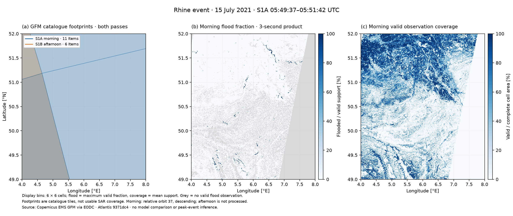

# GFM acquisition and CaMa-aligned 3-arcsecond workflow

## Authorized scope (2026-11-21)

Maintainer-approved implementation on `feature/package-builder`, owned by Codex:
2021-07-15, 4–8°E / 49–52°N; acquire four native GFM layers, preserve pass/time
identity and local reuse, convert the morning pass to 3-arcsecond EPSG:4326,
validate, document and commit/push code plus small inspection figures. No model
run, afternoon processing, multi-day acquisition or Gallery publication.

This file records design, scientific contracts and actual execution results. Scripts have one canonical copy in this tutorial's
`scripts/`; the external Atlantis workspace references them through symlinks.
Downloaded data and run logs stay outside Git.

## Existing environment and protected history

The maintainer moved yesterday's complete workspace into `~/work/Atlantis/old/`.
It is read-only history for this task. A new `source -> old/source` symlink
restores the prefix expected by the existing interpreter/compiled libraries.
The new `pixi/bin/pixi` references the existing executable; no install or Pixi
run modifies its old environment/cache. Commands use the existing Python with
`-B` / `PYTHONDONTWRITEBYTECODE=1`; plotting caches go to the new `logs/`.
Old-tree path/type/size/mtime/link-target metadata are compared before/after.

Atlantis remains commit `9371dc4fc421949caf9a2a8eb03e5fb962872820`.
Its GFM STAC backend is reused. A thin downloader saves only the four requested
COGs, without daily composition, coarsening or six-band CLI processing.

## Source/time identity

A fresh search found 17 GFM Items. Derived Sentinel-1 product identifiers expose
platform, absolute orbit and datatake under the official naming convention.
They separate S1A orbit 038784 / datatake 049389 (11 morning Items) from S1B
orbit 027808 / datatake 03517A (6 afternoon Items). Direct EODC derived-item
links return 404, so no direction is inferred from clock time. Copernicus Data
Space product attributes independently confirm the morning orbit as relative
orbit 37, DESCENDING. All source identifiers and enrichment responses are kept.
See https://sentiwiki.copernicus.eu/web/s1-products for naming semantics.

Groups are platform + absolute orbit + datatake, never time proximity alone.
Each raw Item remains independently described; shared reference COGs can be
stored once within the pass and referenced by several local Items. Local
catalogues contain only the four downloaded layers, with original URLs retained.
The afternoon group is inventoried only.

## Scientific processing contract

- Native flood/water codes: 0, 1, 255 (nodata). Reference: 0/1/2/255.
  Exclusion: 0/1/255; unexpected codes cause an explicit error.
- Conservative common validity: flood and water both have 0/1 classification
  **and exclusion = 0**. This differs intentionally from yesterday's Atlantis
  flood-or-water denominator. Reference water alone never proves observation.
- Same-pass source arrays share the Equi7 Europe 20 m grid. A blockwise native
  mosaic assigns each eligible native pixel once: **earliest valid Item wins**
  in timestamp/ID order. Conflicting overlap codes and duplicate candidates
  are counted. A later valid observation can replace earlier unusable coverage;
  valid pixels are never added twice. Different passes are never combined.
- Native binary flooded/water/valid support indicators use zero outside support,
  not raw 0/1/255 averages. A padded native canvas fully covers the destination,
  so zero support near unobserved/tile edges is not removed from the area
  denominator. Source owner IDs retain the actual chosen native observation.
- GDAL area-weighted `average` warps these **binary indicators** to the target.
  It approximates overlap under the local CRS transformation; it is not exact
  ellipsoidal polygon intersection. At this fine scale the local overlap
  approximation is documented rather than called exact geodesic integration.
- `valid_fraction` is observed usable area support / complete target-cell area;
  `flood_fraction` is flooded support / valid support. No valid support means
  missing flood/water fraction, never dry zero. Observed/excluded fractions
  distinguish missing observations from quality exclusions.
- Target-cell WGS84 geodesic areas convert support fractions to approximate m².
  Float32 supports remain fractional; the old integer-rounded harmonised counts
  are not used. Reference/exclusion codes use categorical resampling, not means.
- Output provenance includes pass/source metadata, local native owner IDs and
  target minimum/maximum contributing Item IDs. A pass mosaic is not an
  instantaneous image; its source acquisition interval is explicit.

## CaMa grid and file unit

`map/glb_15min/1min_nc/location.txt` defines **one global file unit**, 21600×10800,
west/north edges -180/90°, 1/60° spacing. Actual NetCDF coordinates confirm
west-to-east longitude centres and north-to-south latitude centres. This is not
20 separately split files. The observation product is one AOI subset tile per
pass: **4800×3600 at 1/1200°**, edges 4/49/8/52. Every original 1-minute cell
is exactly 20×20 target cells. Output `location.txt` retains CaMa's nine-column
schema with a distinct observation `carea`, without modifying the model map.
GeoTIFF fields are observations, not drop-in CaMa scientific map variables.

## Validation plan

Focused synthetic tests cover code validity/quality masking, reference-only
pixels, missing data, same-pass priority/conflicting overlap, adjacent native
cells, binary-support aggregation and unknown fractions. Real validation checks
CRS/dimensions/edges and 20×20 alignment against actual NetCDF centres, seamless
native tile boundaries, masks/support inequalities, owner/provenance consistency,
local-only regeneration and deterministic output hashes. Resource and transfer
measurements accompany each stage. No model metric or full model test suite.

## Reproduction commands

Run from the repository root. The workspace must already provide the isolated
Atlantis environment above; these scripts do not install or change dependencies.
On another machine recreate Atlantis from its pinned commit and committed
`pixi.toml` / `pixi.lock`, then set `PY` to that isolated Python. The existing
workstation environment is Python 3.14.8, Rasterio 1.5.2 / GDAL 3.13.3. It is
independent of the CaMa-Flood environment.

```bash
WORK="$HOME/work/Atlantis"
PY="$WORK/source/.pixi/envs/default/bin/python"
T11="tutorial/tutorial11-event_evaluation"
GROUP="S1A_o038784_dt049389"
export PYTHONDONTWRITEBYTECODE=1 GDAL_PAM_ENABLED=NO PROJ_NETWORK=OFF

# Search/inventory first. Reruns reuse the matching saved request/catalogue.
"$PY" -B "$T11/scripts/s01-download_gfm.py" --catalogue-only
# Exactly four layers, two download workers, complete original COG files.
"$PY" -B "$T11/scripts/s01-download_gfm.py" --group "$GROUP"
# Verify completed local files and use zero network bytes on reuse.
"$PY" -B "$T11/scripts/s01-download_gfm.py" --group "$GROUP" --offline
# Local conversion: no Atlantis download/catalogue code is called.
"$PY" -B "$T11/scripts/s02-convert_gfm_3sec.py" --group "$GROUP"
"$PY" -B "$T11/scripts/s03-validate_gfm_3sec.py" \
  --output "$WORK/data/Rhine_2021_3sec/tiles_3sec/$GROUP" \
  --report "$WORK/logs/gfm_validation.json"
# Independent full regeneration, changing only the processing block size.
"$PY" -B "$T11/scripts/s02-convert_gfm_3sec.py" --group "$GROUP" \
  --output "$WORK/data/Rhine_2021_3sec/tiles_3sec_offline" \
  --intermediate "$WORK/data/Rhine_2021_3sec/intermediate_offline" \
  --block 256 --rebuild-native
"$PY" -B "$T11/scripts/s03-validate_gfm_3sec.py" \
  --output "$WORK/data/Rhine_2021_3sec/tiles_3sec/$GROUP" \
  --compare-output "$WORK/data/Rhine_2021_3sec/tiles_3sec_offline/$GROUP" \
  --report "$WORK/logs/gfm_replay_validation.json"
"$PY" -B -m unittest discover -s "$T11/tests" -v
bash "$T11/f01-gfm_3sec_validation.sh"
```

Defaults use exactly the approved date and bbox. `--work-dir`, acquisition
`--output`, and conversion `--input`/`--output`/`--intermediate` accept explicit
paths. Output paths resolving into `old/`, including via symlinks, are rejected.
Use another acquisition output directory for another request; a mismatched
cached date/bbox is rejected. A failed transfer retains a `.part` file and
resumes using HTTP Range/If-Range. Existing complete files are checked against
size/SHA-256; a changed file is preserved and reported, never silently replaced.
A native mosaic is reused only with a matching source/code fingerprint and SHA.
Changes to scientific code or source bytes invalidate it.

The example commands show normal local execution. The actual independent replay
also replaced Python socket connection functions with an error, proving that
this run needed no network connection. Logs and measured resources remain in
`~/work/Atlantis/logs/`, outside Git.

## Output interpretation and provenance

All 13 single-band GeoTIFFs have the same 4800×3600 EPSG:4326 grid. Float fields
are Float32; flood/water fraction use -9999 for no usable observation. Coverage
fractions and area supports use **zero support**, not a false dry classification,
where there is no usable observation. `cell_area` is complete WGS84 cell area.

| Filename suffix (`rhine3sec.*.tif`) | Meaning | Units / nodata |
| --- | --- | --- |
| flood_fraction | Flooded support / valid support | 0–1; -9999 |
| water_fraction | Water support / valid support | 0–1; -9999 |
| valid_fraction | Joint-valid support / complete cell area | 0–1; zero = no usable support |
| observed_fraction | At least one flood/water classification available | 0–1 |
| excluded_fraction | Observed exclusion=1 without a selected valid replacement | 0–1 |
| reference_water | Representative categorical GFM reference-water code | 0/1/2; 255 missing |
| exclusion_mask | Representative categorical GFM exclusion code | 0/1; 255 missing |
| source_item_min / source_item_max | Bounds of positive-support contributing owner indices | UInt16; zero = none |
| flooded_support / water_support / valid_support | Fractional area supports | m² |
| cell_area | WGS84 area of the complete geographic cell | m² |

The min/max indices are **bounds**, not a claim that every intervening Item
contributed. Exact native ownership remains in the saved eight-band native
mosaic; the JSON index maps to original STAC IDs, acquisition intervals and all
four local assets/URLs/checksums. Per-owner binary area warps use the same kernel
as the valid mask, and their sum must equal valid support within 1e-6 absolute
fraction. This avoids a verified GDAL min/max-versus-average edge-footprint
mismatch (tiny valid edge contributions were initially missing owner IDs).
Reference/exclusion outputs use categorical mode and are independent context;
neither is a substitute for the fractional valid-observation mask.

`provenance.json` records grid/coordinate checks, source Items/assets, owner
closure, overlap priority/conflicts, output checksums and processing definitions.
`location.txt` passes the existing CaMa high-resolution location reader.
The [Item summary](metadata/gfm_20210715_items.csv) inventories **all 17** Items;
the afternoon group is deliberately metadata-only. Full source STAC JSON,
official orbit responses, complete native COGs and intermediate files stay local.

## Scientific limits and open questions

- This is a short **morning-pass mosaic**, not a daily maximum or the flood-event
  peak. Valid coverage is incomplete; a non-flooded classification is evidence
  only within its usable observation support.
- Joint flood/water/exclusion validity is an explicit conservative workflow
  choice. It differs from the old Atlantis OR rule and must be reviewed before
  comparing against model inundation. It does not alter Atlantis or old results.
- GDAL binary-support overlap is a local area approximation, not exact global
  ellipsoidal polygon integration. Supports are Float32; 1e-6 closure tolerance
  covers accumulated rounding of per-owner fractions, not model accuracy.
- Earliest-valid priority avoids double counting; overlap disagreement counts
  are reported rather than interpreted as independent observations.
- Geometry alignment does not make these observation files CaMa model inputs.
  No model run, calibration or evaluation metric was implemented.
- Public endpoints can change, and EODC's linked source-item URLs currently
  return 404. Original GFM COGs and independent official orbit metadata were
  preserved. Dataset redistribution conditions require separate confirmation;
  Atlantis software licensing alone does not determine satellite-data rights.

## Ownership and storage

The canonical code is in this tutorial. The external `scripts/` directory uses
symlinks to it; `old/scripts/` remains historical and is never used as a second
editable copy. Git contains code, tests, this method/results note, a compact
Item CSV and an inspection PNG. All raw/processed rasters, intermediate native
mosaics, environments and complete execution logs remain outside Git. The
external `figure/` may reference the Git-managed PNG by symlink. No old file or
CaMa scientific map is modified, and no Gallery image/catalog is changed.

## Executed results — 2026-11-21 (JST)

| Stage | Wall time | Peak process RSS | Result |
| --- | ---: | ---: | --- |
| Four-layer acquisition | 62.66 s | 118.84 MiB | 37 complete COGs; 52,333,157 transferred bytes (49.91 MiB) |
| Final native-to-3sec conversion, 512-cell blocks | 289.42 s | 883.59 MiB | 13 rasters + location/provenance, 89,705,290 bytes total |
| Independent offline regeneration, 256-cell blocks | 306.28 s | 1,031.23 MiB | Fresh native mosaic, zero network; all 13 decoded arrays bitwise identical |

RSS comes from `getrusage(RUSAGE_SELF)`, not a sum over unrelated processes.
The offline replay performed acquisition reuse and conversion in one process,
so its RSS high-water mark includes both. Times are stage wall time on this
workstation; the old larger-AOI six-layer CLI run is not a matched benchmark.
Raw COG transfer is the saved compressed byte count; native raster reading is
local decoding of these complete COGs. No remote window reads occur in conversion.
The 13 TIFFs occupy 89,633,832 bytes; total above also includes JSON/location.

- **7,258,263 / 17,280,000 target cells (42.00384%)** have positive usable support;
  10,021,737 have no valid flood fraction. This percentage counts cells with
  *any* support, not percent of AOI area. Valid support totals approximately
  27,059.079 km²; detected flooded support approximately 63.652 km², within this
  pass only. These are mask/aggregation diagnostics, not observed-event truth.
- Valid-pixel centres span 4.000417–7.773750°E and 49.000417–51.999583°N,
  with extensive internal gaps. In particular the eastern portion of the
  requested box is unobserved; the rectangular span does not imply full coverage.
- Padded native processing had 95,488,399 candidate-valid pixel assignments,
  95,213,416 unique pixels and 274,983 duplicate candidates. Earliest-valid
  selection resolves 244 flood and 244 water overlap disagreements. These counts
  concern the native padded processing rectangle, not geographic AOI area.
- Per-owner supports sum to valid support with maximum absolute difference
  **5.96×10⁻⁸**; zero valid-support cells have zero owner indices, and every
  positive-support cell has valid source indices.
- **13 focused tests PASS**, including a real local HTTP Range resume test,
  quality masks, overlap conflicts, source tracking, adjacent grid boundaries,
  rejected half-pixel offsets, protected output paths and actual NetCDF centres.
  The actual 3sec outputs pass all-cell mask/support/provenance/alignment checks.
- A full regeneration with Python socket connections disabled and a different
  block size passes **bitwise decoded-array comparison for all 13 fields**.
  Completed native files were all reused; no bytes were re-downloaded.
- The three-panel PNG was actually rendered and visually inspected. Identical
  map rectangles, correct geographic aspect, full-height colorbars, measured
  title widths, canvas bounds and colorbar/adjacent-label clearance are checked.
  Only the Figure uses 6×6 display bins (maximum valid flood fraction, mean
  coverage), clearly labelled; native and 3sec scientific rasters are unchanged.
- `old/` retains all **204,586** path/type/size/mtime/link-target entries with
  unchanged metadata SHA-256
  `27dba3f0a1c88bf27b4cdbe73d16881295617c0b26e2929f61dcc9cfafe57116`.
  Access times are excluded. This is metadata preservation evidence, not a
  fresh full-content checksum of every environment/cache file.
- Atlantis checkout remains clean. No CaMa map or old sample was edited.
  Research-record validation retains 14 pre-existing broken historical links;
  no new broken record/link is introduced by this task.

Compact durable evidence: [validation summary and decoded hashes](metadata/gfm_20210715_validation.json),
[original COG sizes/URLs/checksums](metadata/gfm_20210715_assets.csv), and
[all Item/pass identities](metadata/gfm_20210715_items.csv).



### Knowledge-gap review

The review covered source identity, support definitions, grid/file units,
resampling edges, provenance and reproduction. Official orbit metadata resolves
pass identity; actual coordinate tests resolve geometry. The discovered owner
edge-kernel mismatch and its resolution are recorded in KG-0038 / VR-0200.
The joint-validity choice and approximate area method remain explicit scientific
review points before evaluation, without blocking this acquisition workflow.
No unsupported claim about event-peak completeness or model skill is made.
