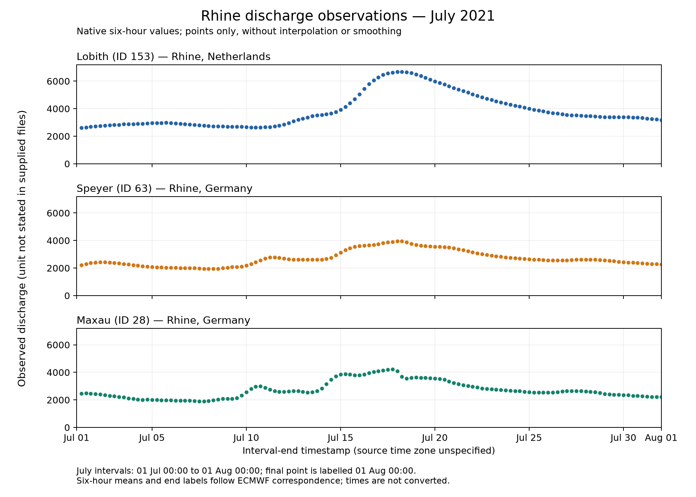

# Tutorial 11: River Discharge Observation Data Inventory

Inspection date: 2026-11-20

## 1. Scope, provenance and confirmed permission

This is a read-only inventory and initial visualization of the data supplied by
ECMWF's Cinzia Mazzetti. The maintainer has **confirmed that these observation
data may be shared and redistributed in the tutorial** in the instruction for
this task. This confirmation supersedes the earlier unresolved redistribution
status recorded in the background documentation and development log. The input
files themselves do not contain a licence identifier or the original observing
agency; those provenance details remain to be documented. No particular open
licence is inferred from the permission confirmation.

The NetCDF description identifies the content as **CEMS Observed Discharge Time
Series**, consistent with the maintainer's identification as observations. No
simulation output was inspected or compared. The original email thread was not
opened for this task. No source file was modified; SHA-256 checks before and
after the inspection/plotting must match (Section 9).

## 2. Files and structures

| File under `stations_data/` | Format | Bytes | Structure |
| --- | --- | --- | --- |
| Qobs_06_2021_st153_63_28.csv | CSV | 61,676 | 1,460 rows × 4 columns (header excluded) |
| Qobs_06_2021_st153_63_28.nc | NetCDF-4 | 34,807 | 1,460 time × 3 station; 3 variables |
| allstations.csv | CSV | 755 | 3 station rows × 27 columns |

The tutorial directory also contains `.gitkeep`, `flood_event_overview.md` and
`development_log.md`, plus an ignored macOS `.DS_Store` file. The latter is not
scientific data. `stations_data.tar.gz` is not present here; the inspected inputs
are the three extracted files listed above. The source files are left in their
original location and are not included in this task's artifact commit.

### 2.1 Station metadata CSV

`allstations.csv` is a comma-separated table with one header and three records.
Its 27 columns are `Id`, `Name`, `StatLon`, `StatLat`, `ProvArea`, `River`,
`Country`, followed by `lon`, `lat`, `area`, `row`, `col` for each of the four
prefixes `Cama1`, `Cama3`, `Cama6`, `Cama15`. Names, IDs and these metadata fields
have no blank values in the supplied three records. No station ID is duplicated.
No separate schema, units or CRS declaration accompanies the table.

### 2.2 Discharge CSV

`Qobs_06_2021_st153_63_28.csv` has header `Timestamp,153,63,28`. Timestamp strings
have minute resolution and format `YYYY-MM-DD HH:MM`, without a time-zone
suffix. The station columns contain decimal numeric values, with no unit row,
missing-value declaration or quality flags. Values are read as provided,
without resampling, adjustment or smoothing.

### 2.3 NetCDF

Data model: `NETCDF4`. Dimensions are fixed-size `time = 1460` and `station = 3`;
neither dimension is unlimited.

| Variable | Stored type | Dimensions | Attributes and contents |
| --- | --- | --- | --- |
| `discharge` | float32 | `(time, station)` | `_FillValue = NaN`; no `units`, `long_name`, `cell_methods` or quality flags |
| `time` | int64 | `(time,)` | `units = hours since 2021-01-01 06:00:00`; `calendar = proleptic_gregorian`; values 0, 6, …, 8754 |
| `station` | int64 | `(station,)` | Values `[153, 63, 28]`; no attributes |

Global attributes are exactly:

- `description = CEMS Observed Discharge Time Series`
- `history = Created 2026-10-07 18:10:37`

The history time describes file creation, not observation timing. There are no
station names, coordinates, area fields, explicit time bounds, time-zone
attribute or global `Conventions` attribute in this NetCDF. Station metadata
must be joined from `allstations.csv` **by ID**, not by row position: metadata
CSV order is `[28, 63, 153]`, whereas both time-series files use `[153, 63, 28]`.

## 3. Stations and the correspondence discrepancy

| ID | Name | River | Country | `StatLat` | `StatLon` | `ProvArea` (unit undeclared) |
| --- | --- | --- | --- | --- | --- | --- |
| 153 | Lobith | Rhine | Netherlands | 51.84444 | 6.10833 | 160800 |
| 63 | Speyer | Rhine | Germany | 49.32379 | 8.44876 | 53131 |
| 28 | Maxau | Rhine | Germany | 49.03896 | 8.30561 | 50196 |

The files agree with one another on the set **153=Lobith, 63=Speyer, 28=Maxau**.
Their filename, CSV columns, NetCDF station coordinate and metadata IDs are
consistent. All three are labelled Rhine stations. **Bonn (ID 6) is absent**
from every inspected data file. The prior email summary instead listed
153=Lobith, 6=Bonn, 28=Maxau. Thus **Speyer/63 replaces Bonn/6 in the actual
supplied files**; this is a discrepancy with that summary, not an internal
CSV/NetCDF mismatch. The files do not explain why the selection changed.
Do not rename Speyer as Bonn or use its series as a substitute Bonn observation.

The coordinate headings and values have the form of geographic longitude and
latitude. The files do not explicitly declare the datum/CRS or the exact station
location convention; no geodetic transformation is performed. The area-like
fields `ProvArea` and `Cama*area` are preserved verbatim below. Their physical
units and precise upstream-area definition are **not declared**, so they are
not converted to km² or used to assess allocation quality.

## 4. CaMa-Flood coordinates and indices

| Station ID | Name | Group | Latitude field | Longitude field | Stored row | Stored column | Area field (unit undeclared) |
| --- | --- | --- | --- | --- | --- | --- | --- |
| 153 | Lobith | Cama1 | 51.875 | 6.04167 | 2287 | 11162 | 159280.5 |
| 153 | Lobith | Cama3 | 51.875 | 6.025 | 762 | 3720 | 159286 |
| 153 | Lobith | Cama6 | 51.85 | 5.95 | 381 | 1859 | 159327.8 |
| 153 | Lobith | Cama15 | 51.875 | 6.125 | 152 | 744 | 159285.6 |
| 63 | Speyer | Cama1 | 49.30833 | 8.45833 | 2441 | 11307 | 52752.934 |
| 63 | Speyer | Cama3 | 49.325 | 8.475 | 813 | 3769 | 53489.9 |
| 63 | Speyer | Cama6 | 49.35 | 8.45 | 406 | 1884 | 53680.1 |
| 63 | Speyer | Cama15 | 49.125 | 8.375 | 163 | 753 | 52103.7 |
| 28 | Maxau | Cama1 | 48.99167 | 8.29167 | 2460 | 11297 | 50265.539 |
| 28 | Maxau | Cama3 | 48.975 | 8.275 | 820 | 3765 | 50265.5 |
| 28 | Maxau | Cama6 | 48.95 | 8.25 | 410 | 1882 | 50265.7 |
| 28 | Maxau | Cama15 | 48.875 | 8.375 | 164 | 753 | 50808.3 |

Here `Latitude field`, `Longitude field` and `Area field` mean the literal values
of `CamaNlat`, `CamaNlon`, `CamaNarea`. These are not assumed to be identical to
the station coordinates or to stored CaMa-Flood outlet coordinates.

A numerical consistency check was made for all 12 grid entries using a regular
global grid, western edge −180°, northern edge 90°, cell size `d = N/60` degrees:

```text
longitude = -180 + (column + 0.5) * d
latitude  =   90 - (row    + 0.5) * d
```

All supplied pairs match this **zero-based cell-centre interpretation** within
3.333333343e-06 degrees, consistent with the coordinate text precision.
The groups therefore support a 1/3/6/15-arcmin interpretation, with rows running
north to south and columns west to east. This is a conditional numerical check,
**not an explicit provider declaration of the grid or index convention**.

If this interpretation is confirmed for the intended CaMa-Flood map, conversion
to 1-based Fortran labels would be `ix = stored column + 1` and
`iy = stored row + 1`. For example, Lobith Cama1 would be `(ix, iy) =
(11163, 2288)`, and Cama15 `(745, 153)`. Do not directly use these global indices
in a cropped regional map. Exact map version, origin, CRS, grid-centre/outlet
meaning and allocation provenance still need confirmation against the target
map before any model comparison.

## 5. Time axis, data quality and statistics

### 5.1 Common time coverage

Both time-series files contain **1,460 records per station**, starting at
**2021-01-01 06:00** and ending at **2022-01-01 00:00**. Decoded timestamps match
exactly. They are strictly increasing, with **zero duplicate timestamps**, and
all 1,459 successive differences are **21,600 seconds (six hours)**. There are
no irregular steps or missing timestamps on this six-hour sequence.

The 2022 endpoint is consistent with the reported end-of-interval convention:
1,460 six-hour means cover 8,760 hours from 2021-01-01 00:00 to 2022-01-01 00:00.
This supports the ECMWF explanation, but cadence and coverage alone do not prove
that the values are means. **Six-hour averaging and endpoint semantics come
from the correspondence**, because neither file has bounds or averaging
attributes that independently encode them.

Neither file explicitly identifies the original observation time zone. The
NetCDF origin lacks an explicit offset, and the CSV strings are naive times.
A numerical decoder's interpretation of that origin does not establish the
original observing agency's clock. All dates here and in the figure are shown
as supplied/decoded, **without conversion or an asserted UTC/local-time label**.

### 5.2 Full supplied period

**All discharge numbers in this report retain the source's undeclared unit.**
Although a discharge unit may be customary, neither the CSV nor NetCDF states
it. In particular, the table and figure do not silently assume m³/s.
Arithmetic means below use all 1,460 equally spaced records in the CSV.

| ID / station | Records | Minimum | Maximum | Arithmetic mean | Missing CSV / NetCDF | Missing fraction |
| --- | --- | --- | --- | --- | --- | --- |
| 153 / Lobith | 1460 | 1,017.552000 | 7,375.068000 | 2,229.946003 | 0 / 0 | 0% |
| 63 / Speyer | 1460 | 553.833000 | 3,957.500000 | 1,353.841559 | 0 / 0 | 0% |
| 28 / Maxau | 1460 | 552.792000 | 4,214.583000 | 1,360.897809 | 0 / 0 | 0% |

There are no empty/nonfinite CSV discharge values, masked NetCDF values, or
nonfinite NetCDF values among the **4,380 station-time pairs**. There are also
no zero or negative discharge values. NetCDF declares NaN as fill but does not
use it in these records. No additional finite sentinel is documented; absence
of declared missing values is not an independent assessment of observation
quality. There are no quality flags with which to judge provisional values,
gauge failures or rating-curve uncertainty.

### 5.3 July 2021 peaks

For a July interval window `[2021-07-01 00:00, 2021-08-01 00:00]`, the included
**end labels** are `(2021-07-01 00:00, 2021-08-01 00:00]`: **124 native values**
per station, from July 1 at 06:00 through August 1 at 00:00. This excludes the
July 1 at 00:00 label for the preceding June interval and includes the final
six hours of July. This is a transparent display selection, not a finalized
flood-event definition or evaluation method.

| ID / station | July peak (CSV) | Peak label (interval end) | Corresponding six-hour interval |
| --- | --- | --- | --- |
| 153 / Lobith | 6,684.746000 | 2021-07-18 06:00:00 | 2021-07-18 00:00:00 to 2021-07-18 06:00:00 |
| 63 / Speyer | 3,957.500000 | 2021-07-18 06:00:00 | 2021-07-18 00:00:00 to 2021-07-18 06:00:00 |
| 28 / Maxau | 4,214.583000 | 2021-07-17 18:00:00 | 2021-07-17 12:00:00 to 2021-07-17 18:00:00 |

These are maxima of the supplied **six-hour mean series**, not independently
measured instantaneous flood peaks. Each maximum has one matching timestamp.
The full-year maximum is larger than the July maximum at Lobith; it equals the
July maximum at Speyer and Maxau. Differences in peak timing are reported only
as data characteristics, not interpreted as model error or flood travel time.

## 6. CSV–NetCDF consistency

- Station sets/order and all 1,460 decoded timestamps agree exactly.
- All three series cover the same interval and have the same valid-value mask.
- Casting each CSV decimal value to float32 produces **bit-for-bit equal stored
  numeric values at all 4,380 positions** in the NetCDF array. No arbitrary
  hydrological tolerance is needed to explain the differences.
- Comparing CSV decimals as float64 with NetCDF float32 promoted to float64
  reveals only representation differences, summarized below. Relative
  differences are `abs(CSV − NetCDF) / abs(CSV)`; all CSV values are positive.

| ID / station | Max absolute CSV–NetCDF difference | Max relative difference | Example timestamp | CSV | NetCDF |
| --- | --- | --- | --- | --- | --- |
| 153 / Lobith | 0.000238281249949 | 5.60561079962e-08 | 2021-02-02 18:00:00 | 6106.219 | 6106.21923828125 |
| 63 / Speyer | 7.81250003001e-06 | 1.41062378551e-08 | 2021-01-01 06:00:00 | 1002.333 | 1002.3330078125 |
| 28 / Maxau | 7.81250037107e-06 | 1.41328022656e-08 | 2021-07-17 06:00:00 | 4149.583 | 4149.5830078125 |

The example column gives an instance at the station's maximum absolute
representation difference, not a mismatched observation. Station names and
coordinates appear only in `allstations.csv`. NetCDF additionally records types,
calendar, NaN fill and a global description/history; CSV lacks these attributes.
Neither format declares discharge units, explicit time zone, observation
provenance beyond the global description, or the six-hour averaging bounds.

## 7. Initial July hydrograph



One figure contains three vertically aligned station panels with the same time
and value ranges. It plots the **124 original CSV values per station as points
only**: no interpolation, connecting segments, smoothing, resampling or model
series. The final point at August 1 at 00:00 represents the last six-hour
interval in July under the supplied convention. The axis explicitly says that
the discharge unit and source time zone are unspecified. The stations are named
from the actual metadata, including Speyer rather than Bonn.

## 8. Findings and remaining questions

**Confirmed findings:** the supplied stations differ from the email summary;
CSV and NetCDF agree after float32 representation; the six-hour sequence is
complete; a 2022 endpoint is consistent with 2021 end-labelled means; the
coordinate/index fields support the stated conditional zero-based global-grid
interpretation. Redistribution permission has now been confirmed by the
maintainer, although a formal licence identifier is not embedded in the files.

**To confirm before quantitative evaluation:**

1. Why Bonn/6 was replaced by Speyer/63, and whether Bonn observations should be
   obtained separately.
2. Discharge and area units; precise definitions of `ProvArea` and `Cama*area`.
3. Source time zone and any prior time conversion; provider confirmation of the
   six-hour averaging/interval convention and quality-control history.
4. Original observing agency, station identifiers in that agency's system and
   the citation/permission wording that should accompany redistribution.
5. Grid version, datum, coordinate role and documented indexing/allocation
   convention for each `Cama*` group.

The earlier background overview is preserved as a historical initial summary;
this inventory and the appended development-log entry record the newly
confirmed permission and the observed station discrepancy. No evaluation
metrics, simulations or model–observation comparisons were implemented.

## 9. Source integrity and inspection method

The three scientific source files were hashed before inspection and after
plot/report generation. Their SHA-256 values are unchanged:

- `Qobs_06_2021_st153_63_28.csv`: `a7ea1c49f74139fa1f0393a384a0f105578d29252349457b2e98c64436d90431`
- `Qobs_06_2021_st153_63_28.nc`: `90e45b36f45093c925a1047f44f46d5955ce41b31838bcf7f6db95ac8a6e2fb1`
- `allstations.csv`: `885f0e920e0b72ea222dbff0efc894509f49970223a86338e1a7cc5987cc2613`

Inspection used Python's CSV/date tools, netCDF4 decoding and masked-array
reading, NumPy statistics/precision comparison, and Matplotlib for the PNG.
Statistics are calculated directly from supplied records; six decimal places
in summary tables are reporting precision, not additional measurement precision.
A temporary inspection script outside the repository was used; no reusable
analysis framework or event-evaluation code is added. New committed artifacts
are this report, the figure and an appended development-log entry only.
